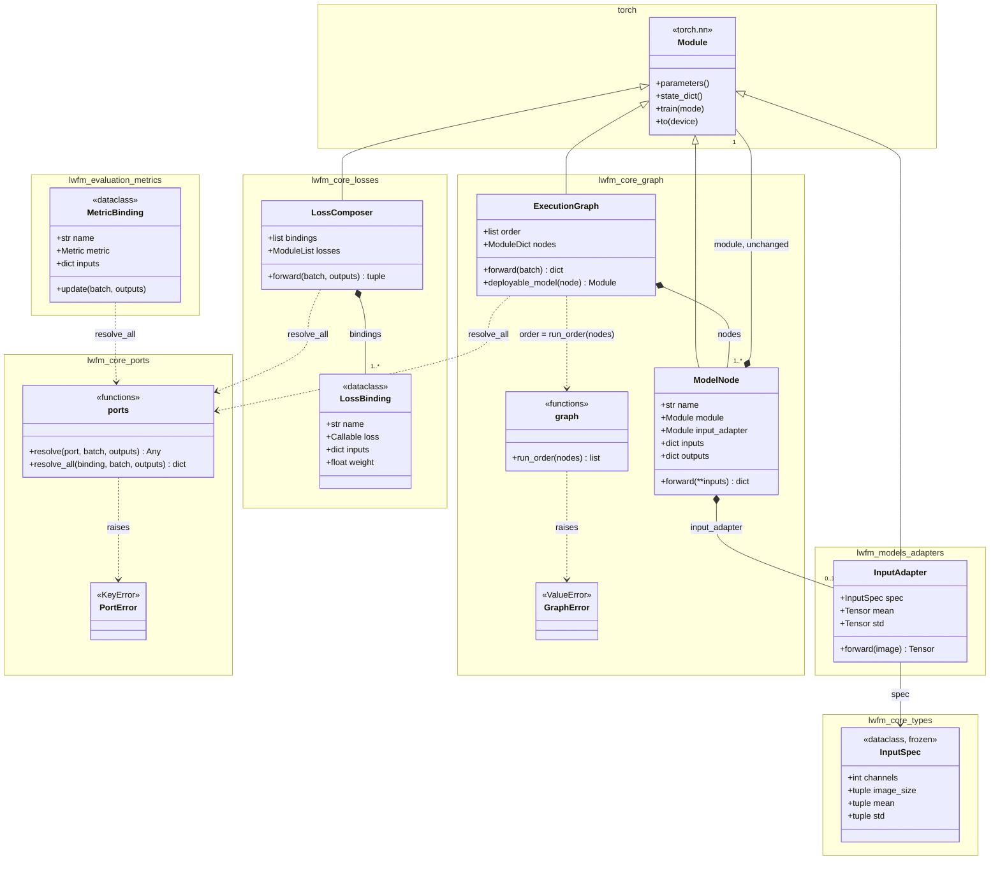
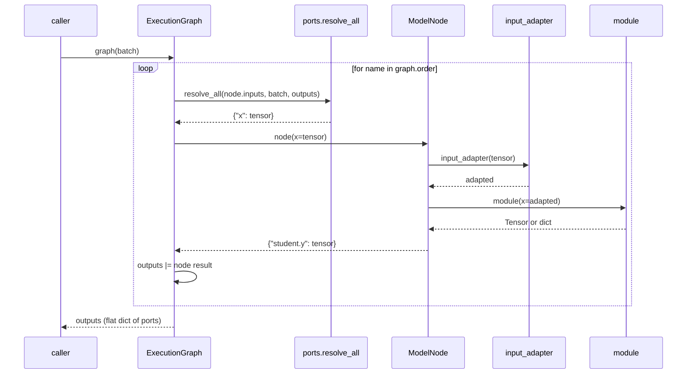
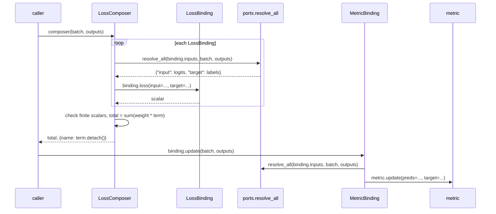
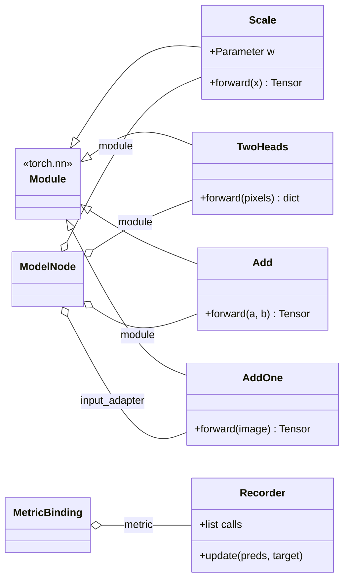
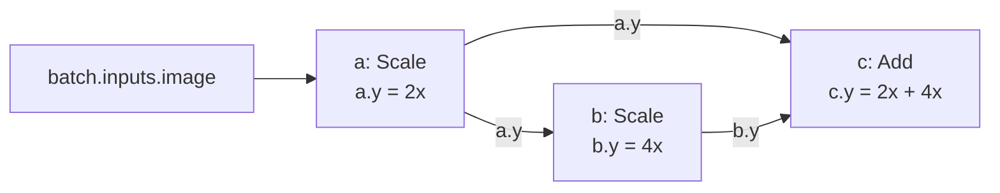

# Scaffold the graph primitives (PLAN.md §3.2)

Adds the smallest set of objects needed for one node that reads a batch and writes named outputs, plus the loss and metric bindings that read those outputs. No real models, data modules, trainer or stages yet; those build on these.

**Changes**

- `lwfm/` at the repository root (no `src/`), with `core/`, `models/` and `evaluation/` subpackages.
- `tests/unit/`: 29 tests using tiny dummy modules.
- `pyproject.toml`: `[tool.pytest.ini_options]` with `pythonpath = ["."]` and `testpaths = ["tests"]`, so tests import `lwfm` without installing it.
- `PLAN.md`: `src/lwfm` references changed to `lwfm/`.

**Differences from the PLAN.md code**

- `resolve("batch", ...)` raises `PortError` instead of returning the whole batch: a port must name one value.
- `ExecutionGraph` validates nodes **before** building its `ModuleDict`, so a duplicate name fails instead of silently overwriting the first node.
- `LossComposer([])` raises `ValueError` instead of returning a total of `0` (an `int`, not a tensor).
- `MetricBinding` imports `torchmetrics.Metric` for type hints only; any object with `update(**kwargs)` works until `torchmetrics` is added as a dependency.

---

## Diagrams

### Classes and modules

Solid arrows with a hollow head are inheritance; filled diamonds mean "holds"; dotted arrows mean "calls" or "raises". The only base class is `nn.Module`. `ports` and `graph` stand for module-level functions, not classes. All reading of named values goes through `resolve_all`, so the graph, the losses and the metrics agree on what a port means.

### What one forward pass does

### What scoring the outputs does

### Test doubles

| Double     | Why it is shaped this way                                                                                          |
| ---------- | ------------------------------------------------------------------------------------------------------------------ |
| `Scale`    | One parameter and a Tensor return: the smallest trainable node; outputs are easy to predict ($2x$).               |
| `TwoHeads` | Argument named `pixels`, not `x`, and a dict return with an extra field: tests both mappings.                      |
| `Add`      | Two inputs: the only way to build a node that depends on two other nodes.                                         |
| `AddOne`   | A visible, parameter-free adapter: shows the adapter runs before the module ($2(x+1)$, not $2x+1$).               |
| `Recorder` | Plain class with `update(preds, target)`: stands in for a torchmetrics metric and records what it received.       |

### The dependency-order test graph

The nodes are passed as `[c, b, a]`; the graph must still run `a, b, c`.

---

## Tests

All tests run on CPU in about a second and use no real models or data.

### `tests/unit/test_ports.py` — reading named values

| Test                                      | What it checks                                                                                                                                                 | Why it matters                                                                   |
| ----------------------------------------- | -------------------------------------------------------------------------------------------------------------------------------------------------------------- | -------------------------------------------------------------------------------- |
| `test_resolves_batch_ports`               | `batch.inputs.image` returns the very tensor in the batch (same object, no copy); `batch.meta.sample_id` returns a non-tensor list.                            | Ports reach any batch value, including metadata, without copying.                |
| `test_resolves_node_outputs`              | `student.logits` returns the tensor from the outputs dict.                                                                                                     | Node outputs and batch values are read the same way.                             |
| `test_unknown_port_names_the_port` (×3)   | `batch.inputs.imgae` (typo in a key), `studnet.logits` (typo in a node name) and bare `batch` all raise `PortError` with the bad name in the message.         | A wiring mistake says exactly which name is wrong.                               |
| `test_resolve_all_maps_argument_names`    | A binding `{"input": ..., "target": ...}` returns a dict with those argument names as keys.                                                                    | This is what lets a loss or metric be called with keyword arguments.             |

### `tests/unit/test_graph.py` — nodes and the graph

| Test                                                        | What it checks                                                                                                                                                   | Why it matters                                                                                                   |
| ----------------------------------------------------------- | ---------------------------------------------------------------------------------------------------------------------------------------------------------------- | ---------------------------------------------------------------------------------------------------------------- |
| `test_node_maps_tensor_return_to_its_port`                  | A module returning a plain Tensor has it stored under the one declared port (`student.y`), with the right value.                                                | Most models return a single tensor; they need no wrapper.                                                        |
| `test_node_maps_argument_names_and_dict_fields`             | A module with argument `pixels` gets the input under that name; of its three dict fields, only the two declared are returned, under their ports.               | Any call signature and return shape fits through the maps; unwanted fields don't leak into the graph outputs.   |
| `test_node_applies_input_adapter_before_module`             | With `AddOne` as adapter and `Scale` as module, input `0` gives `2`, i.e. $2(0+1)$.                                                                             | Preprocessing runs once, before the model, inside the node.                                                      |
| `test_one_node_graph_reads_batch_and_returns_flat_ports`    | A one-node graph reads `batch.inputs.image` and returns exactly `{"student.y": 2x}`, with nothing from the batch copied in.                                     | The Phase 1 setup: data in, named output out.                                                                    |
| `test_nodes_run_in_dependency_order_not_list_order`         | Nodes given as `[c, b, a]` run as `["a", "b", "c"]`, and `c.y` equals $2x + 4x$ (diagram above).                                                                | Adding nodes later (teachers, projectors) needs no change to the executor, and list order never matters.       |
| `test_graph_is_a_normal_module`                             | The graph is an `nn.Module`; it exposes one parameter; `state_dict` keys are `nodes.student.module.w`; `eval()`/`train()` reach the inner module; a second graph loaded from the first gives identical outputs. | Optimizers, `.to()`, checkpointing and train/eval switching work through standard torch calls.          |
| `test_gradients_reach_node_parameters`                      | `backward()` on a graph output fills the gradient of the node's parameter.                                                                                     | The wrappers don't break autograd, so training works.                                                            |
| `test_deployable_model_matches_node_and_shares_weights`     | `deployable_model("student")` gives the same output as the node (adapter included), and its weight is the same object as the node's.                           | The exported model is exactly what was trained, with preprocessing, and holds no copies.                        |
| `test_invalid_graphs_fail_at_build_time` (×4)               | `GraphError` when building a graph with: a duplicate node name; two nodes writing the same port; a node reading a port nobody writes (`studnet.y`); a cycle (`a` reads `b`, `b` reads `a`). | Wiring mistakes fail immediately, before any data is touched, with a message naming the problem.            |

### `tests/unit/test_bindings.py` — losses and metrics

| Test                                                     | What it checks                                                                                                                                                       | Why it matters                                                                                       |
| -------------------------------------------------------- | -------------------------------------------------------------------------------------------------------------------------------------------------------------------- | ---------------------------------------------------------------------------------------------------- |
| `test_composer_is_weighted_sum_with_detached_terms`      | With CE (weight 0.7) and multi-margin (weight 0.3): total $= 0.7\,\ell_{ce} + 0.3\,\ell_{margin}$; logged terms carry no gradient; `backward()` reaches the logits.   | Several loss terms combine without trainer changes; logging terms can't hold on to the autograd graph. |
| `test_plain_callable_loss_is_accepted`                   | A `lambda` loss (not an `nn.Module`) works and returns a scalar.                                                                                                     | Any function returning a scalar can be a loss.                                                       |
| `test_loss_with_parameters_is_registered`                | A loss that is an `nn.Linear` has its parameters returned by `composer.parameters()`, and nothing else does.                                                       | Learnable loss terms (e.g. projectors) get optimised and moved to the device.                        |
| `test_non_finite_or_non_scalar_loss_fails` (×2)          | A loss returning NaN, or a vector instead of a scalar, raises `ValueError` naming the loss (`bad`).                                                                 | Broken losses fail at the step they happen, with the culprit named, rather than corrupting training. |
| `test_composer_needs_a_binding`                          | `LossComposer([])` raises `ValueError`.                                                                                                                              | An empty composer would otherwise return the integer `0`, which cannot be backpropagated.            |
| `test_metric_binding_passes_resolved_ports_by_name`      | Two `update` calls reach the `Recorder` with `preds` and `target` set to the exact logits and labels objects.                                                       | Metrics read the same ports as losses, by name, and accumulate across calls.                         |

### `tests/unit/test_adapters.py` — input preprocessing

| Test                                                  | What it checks                                                                                              | Why it matters                                                                                                        |
| ----------------------------------------------------- | ----------------------------------------------------------------------------------------------------------- | --------------------------------------------------------------------------------------------------------------------- |
| `test_normalises_without_resizing_when_size_matches`  | At the spec's size, the output is exactly $(x - \mu)/\sigma$, so no resize happened.                         | A CPU crop already at the right size is not resized again.                                                            |
| `test_resizes_to_spec`                                | A `16×12` input comes out at the spec's `8×6`.                                                              | Each model gets the input size it declares.                                                                           |
| `test_statistics_are_buffers_not_saved_weights`       | The adapter has no parameters and an empty `state_dict`; `mean` and `std` are buffers.                     | Mean/std move with `.to(device)` but are never trained, and are rebuilt from `InputSpec` rather than read from checkpoints. |
