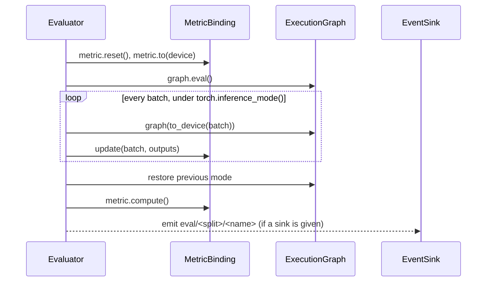
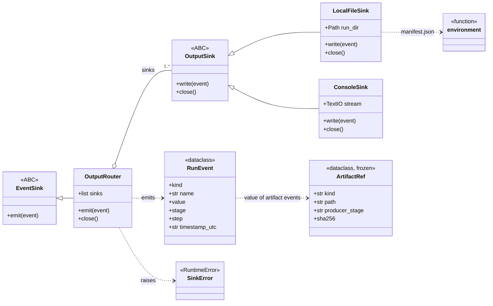
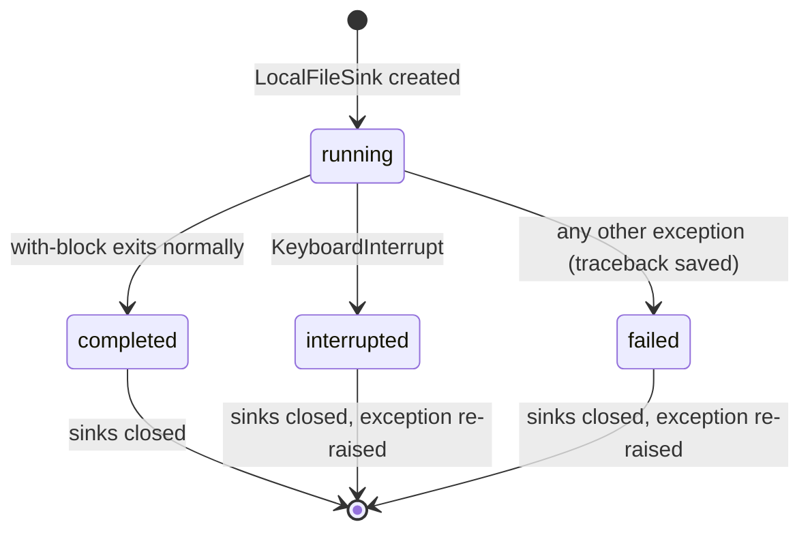
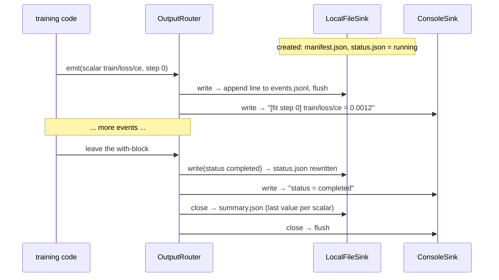

# Add output sinks and the evaluator (PLAN.md P1.7, P1.5)

Two Phase 1 items. **P1.5:** `Evaluator` scores a graph with torchmetrics through `MetricBinding`s (micro top-1/top-5). **P1.7:** the results layer. The evaluator is described first; the sinks section follows.

## Evaluator (P1.5)

```python
metrics = [
    MetricBinding(
        f"top{k}",
        MulticlassAccuracy(num_classes=10, top_k=k, average="micro"),
        ["student.logits", "targets.class"],
    )
    for k in (1, 5)
]
result = Evaluator().evaluate(graph, val_loader, metrics, device=torch.device("cpu"))
result.metrics  # {"top1": ..., "top5": ...}
```

| File | What | Why |
| --- | --- | --- |
| `lwfm/evaluation/evaluator.py` | `Evaluator`, `EvaluationResult` | Reset, eval mode, `inference_mode`, update per batch, compute once (§3.6). |
| `lwfm/core/batch.py` | `to_device(batch, device)` | Moves tensors, keeps ids; the trainer will reuse it. |
| `lwfm/evaluation/metrics.py` | `metric: torchmetrics.Metric` | `torchmetrics` is now a dependency (`pyproject.toml`, `uv.lock`). |
| `tests/unit/test_evaluator.py` | 11 tests | Below. |
| `examples/building_blocks.ipynb` | Section 7, "Evaluate top-1 and top-5" | Runnable example. |
| `PLAN.md` | §3.3, §3.6, API table, P1.5 marked done | The plan stays the source of truth. |
| `tutorial/` | New slide 7 "Evaluating a model"; later slides renumbered | Also adds: a shared node runs once, weights saved as file + artifact event. |

**Design choices**

- **Computed once over all batches**, so accuracy is per sample (micro across batches), independent of batch size. The micro/macro choice belongs to the metric object.
- **The graph's train/eval mode is restored**, also on error, so the trainer can call the evaluator for validation mid-run.
- **`split` only names events** (`eval/<split>/<name>`); `"val"` is the default since validation is the common call.
- **Fails clearly** on an empty loader, no metrics, duplicate names, or a metric that computes more than one number.
- **The loader is any `Iterable[Batch]`**: a `DataLoader`, or a list of batches in tests and notebooks.



### `tests/unit/test_evaluator.py`

The fixture is a hand-worked example: an identity node passes fixed logits through, $K=6$, true-class ranks $1,1,6,2$, so top-1 $=2/4$, top-5 $=3/4$. Batches have sizes 3 and 1, so a per-batch average would give top-1 $=1/3$.

| Test | What it checks | Why it matters |
| --- | --- | --- |
| `test_micro_top1_top5_match_hand_worked_example` | `{"top1": 0.5, "top5": 0.75}`. | Matches a hand computation, globally over unequal batches (§6.5). |
| `test_metric_state_resets_between_runs` | Reusing the same bindings on a second loader gives that loader's score (0.0), not an accumulation. | Metric state resets between runs (§6.5). |
| `test_runs_in_eval_and_inference_mode_and_changes_no_weights` | A probe module sees `training=False` and inference mode; the `state_dict` is bit-identical afterwards; two runs give equal results; the graph is back in train mode. | The evaluator changes no weights and is repeatable (§6.5). |
| `test_eval_mode_is_kept_if_graph_was_in_eval` | A graph in eval mode stays in eval mode. | It restores, not forces, the mode. |
| `test_mode_is_restored_when_a_metric_fails` | A binding reading a missing name raises `KeyError` naming it, and the graph is back in train mode. | An error can't leave training in eval mode. |
| `test_values_are_emitted_as_eval_split_name` | With `split="test"`, `step=7`: scalars `eval/test/top1` and `eval/test/top5` at step 7. | Event names follow §3.6. |
| `test_bad_inputs_fail_clearly` (×4) | Empty loader, no metrics, duplicate names, `average="none"` (shape `(6,)`) each raise with the reason. | Misuse fails clearly (§6.5). |
| `test_to_device_moves_tensors_and_keeps_other_values` | Tensors move to the `meta` device; `sample_id` strings are unchanged. | Ids and paths survive a device move. |

---

## Output sinks (P1.7)

Adds the results layer. Code **emits** typed events; **sinks** decide where they go. The trainer, evaluator and benchmarks (later steps) therefore never know about files. Nothing emits events yet, so the tests and a new notebook section emit them directly.

```python
from lwfm.results.events import RunEvent
from lwfm.results.router import OutputRouter
from lwfm.results.sinks import ConsoleSink, LocalFileSink

with OutputRouter([LocalFileSink("runs/demo"), ConsoleSink()]) as router:
    for step in range(3):
        total, terms = loss_fn(batch, graph(batch))
        ...
        router.emit(
            RunEvent(
                "scalar", "train/loss/total", total.detach(), stage="fit", step=step
            )
        )
# runs/demo: manifest.json, status.json (completed), events.jsonl, summary.json
```

**Changes**

| File | What | Why |
| --- | --- | --- |
| `lwfm/results/events.py` | `RunEvent`, `EventSink` (ABC) | One record type for everything a run reports; `EventSink` is what computing code will accept. |
| `lwfm/results/sinks.py` | `OutputSink` (ABC), `LocalFileSink`, `ConsoleSink`, `SinkError` | The two Phase 1 destinations; `SinkError` makes a storage failure loud. |
| `lwfm/results/router.py` | `OutputRouter` | Sends each event to every sink; as a context manager it records the final run status. |
| `lwfm/results/manifest.py` | `environment()` | Versions, machine and git state for `manifest.json` (§6.4). |
| `lwfm/core/types.py` | `ArtifactRef` | The value of an `artifact` event (§3.7). |
| `tests/unit/test_{events,sinks,router}.py` | 27 tests | One per behaviour below. |
| `examples/building_blocks.ipynb` | Section 6, "Record a run" | The notebook's training loop writes a run directory. |
| `PLAN.md` | §3.9 rewritten as the implemented API; §3.6 and §6.1 point to it | The plan stays the source of truth. |

**Design choices**

- **Tensors are kept out of the log.** A one-element tensor scalar (as `LossComposer` returns) becomes a Python number; any other tensor raises `TypeError` asking for a file plus an `artifact` event (§3.9).
- **The status can't be left at `running` by a crash.** `with OutputRouter(...)` records `completed`, `interrupted` (`KeyboardInterrupt`) or `failed` with the traceback, then closes the sinks, even when the run raised.
- **Partial runs keep their data.** Each event is flushed to `events.jsonl` as it is emitted.
- **The manifest is written at the start, not the end** (a change from the earlier §3.9 text), so a crashed run still records what it was.
- **No half-written files.** `manifest.json`, `status.json` and `summary.json` go to a temporary file and are renamed into place.
- **Failures are loud.** A non-JSON value fails before anything is written; a failing sink raises `SinkError` naming the sink and the event; a directory that already holds a run is refused.
- **Git is read from the code's directory**, not the working directory, so the recorded revision is the code that ran. Outside a checkout the fields are `None` rather than an error.
- **`ConsoleSink` writes to a stream, not `logging`**: it is the console destination, so logging configuration shouldn't hide it.

---

## Diagrams

### Classes



Code that produces results (the future `Trainer`, `Evaluator`, stages) depends only on `EventSink`. The router is the one `EventSink`, and it fans out to any number of `OutputSink`s. Adding a destination (CSV, MLflow) is a new `OutputSink` subclass; nothing else changes.

### Run status



### What lands where in the run directory



---

## Tests

All 76 tests (38 existing, 27 for sinks, 11 for the evaluator) run on CPU in under two seconds. The new tests write only to pytest's `tmp_path`.

### `tests/unit/test_events.py` — the event record

| Test | What it checks | Why it matters |
| --- | --- | --- |
| `test_timestamp_is_set_in_utc` | A new event's `timestamp_utc` parses as ISO-8601 with a zero UTC offset. | Events from different machines and time zones line up. |
| `test_one_element_tensor_scalar_becomes_a_number` | `torch.tensor(0.25)` is stored as the Python `float` `0.25`. | Losses can be logged straight from `LossComposer` without `.item()` everywhere. |
| `test_other_tensors_are_refused` (×2) | A 2-element scalar tensor, and a tensor in a `table` event, raise `TypeError` naming the event and pointing to artifact events. | Tensors never end up in the JSONL log (§3.9). |
| `test_unknown_kind_fails` | `kind="metric"` raises `ValueError`. | A typo in the kind can't create events no sink understands. |
| `test_unknown_status_fails` | A `status` event with value `"done"` raises `ValueError`. | Only the four statuses in §6.4 can be recorded. |
| `test_event_sink_is_abstract` | `EventSink()` raises `TypeError`. | It is an interface (§3.5); only implementations can be created. |

### `tests/unit/test_sinks.py` — local files and console

| Test | What it checks | Why it matters |
| --- | --- | --- |
| `test_manifest_and_running_status_are_written_on_creation` | Right after `LocalFileSink(run, manifest={"seed": 42})`: `manifest.json` has the seed and the environment keys (`python`, `torch`, `git_sha`, `git_dirty`), and `status.json` says `running`. | A run records what it is before anything can go wrong. |
| `test_events_are_on_disk_before_close` | An event written to an **open** sink can already be read back from `events.jsonl`, with its name, value (`2.5`, from a tensor), stage and step. | A crashed run still leaves its data. |
| `test_artifact_ref_round_trips` | An `ArtifactRef` in an `artifact` event is read back from JSON as an equal `ArtifactRef`. | Stages can find saved files from the log alone. |
| `test_summary_holds_last_value_of_each_scalar` | After losses `3, 2, 1` and a top-1 of `0.5`, `summary.json` is exactly `{"train/loss/total": 1.0, "eval/val/top1": 0.5}`; messages are left out. | The summary gives final metrics without replaying the log. |
| `test_status_event_updates_status_file_with_traceback` | A `traceback` message followed by `status=failed` leaves `status.json` saying `failed`, with the traceback text. | A failed run says why. |
| `test_existing_run_directory_is_refused` | A second `LocalFileSink` on the same directory raises `FileExistsError`. | Two runs can't mix their logs. |
| `test_no_temporary_files_are_left` | After a full run the directory holds exactly the four files, with no `.tmp` leftovers. | The write-then-rename steps finish cleanly. |
| `test_non_json_value_fails_without_writing` | A `table` holding an arbitrary object raises `TypeError` naming the event, and `events.jsonl` stays empty. | A bad value can't leave a broken half-line in the log. |
| `test_close_is_safe_to_call_twice` | Calling `close()` twice raises nothing. | The router and user code can both close safely. |
| `test_console_line_format` (×3) | Lines read `[fit step 10] train/loss/total = 0.4321`, `[eval_val] eval/val/top1 = 0.5` and `status = completed`. | Console output is short and readable; floats are rounded to 4 significant figures. |
| `test_environment_outside_git_has_no_sha` | `environment(repo=tmp_path)` gives `git_sha=None`, `git_dirty=None`, and the real torch version. | Runs outside a git checkout are recorded, not refused (§6.4). |
| `test_output_sink_is_abstract` | `OutputSink()` raises `TypeError`. | It is an interface (§3.5). |

### `tests/unit/test_router.py` — fan-out and run status

| Test | What it checks | Why it matters |
| --- | --- | --- |
| `test_router_is_an_event_sink_and_broadcasts_in_order` | The router is an `EventSink`; two events reach two sinks in the order `(first, a), (second, a), (first, b), (second, b)`; `close` closes both. | Every destination sees the same events in the same order. |
| `test_normal_exit_records_completed_and_closes` | Leaving the `with` block normally records exactly one status, `completed`, and closes the sink. | A finished run is marked finished. |
| `test_exception_records_traceback_and_failed_then_propagates` | A `RuntimeError("boom")` inside the block is still raised; the sink got a `traceback` message containing `RuntimeError: boom`, then `failed`, and was closed. | Failures are recorded **and** still visible to the caller. |
| `test_keyboard_interrupt_records_interrupted` | `KeyboardInterrupt` inside the block records `interrupted`, closes the sink, and is re-raised. | A cancelled run is told apart from a crashed one. |
| `test_failing_sink_raises_sink_error_naming_sink_and_event` | A sink whose `write` raises `OSError("disk full")` makes `emit` raise `SinkError` naming `BrokenSink`, the event and the cause. | A storage failure can't be mistaken for success (§3.9). |
| `test_run_directory_after_a_failed_run` | With a real `LocalFileSink`, a run that logs one loss and then raises `ValueError("loss is nan")` leaves `status.json` = `failed` with that traceback, and `summary.json` = `{"train/loss/total": 1.0}`. | End to end: a crashed run's directory is complete and explains the crash. |
