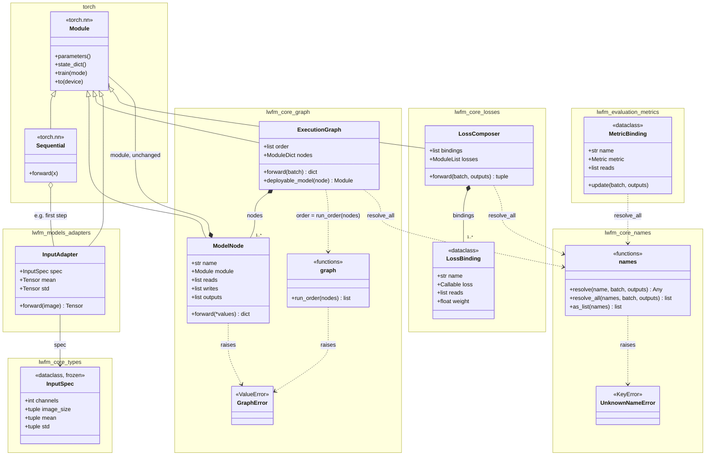
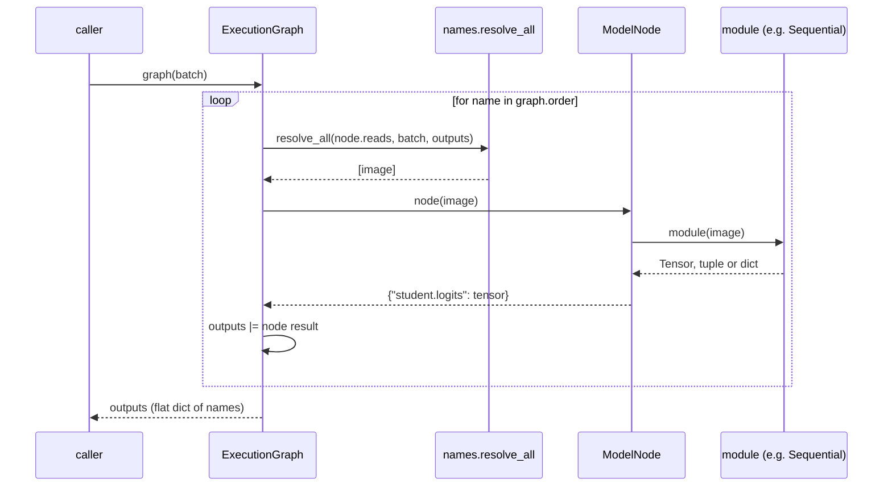
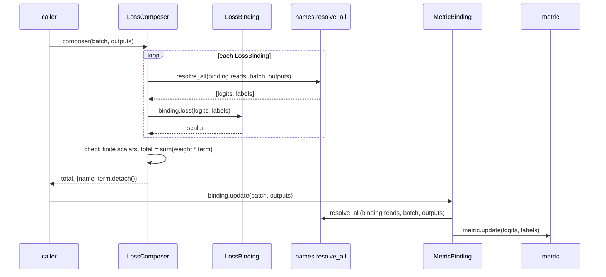
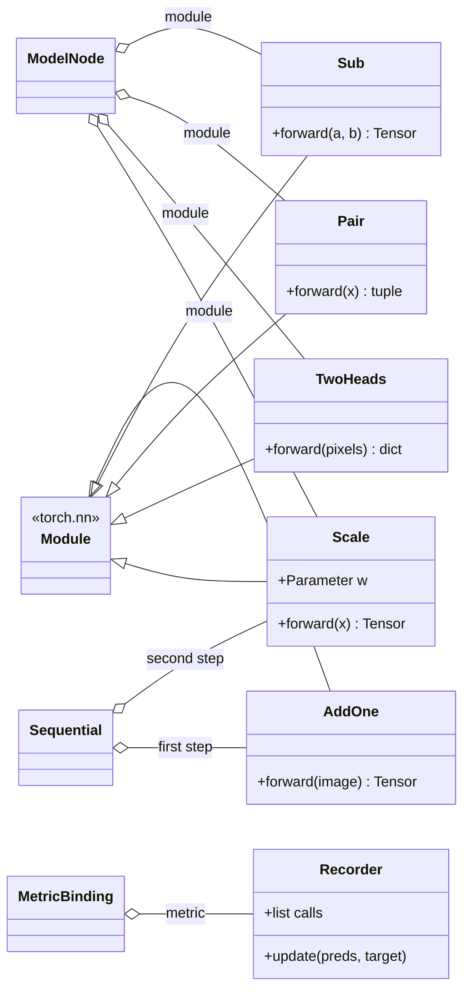
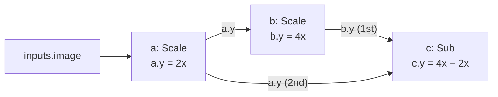

# Simplify the graph API: positional `reads`/`writes`, plain `nn.Sequential` chains

Reworks the building blocks from the previous commit so a node is easier to read and write:

```python
# Before
ModelNode(
    name="student",
    module=resnet18(num_classes=10),
    inputs={"x": "batch.inputs.image"},
    outputs={"logits": "student.logits"},
    input_adapter=InputAdapter(InputSpec(image_size=(64, 64))),
)

# After
ModelNode(
    "student",
    nn.Sequential(
        InputAdapter(InputSpec(image_size=(64, 64))), resnet18(num_classes=10)
    ),
    reads="inputs.image",
    writes="logits",  # stored as "student.logits"
)
```

**What changed and why**

| Change | Why |
| --- | --- |
| "Port" is now "name"; `ports.py` → `names.py`, `PortError` → `UnknownNameError`, `Port` → `Name`. | "Port" was jargon for "the name of a value". |
| Batch values are `inputs.image`, `targets.class`, `meta.sample_id` (no `batch.` prefix). | The prefix was in nearly every name and added nothing. |
| `ModelNode(name, module, reads, writes)`: `reads` are passed to `forward` **by position**. | You no longer need to know that torchvision calls its argument `x`. |
| `writes` are short names; the node stores them as `<node>.<write>`. | The node name is typed once, and two nodes can't write the same name. |
| Tuple returns are supported (one name per item, in order); a wrong count raises `GraphError`. | Previously only Tensor and dict returns worked. |
| `input_adapter` is removed; build chains with `nn.Sequential(InputAdapter(spec), model)`. | Straight chains are plain torch. The graph is only for branches and merges, and the adapter now runs only where it's placed, not on every input. |
| `deployable_model(node)` returns the node's module and takes **no default**. | The module already is the full chain. The graph doesn't know which node is "the student", so it shouldn't guess. |
| `LossBinding(name, loss, reads, weight)` and `MetricBinding(name, metric, reads)` pass values by position. | `CrossEntropyLoss(input, target)` and torchmetrics' `update(preds, target)` already take a fixed order. |
| Node names may not contain `.` or be `inputs`, `targets`, `meta`; a node may not write the same name twice. | Otherwise names would be ambiguous. |
| Type fixes: `cast` for `ModuleDict` lookups and the loss total; declared buffer types on `InputAdapter`; `resolve_all` takes any sequence. | `pyright lwfm` now reports 0 errors. |

**Files**

- `lwfm/core/names.py` (was `ports.py`), `lwfm/core/graph.py`, `lwfm/core/losses.py`, `lwfm/evaluation/metrics.py`, `lwfm/core/types.py`, `lwfm/models/adapters.py`.
- `tests/unit/test_names.py` (was `test_ports.py`), `test_graph.py`, `test_bindings.py`: 38 tests.
- `examples/building_blocks.ipynb`: same examples on the new API; same outputs as before.
- `PLAN.md`: §3.1–3.4 rewritten for the new API; §3.2's copied code is replaced by an API table pointing at the real files; §6.2 YAML now names the node and what it reads and writes.

---

## Diagrams

### Classes and modules



Hollow-headed arrows are inheritance; filled diamonds mean "holds"; dotted arrows mean "calls" or "raises". The only base class is `nn.Module`. `names` and `graph` stand for module-level functions, not classes. A node's module is any `nn.Module`; for a model with preprocessing it is an `nn.Sequential` whose first step is an `InputAdapter`. All reading of values goes through `resolve_all`, so the graph, the losses and the metrics agree on what a name means.

### What one forward pass does



### What scoring the outputs does



### Test doubles



| Double     | Why it is shaped this way                                                                                      |
| ---------- | -------------------------------------------------------------------------------------------------------------- |
| `Scale`    | One parameter (`w = 2`) and a Tensor return: the smallest trainable node; outputs are easy to predict ($2x$). |
| `TwoHeads` | Argument named `pixels`, not `x`, and a dict return with an extra field: tests that only listed fields are kept. |
| `Pair`     | Returns a tuple `(x + 1, x - 1)`: tests tuple items are named in order, and a wrong count fails.              |
| `Sub`      | Two inputs, `a - b`, which is **not** symmetric: a swapped argument order would give the wrong sign.           |
| `AddOne`   | Visible and parameter-free: as the first step of `nn.Sequential(AddOne(), Scale())` it shows order ($2(x+1)$). |
| `Recorder` | Plain class with `update(preds, target)`: stands in for a torchmetrics metric and records what it received.   |

### The dependency-order test graph



The nodes are passed as `[c, b, a]`; the graph must still run `a, b, c`, and pass `b.y` then `a.y` to `c`.

---

## Tests

All 38 tests run on CPU in about a second and use no real models or data.

### `tests/unit/test_names.py` — reading values by name

| Test                                          | What it checks                                                                                                                                                         | Why it matters                                                                    |
| --------------------------------------------- | ---------------------------------------------------------------------------------------------------------------------------------------------------------------------- | --------------------------------------------------------------------------------- |
| `test_resolves_batch_values`                  | `inputs.image` and `targets.class` return the very tensors in the batch (same object, no copy); `meta.sample_id` returns a non-tensor list.                            | Names reach any batch value, including metadata, without copying.                 |
| `test_resolves_node_outputs`                  | `student.logits` returns the tensor from the outputs dict.                                                                                                             | Node outputs and batch values are read the same way.                              |
| `test_unknown_name_is_in_the_error` (×4)      | `inputs.imgae` (typo in a key), `studnet.logits` (typo in a node name), bare `inputs`, and the old-style `batch.inputs.image` all raise `UnknownNameError` naming the value. | A wiring mistake says exactly which name is wrong; old names fail loudly.       |
| `test_resolve_all_keeps_order`                | `["student.logits", "targets.class"]` returns the logits then the labels.                                                                                             | Values are passed by position, so order is the contract.                          |
| `test_as_list_accepts_one_name_or_many`       | A single string becomes a one-item list; a tuple becomes a list.                                                                                                       | `reads="inputs.image"` and `reads=["a.y", "b.y"]` both work.                      |

### `tests/unit/test_graph.py` — nodes and the graph

| Test                                                        | What it checks                                                                                                                                                                  | Why it matters                                                                                        |
| ----------------------------------------------------------- | ------------------------------------------------------------------------------------------------------------------------------------------------------------------------------- | ----------------------------------------------------------------------------------------------------- |
| `test_node_writes_tensor_under_its_own_name`                | `reads="inputs.image"` becomes `["inputs.image"]`; `writes="y"` on node `student` gives output `student.y` with value $2x$.                                                     | Most models return one tensor; the node names it without the user repeating the node name.          |
| `test_node_keeps_only_listed_dict_fields`                   | Of `TwoHeads`' three dict fields, only `logits` and `features` are returned, as `student.logits` and `student.features`.                                                      | Unwanted fields don't leak into the graph outputs.                                                    |
| `test_node_names_tuple_items_in_order`                      | `Pair` returns `(x + 1, x - 1)`; with `writes=["up", "down"]`, `p.up` is $1$ and `p.down` is $-1$ for $x = 0$.                                                                 | Tuple-returning models work with no wrapper.                                                          |
| `test_node_passes_reads_by_position`                        | With `reads=["a.y", "b.y"]`, `Sub` gets $a = 5$, $b = 3$ and returns $2$.                                                                                                      | Argument order follows `reads`, whatever the argument names are.                                      |
| `test_node_runs_a_sequential_chain_in_order`                | `nn.Sequential(AddOne(), Scale())` as the module turns $0$ into $2$, i.e. $2(0+1)$.                                                                                            | Straight chains (preprocessing then model) are plain torch inside one node.                          |
| `test_wrong_number_of_outputs_fails`                        | `Pair` returns two values but the node writes one name: `GraphError` "returned 2 values".                                                                                     | A mismatch fails clearly instead of silently dropping or misnaming outputs.                          |
| `test_bad_node_names_fail` (×4)                             | Node names `a.b`, `inputs`, `targets` and `meta` raise `GraphError`.                                                                                                           | Every name stays unambiguous: a dot always splits node from output, and batch groups can't be shadowed. |
| `test_duplicate_writes_fail`                                | `writes=["y", "y"]` raises `GraphError` "twice".                                                                                                                              | One node can't write the same name twice.                                                             |
| `test_one_node_graph_reads_batch_and_returns_flat_names`    | A one-node graph reads `inputs.image` and returns exactly `{"student.y": 2x}`, with nothing from the batch copied in.                                                         | The Phase 1 setup: data in, named output out.                                                         |
| `test_nodes_run_in_dependency_order_not_list_order`         | Nodes given as `[c, b, a]` run as `["a", "b", "c"]`, and `c.y` equals $4x - 2x$ (diagram above).                                                                               | Adding nodes later (teachers, projectors) needs no change to the executor, and list order never matters. |
| `test_graph_is_a_normal_module`                             | The graph is an `nn.Module`; it exposes one parameter; `state_dict` keys are `nodes.student.module.w`; `eval()`/`train()` reach the inner module; a second graph loaded from the first gives identical outputs. | Optimizers, `.to()`, checkpointing and train/eval switching work through standard torch calls. |
| `test_gradients_reach_node_parameters`                      | `backward()` on a graph output fills the gradient of the node's parameter.                                                                                                    | The wrappers don't break autograd, so training works.                                                 |
| `test_deployable_model_is_the_nodes_module`                 | `deployable_model("student")` returns the very `nn.Sequential` passed in, and it gives the same output as the node.                                                           | The exported model is exactly what was trained, preprocessing included, with no copies.              |
| `test_invalid_graphs_fail_at_build_time` (×3)               | `GraphError` when building a graph with: a duplicate node name; a node reading a name nobody writes (`studnet.y`); a cycle (`a` reads `b`, `b` reads `a`).                   | Wiring mistakes fail immediately, before any data is touched, with a message naming the problem.    |

### `tests/unit/test_bindings.py` — losses and metrics

| Test                                                     | What it checks                                                                                                                                                       | Why it matters                                                                                         |
| -------------------------------------------------------- | -------------------------------------------------------------------------------------------------------------------------------------------------------------------- | ------------------------------------------------------------------------------------------------------ |
| `test_composer_is_weighted_sum_with_detached_terms`      | With CE (weight 0.7) and multi-margin (weight 0.3), both reading `["student.logits", "targets.class"]`: total $= 0.7\,\ell_{ce} + 0.3\,\ell_{margin}$; logged terms carry no gradient; `backward()` reaches the logits. | Several loss terms combine without trainer changes; logging terms can't hold on to the autograd graph. |
| `test_plain_callable_loss_is_accepted`                   | A `lambda` loss (not an `nn.Module`) reading one name works and returns a scalar.                                                                                    | Any function returning a scalar can be a loss.                                                         |
| `test_loss_with_parameters_is_registered`                | A loss that is an `nn.Linear` has its parameters returned by `composer.parameters()`, and nothing else does.                                                       | Learnable loss terms (e.g. projectors) get optimised and moved to the device.                          |
| `test_non_finite_or_non_scalar_loss_fails` (×2)          | A loss returning NaN, or a vector instead of a scalar, raises `ValueError` naming the loss (`bad`).                                                                 | Broken losses fail at the step they happen, with the culprit named, rather than corrupting training.   |
| `test_binding_accepts_one_name`                          | `LossBinding(..., reads="student.logits")` stores `["student.logits"]`.                                                                                             | Single-input losses don't need a list.                                                                 |
| `test_composer_needs_a_binding`                          | `LossComposer([])` raises `ValueError`.                                                                                                                              | An empty composer would otherwise return the integer `0`, which cannot be backpropagated.              |
| `test_metric_binding_passes_values_in_order`             | Two `update` calls reach the `Recorder` with `preds` and `target` set to the exact logits and labels objects, in that order.                                       | Metrics read values the same way losses do and accumulate across calls.                                |

### `tests/unit/test_adapters.py` — input preprocessing

| Test                                                  | What it checks                                                                                              | Why it matters                                                                                                        |
| ----------------------------------------------------- | ----------------------------------------------------------------------------------------------------------- | --------------------------------------------------------------------------------------------------------------------- |
| `test_normalises_without_resizing_when_size_matches`  | At the spec's size, the output is exactly $(x - \mu)/\sigma$, so no resize happened.                         | A CPU crop already at the right size is not resized again.                                                            |
| `test_resizes_to_spec`                                | A `16×12` input comes out at the spec's `8×6`.                                                              | Each model gets the input size it declares.                                                                           |
| `test_statistics_are_buffers_not_saved_weights`       | The adapter has no parameters and an empty `state_dict`; `mean` and `std` are buffers.                     | Mean/std move with `.to(device)` but are never trained, and are rebuilt from `InputSpec` rather than read from checkpoints. |
