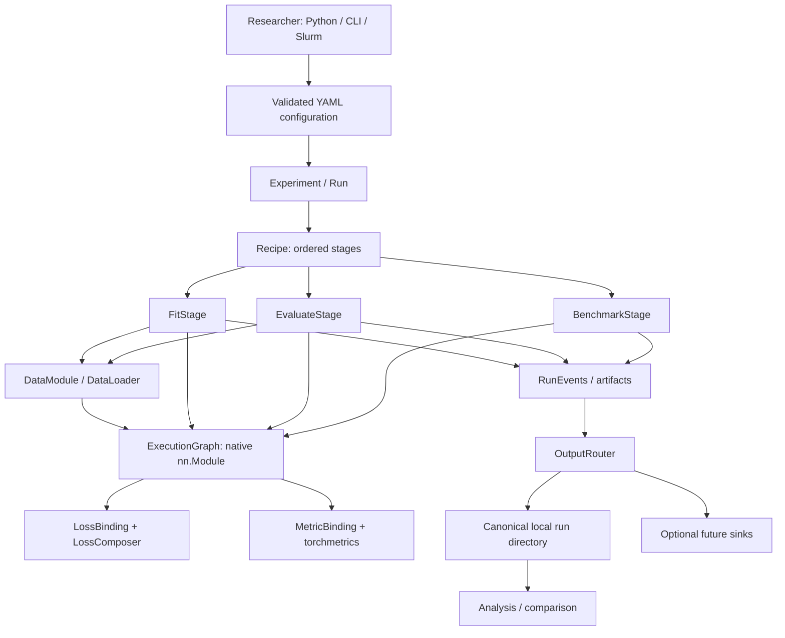
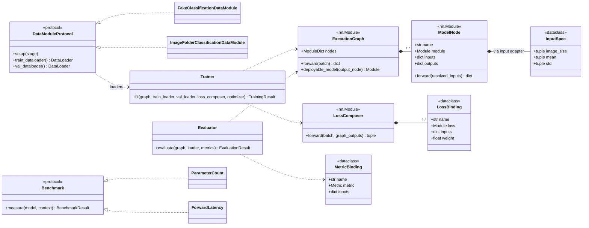
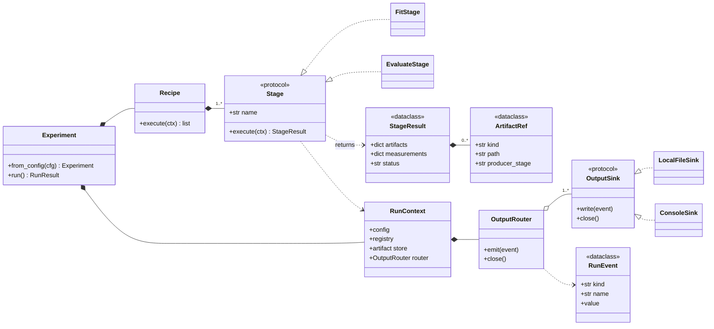
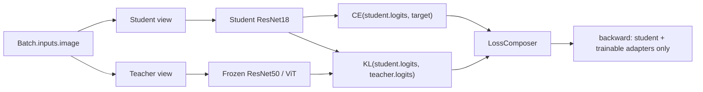

# CS407: Modular PyTorch Research Pipeline — Implementation Plan

**Version:** 1.0 (proposed implementation baseline)  
**Date:** 17 November 2026  
**Status:** Ready for team review; assumptions marked _Provisional_ must be confirmed during Phase 0.  
**Intended audience:** Human researchers and coding agents implementing the repository.  
**Primary objective:** Provide a working, end-to-end, single-model ImageNet-style classification prototype **before** introducing sophisticated compression research features.

> **Instructions to an implementing agent:** Implement this document **in phase order**. Do not build later-phase features while Phase 1 acceptance tests are failing. Treat public interfaces, dependency-direction rules, and test criteria as requirements. Where a detail is not specified, prefer the smallest native-PyTorch solution; record decisions in `docs/decisions.md`, rather than adding an abstraction pre-emptively. Examples below define the intended API; no code is assumed to exist yet.

---

## 0. Background, project goals, and boundaries

The CS407 project investigates efficient computational pathology models, initially including **knowledge distillation, quantisation, pruning, and tile selection**. It requires interchangeable teacher and student architectures, **zero or multiple teachers**, classification and later segmentation, benchmarking of both predictive quality and real inference cost, and eventual TIAToolbox integration. The project's specification initially proposes an ImageNet/ResNet prototype, later pathology foundation models, and evaluation of compound optimisation (accuracy versus parameters, size, FLOPs, latency, throughput and peak memory).

This implementation plan reconciles those requirements with the accompanying 15-file `alternative-plan.zip` and the subsequent architecture discussion:

- **Keep:** recipe/stage execution, model input specifications, explicit adapters, reproducibility, stage artifacts, torchmetrics, output routing, standalone Python use, synthetic smoke tests, later teacher-output caching, and fair benchmarks.
- **Improve:** use a small **execution DAG** for model computations rather than making a hard-coded main-model/teacher bundle the only execution shape; connect losses and metrics through **explicit named bindings**, not access to a global context; represent techniques through **stage-specific extension points**, with optional technique bundles.
- **Defer:** a general-purpose distributed DAG engine, multi-GPU/DDP, full workflow caching, custom dashboards, automatic adapter design, FPGA deployment, comprehensive WSI processing, and all advanced optimisations until the baseline works.

### Goals and success definition

1. A researcher can define a standard `torch.nn.Module` and train/infer with **no experiment infrastructure**.
2. The same model can be wrapped and run through a small, reproducible configured experiment (`Fit → Evaluate → Benchmark`), saving results automatically.
3. Another researcher can later add a loss, metric, architecture adapter, optimisation or dataset **without editing the main trainer**.
4. A recipe can evaluate and benchmark **between** compression stages, making cumulative effects measurable.
5. Single-GPU Slurm array jobs can run configurations independently; Slurm is **not** a dependency of the computational core.
6. The deployable model remains an ordinary `nn.Module`, suitable for a later TIAToolbox adapter.

### Scientific invariants (from the start)

- No silent use of the final test set for selection, hyperparameter tuning or early stopping.
- Every prediction or metric is associated with the correct task unit (image, tile, slide, patient or pixel).
- Benchmarks never count a frozen teacher or training-only projector as part of a student's deployed inference cost.
- Claims about low-bit acceleration require **actual supported kernels and measured timings**; fake quantisation alone does not establish speed-up.
- Record input resolution/normalisation, split definitions, checkpoints, random seed, git revision and effective precision for comparisons.
- **Patient-level** separation becomes mandatory before pathology experiments.

---

## 1. Architecture summary

Two graphs exist at **different timescales**:

- **Recipe:** a sequential list of _stages_ (whole operations): `Fit`, `Transform`, `Evaluate`, `Benchmark`, `Export`. A stage consumes artifact references and produces new artifacts/measurements. Phase 1 needs just `Fit`, `Evaluate`, `Benchmark`.
- **ExecutionGraph (DAG):** a directed acyclic graph of _PyTorch computations within one forward pass_, such as a ResNet, ViT, learned feature projector, or tile selector. A single model is a **one-node DAG**. Future KD can have two or more model branches.

A **contract** is the declared input/output shape and behavior of a component. **Composition over inheritance** means combining native PyTorch objects instead of defining special subclasses for every optimisation combination. A **registry/factory** selects an implementation by name from validated configuration. **Adapters** change representations at boundaries. **Output sinks** implement the observer/sink pattern: computational code emits typed results; the storage destination is chosen elsewhere.



**Dependency rule:** `core/data/models/training/evaluation` must not import the CLI, Slurm, or experiment runner. High-level orchestration uses the lower-level services, not the reverse. TIAToolbox and TRIDENT adapters live under `integrations/` and must not be required to import or test the core package.

### Modes of use (all must remain possible)

| Level                   | Typical use                                                                  | Infrastructure required                         |
| ----------------------- | ---------------------------------------------------------------------------- | ----------------------------------------------- |
| 0 — native PyTorch      | `model(x)`, custom training/debugging                                        | PyTorch only                                    |
| 1 — reusable components | `Trainer.fit(graph, loader, ...)`, `Evaluator.evaluate(...)`, `graph(batch)` | Core package only; **no Recipe/Experiment**     |
| 2 — reproducible run    | `python -m lwfm.run --config ...`                                            | Config, Recipe, canonical outputs               |
| 3 — batch experiment    | Slurm array or Hydra/Submitit (later)                                        | Same Level 2 command, different config per task |

---

## 2. Decision register and assumptions

These are the **default decisions agents should implement**, unless the team changes them before or during Phase 0. Do not interpret them as claims about existing repository code.

| ID  | Decision                 | Default / rationale                                                                                                                  | Status                                              |
| --- | ------------------------ | ------------------------------------------------------------------------------------------------------------------------------------ | --------------------------------------------------- |
| D01 | Package                  | `lwfm` in a single `src/`-layout Python repository                                                                                   | **Provisional:** rename if team prefers             |
| D02 | Python/PyTorch           | Choose a Python version supported by the **actual cluster** and lock a compatible PyTorch/torchvision/torchmetrics combination       | **Must verify on DCS**; do not hardcode Python 3.14 |
| D03 | Computational primitives | `torch.nn.Module`, `Dataset`/`DataLoader`, `torch.optim.Optimizer`, `torchmetrics.Metric`                                            | Accepted default                                    |
| D04 | Data exchange            | Nested Python dict `{"inputs":..., "targets":..., "meta":...}`; numerical payloads are `Tensor`s                                     | Accepted default                                    |
| D05 | Model wrapping           | Keep raw `nn.Module` unchanged; `ModelNode` adapts calling conventions and maps returns to named outputs                             | Accepted default                                    |
| D06 | Forward graph            | Small **statically declared DAG**, parameterized nodes stored in `nn.ModuleDict`; no runtime graph rewriting initially               | Accepted default                                    |
| D07 | Losses and metrics       | Independent callable/`nn.Module`/TorchMetrics objects with **explicit named input bindings**                                         | Accepted default                                    |
| D08 | Training loop            | Thin, readable, single-device native-PyTorch `Trainer`; no Lightning requirement                                                     | Accepted default                                    |
| D09 | Technique interface      | Separate `DataTransform`, `ModelTransform`, `RuntimeNode`, `LossBinding`, `Callback`; optional higher-level `Technique` bundle later | Accepted default                                    |
| D10 | Run orchestration        | `Recipe` is ordered `Stage`s returning explicit `StageResult` artifact references                                                    | Accepted default                                    |
| D11 | Config                   | **Phase 1:** safely parsed YAML plus typed validation; **later:** Hydra/Submitit if proven compatible                                | Accepted default                                    |
| D12 | Dataset for MVP          | **Synthetic FakeData first**, then an **ImageNet-compatible `ImageFolder` subset** (e.g., ImageNet-100)                              | Requires local data; no download assumed            |
| D13 | Preprocessing            | Shared per-sample training augmentation, then independently configurable per-model resize/normalisation; avoid double transforms     | Accepted default                                    |
| D14 | Evaluation split         | Train/validation separated by reproducible manifest; official ImageNet val reserved as final test if available                       | Accepted default                                    |
| D15 | Tracking                 | Local run directory + JSON/JSONL is canonical; remote tracker optional                                                               | Accepted default                                    |
| D16 | Compute                  | Local CPU smoke / optional GPU runs, one GPU per Slurm task; cluster feature support verified separately                             | Accepted default                                    |
| D17 | Benchmarks               | Separate **quality** and **cost** evaluation; report protocol + hardware fingerprint                                                 | Accepted default                                    |
| D18 | TIAToolbox               | Later integration adapter wrapping final deployable model; do not depend on TIAToolbox in Phase 1                                    | Accepted default                                    |
| D19 | Teacher representations  | Online teacher first; offline embeddings later with sample/view identity                                                             | Accepted default                                    |
| D20 | FPGA/Rust/DDP            | Not in MVP; evaluate after real bottleneck profiling                                                                                 | Accepted default                                    |

### Explicit Phase 1 assumptions

- Images are **RGB classification** inputs with `num_classes >= 5` when computing top-5.
- Images in `Sample.inputs.image` are floating-point CHW tensors in `[0,1]`; normalisation and per-model resizing happen exactly once through the model input adapter. `ImageFolder` decodes on CPU. Images can have different original resolutions.
- Targets are integer class IDs, zero-indexed and in `[0, K)`, represented as `torch.long`.
- The ImageNet-compatible folder contains images indexed by class names, with a **frozen class-name-to-index mapping** used for every split. Do not construct a different mapping per split.
- Phase 1 does **not** require full ImageNet-1k download or pretraining. The user/team supplies an appropriately licensed folder dataset. Synthetic data proves functionality; **no meaningful scientific accuracy claim** is made from it.
- The first working benchmark reports **CPU or CUDA inference latency**, parameter count and model-size information. FLOPs, energy and WSI latency are later stages.
- Single process and single device (CPU or one GPU). No distributed training in Phase 1.
- Only **classification** task is accepted in Phase 1. Segmentation and WSI-specific records are planned extension cases, not silently mapped into classification.

---

## 3. Public contracts (implement these small and test them)

Keep these interfaces under `src/lwfm/core/` and version their semantics via tests. Example signatures are **normative goals**; agents can refine typing or naming only if the behavior remains equivalent and tests are updated.

### 3.0 Primitive objects at a glance

Two diagrams mirror the modes of use in §1. **Computational primitives** (Level 1) work alone from Python. **Orchestration primitives** (Level 2) only compose them, and nothing in the first diagram imports anything in the second. Each hierarchy shows at most two implementations; the others follow the same contract.

**Computational primitives (Level 1: no run, config or files needed)**



**Orchestration primitives (Level 2: reproducible run)**



`BenchmarkStage` (third `Stage`) and the Level 1 services it calls are omitted from the second diagram for brevity.

**The primitives.** Notation: a _port_ $p$ is a dotted path; $\mathrm{res}(p)$ resolves it against the batch (`batch.*`) or the flat graph-output dict (`<node>.<field>`).

| Object                        | What it is                                          | Contract                                                                                                                                                                                                                 |
| ----------------------------- | --------------------------------------------------- | ------------------------------------------------------------------------------------------------------------------------------------------------------------------------------------------------------------------------ |
| `Batch`                       | Plain nested `dict`                                 | Keys `inputs`, `targets`, `meta`; tensors under the first two, e.g. `inputs.image` $\in [0,1]^{B\times 3\times H\times W}$, `targets.class` $\in \{0,\dots,K-1\}^B$ (`int64`)                                            |
| `DataModuleProtocol`          | Owner of datasets and loaders                       | `setup(stage)`, then `{train,val,test}_dataloader()` yield `Batch`es with identical keys whatever the source; splits come from frozen manifests                                                                          |
| `InputSpec`                   | Frozen description of what a model expects          | `image_size`, `mean`, `std`; the input adapter applies $x \mapsto (\mathrm{resize}(x)-\mu)/\sigma$ exactly once                                                                                                          |
| `ModelNode`                   | `nn.Module` wrapping an **unchanged** `nn.Module`   | Maps callee arguments to source ports (`{"x": "batch.inputs.image"}`) and returns to qualified ports (`{"logits": "student.logits"}`)                                                                                    |
| `ExecutionGraph`              | `nn.Module` holding a DAG $G=(V,E)$ of `ModelNode`s | `forward(batch)` evaluates nodes in a topological order fixed at build time and returns a flat `{port: Tensor}`; a single model is $\lvert V\rvert = 1$. `deployable_model(...)` returns the inference-only `nn.Module`. |
| `LossBinding`                 | Pairs a loss with named inputs                      | $\ell_i\big(\mathrm{res}(p_{i,1}),\dots\big)$ must be a finite scalar; `nn.CrossEntropyLoss` works unwrapped                                                                                                             |
| `LossComposer`                | `nn.Module` summing bindings                        | $\mathcal{L} = \sum_i w_i\,\ell_i$; returns $(\mathcal{L}, \{\text{name}_i: \ell_i.\mathrm{detach}()\})$                                                                                                                 |
| `MetricBinding`               | Pairs a `torchmetrics.Metric` with named inputs     | `update(**resolved)` per batch, `compute()` once; the same metric scores any node by rebinding `preds`                                                                                                                   |
| `Trainer`                     | Stateless training service                          | For each step: `move_to_device` → `graph(batch)` → $\mathcal{L}$ → `backward` → `step`. It knows nothing of runs, files or YAML.                                                                                         |
| `Evaluator`                   | Stateless evaluation service                        | `graph.eval()` under `torch.inference_mode()`; resets, updates and computes every `MetricBinding`                                                                                                                        |
| `Benchmark`                   | Cost measurement on the **deployable** model        | `measure(model, BenchContext) → BenchmarkResult`, e.g. $\lvert\theta\rvert$ or median/p95 latency, plus protocol metadata                                                                                                |
| `Stage`                       | One whole operation in a recipe                     | `execute(ctx) → StageResult`; calls Level 1 services and never builds its own graph                                                                                                                                      |
| `Recipe`                      | Ordered list of `Stage`s                            | Runs in order; stops at the first failure                                                                                                                                                                                |
| `RunContext`                  | State shared by stages                              | Config, registry, artifact store, router. **Not** passed to Level 1 services.                                                                                                                                            |
| `StageResult` / `ArtifactRef` | Typed stage output                                  | Artifacts are referenced by `(kind, path, producer_stage, sha256)`, never passed implicitly                                                                                                                              |
| `RunEvent`                    | One typed result record                             | `kind` ∈ {scalar, table, artifact, status, message}; JSON-safe `value` or an `ArtifactRef`                                                                                                                               |
| `OutputRouter` / `OutputSink` | Observer pattern for results                        | Stages and services `emit`; sinks `write`. Destinations are chosen by config, never by computational code.                                                                                                               |
| `Experiment`                  | Level 2 entry point                                 | `from_config(cfg)` validates and builds everything; `run()` creates the run directory, executes the recipe and finalises the status                                                                                      |

> **Naming to resolve:** `Trainer.fit(..., event_sink: EventSink)` (§3.6) and `OutputSink`/`OutputRouter` (§3.9) describe the same role under different names. Below, `event_sink` is anything with `emit(RunEvent)`, which `OutputRouter` satisfies. Pick one name in Phase 0.

### 3.1 `Sample` and `Batch`

Use standard dictionaries, **not an invented tensor base class**:

```python
from typing import Any, TypeAlias

Sample: TypeAlias = dict[str, Any]
Batch: TypeAlias = dict[str, Any]

# Each Sample or Batch must have:
# {
#   "inputs": {str: torch.Tensor},
#   "targets": {str: torch.Tensor},
#   "meta": {str: metadata}
# }
```

**Example classification batch:**

```python
batch = {
    "inputs": {"image": images},        # float32 [B,3,H,W], [0,1] before per-model prep
    "targets": {"class": labels},       # int64 [B]
    "meta": {"sample_id": sample_ids},  # list[str], length B
}
```

For segmentation later, add `targets.mask` of shape `[B,H,W]`; for slide embeddings add `inputs.features` `[B,N,D]`, `inputs.coords` `[B,N,2]` and `inputs.valid_tiles` `[B,N]`. Support variable-length examples via **task-specific collators**, not by changing the basic keys.

**Required helpers:**

- `validate_batch(batch, required_fields, task)` checks required keys, tensor ranks, label types, batch-size alignment and helpful error messages.
- `move_to_device(obj, device)` recursively moves **only tensors** within nested dictionaries/lists/tuples; preserves strings/paths/metadata; nonblocking optional.
- `classification_collate(samples)` handles batch stacking and metadata lists; tests must include non-tensor metadata.
- **Do not put GPU tensors inside Dataset worker processes.** Transfer in trainer/evaluator.

### 3.2 Dataset source and `DataModule`

```python
class DataModuleProtocol(Protocol):
    def prepare_data(self) -> None: ...       # validate/download separately; idempotent
    def setup(self, stage: str) -> None: ...
    def train_dataloader(self) -> DataLoader: ...
    def val_dataloader(self) -> DataLoader: ...
    def test_dataloader(self) -> DataLoader: ...
```

Concrete MVP implementations:

1. `FakeClassificationDataModule`: seeded fixed-size synthetic dataset with valid `Sample` structure; no network use; configurable `num_classes`, size and count. Used for CI/smoke tests only.
2. `ImageFolderClassificationDataModule`: accepts explicit `train_manifest`, `val_manifest`, optional `test_manifest`, root, class mapping and transforms; loads images lazily with a PyTorch Dataset. If manifests are not specified, a separate **split-generation command** creates them with a fixed seed and class-stratified rules. Never randomly resplit inside every run.

`prepare_data()` for Phase 1 **validates and reports** locations; it must not silently download protected ImageNet content. Later add optional explicit dataset downloader/source adapters; downloading is independent of training.

**Manifest contract:** use UTF-8 CSV with columns `sample_id,path,label`, where `path` is a path relative to the dataset root, `sample_id` is a stable unique ID and `label` is the integer class ID. Save `class_to_idx.json` alongside split manifests; validation must ensure that train/val/test have identical label semantics and no repeated `sample_id` (or duplicate resolved file path) across splits. The manifest generator accepts an explicit seed, class-stratified hold-out rule and data root; generated split files are not silently overwritten. Never use ImageNet official validation data to select the best model when that same set will be reported as final test.

**Transforms:** CPU decode, RGB conversion, train/eval resizing/cropping as configured, optional horizontal flip, tensor conversion; `eval` is deterministic. Keep the model normalisation in a configurable **input adapter**, not scattered across datasets. If CPU crop already changes resolution, model adapter should not blindly apply a second arbitrary crop. Record the full transform chain.

### 3.3 Models, input specifications and graph ports

```python
@dataclass(frozen=True)
class InputSpec:
    channels: int = 3
    image_size: tuple[int, int] = (224, 224)
    mean: tuple[float, ...] = (0.485, 0.456, 0.406)
    std: tuple[float, ...] = (0.229, 0.224, 0.225)
    # Later: dtype, task, mpp, color_space, patch_size, required fields

class ModelNode(nn.Module):
    def __init__(
        self,
        name: str,
        module: nn.Module,
        inputs: dict[str, str],
        outputs: dict[str, str],
        input_adapter: nn.Module | None = None,
    ): ...

    def forward(self, resolved_inputs: dict[str, Tensor]) -> dict[str, Tensor]: ...

class ExecutionGraph(nn.Module):
    def __init__(self, nodes: list[ModelNode]): ...
    def forward(self, batch: Batch) -> dict[str, Tensor]: ...
```

**Ports:** paths like `batch.inputs.image`, `batch.targets.class`, `student.logits`, `teacher.logits`, `projection.features`. For the proposed `ModelNode`, `inputs={"x": "batch.inputs.image"}` maps the _callee's input argument_ `x` to a source port; `outputs={"logits": "student.logits"}` maps the _callee's logical return field_ `logits` to a fully qualified output port. A plain Tensor return is treated as the declared single output; a dict return must contain the declared fields. Graph construction validates that each node's dependencies are available (starting with batch ports or earlier node outputs), node names and output names are unique, and no cycles occur. Perform topological ordering once at build time. A node must return tensors with declared names. For Phase 1, graph outputs are a **flat dictionary** keyed by qualified names; nested dataset fields remain under `batch.*` only.

In Phase 1, implement a **one-node graph** wrapping a torchvision `resnet18` or tiny custom CNN. **Still use the same class** that later supports additional nodes; implement the minimal generic topological executor or add that in early Phase 2 with contract tests. Avoid a bespoke `SingleModelGraph` and then a second KD-only architecture.

**Important PyTorch semantics:** Store model/adapter submodules in registered `ModuleDict` or `ModuleList`; do not hide trainable modules inside ordinary Python dictionaries. `ExecutionGraph.parameters()`, `state_dict()`, `.train()`, `.eval()`, `.to(device)` and standard autograd must work. Model constructors are selected from an allowlisted registry; the loader must not execute arbitrary Python from YAML.

For Phase 1, a single-output `nn.Module` is adapted to `{"logits": output}`. Later add feature taps, dict/tuple output mappings and explicit CNN/ViT feature adapters. All trainable adapters remain registered; distinguish **training-only** from **required at inference**.

**Deployable-model contract:** implement `ExecutionGraph.deployable_model(output_node="student") -> nn.Module` (or an equivalent explicit factory). In Phase 1 it returns a PyTorch inference wrapper that includes the selected model and **any required runtime input/output adapters**, but no trainer, loss modules or metrics. It must preserve `eval()`, `.to(device)`, `.state_dict()`, direct `forward(...)` inference and checkpoint reload. In later phases, the export procedure removes frozen teachers and training-only feature projectors but retains permanent prediction heads and necessary preprocessing; it must not assume every graph node is deployable.

### 3.4 Losses: `LossBinding` and `LossComposer`

A loss object is an `nn.Module` or callable returning a **scalar differentiable tensor**. A binding states **exactly** which named values it consumes:

```python
@dataclass
class LossBinding:
    name: str
    loss: nn.Module
    inputs: dict[str, str]    # e.g. {"input": "student.logits", "target": "batch.targets.class"}
    weight: float = 1.0

class LossComposer(nn.Module):
    def __init__(self, bindings: list[LossBinding]): ...
    def forward(
        self, batch: Batch, graph_outputs: dict[str, Tensor]
    ) -> tuple[Tensor, dict[str, Tensor]]: ...
```

- Composer resolves bindings, calls each loss with keyword arguments, checks finite scalar output, computes weighted sum and returns per-term **detached** scalar logs. No loss should read a global `StepContext` to discover hidden dependencies.
- `CrossEntropyLoss` must work unchanged (`input=student.logits`, `target=batch.targets.class`). Distillation KL, feature regression and others are later modules with the **same binding mechanism**.
- Validation at startup rejects invalid paths; a preflight forward on one synthetic/sample batch can check actual shapes.
- If a loss/adaptor has trainable parameters, include them in optimiser groups, with duplicate-parameter checking. Phase 1 uses nontrainable CE only.
- No loss must depend on a `Run`, CLI, dataset implementation or specific model class.

### 3.5 Metrics: `MetricBinding`

Use `torchmetrics.Metric` without a competing accumulator hierarchy:

```python
@dataclass
class MetricBinding:
    name: str
    metric: torchmetrics.Metric
    inputs: dict[str, str]    # e.g. {"preds": "student.logits", "target": "batch.targets.class"}
```

`Evaluator` resets metric states, runs the graph in `eval()` and `torch.inference_mode()` (for evaluation only), updates all metrics batch by batch, computes final results, and returns `EvaluationResult` objects. Phase 1 includes micro/global **top-1** and **top-5** classification accuracy where `K >= 5`; do not accidentally use a macro-per-class reduction when reporting standard ImageNet top-1/top-5. Optional loss and macro-F1 are extensions.

Output names are explicit: `eval/val/top1`, `eval/val/top5`; corresponding final test metrics use `eval/test/...`. Metrics can target different graph outputs without custom teacher/student metric implementations.

### 3.6 Trainer and evaluator

**Independent services:**

```python
class Trainer:
    def fit(
        self,
        graph: ExecutionGraph,
        train_loader: DataLoader,
        val_loader: DataLoader | None,
        loss_composer: LossComposer,
        optimizer: torch.optim.Optimizer,
        *,
        epochs: int,
        device: torch.device,
        callbacks: Sequence[Callback] = (),
        event_sink: EventSink | None = None,
        max_steps: int | None = None,
    ) -> TrainingResult: ...

class Evaluator:
    def evaluate(
        self,
        graph: ExecutionGraph,
        loader: DataLoader,
        metrics: Sequence[MetricBinding],
        *,
        device: torch.device,
        event_sink: EventSink | None = None,
    ) -> EvaluationResult: ...
```

The trainer owns: device transfer, `.train()`, graph forward, scalar loss, `.backward()`, optimizer step/zero grad, counters and optional validation. It **does not** create runs/directories, parse YAML, launch Slurm, or know how a technique was implemented. `event_sink` is optional; use a no-op sink or `None` for notebooks.

**Phase 1 training features:** clear epoch/step reporting, random seed, validation, `max_steps`/`limit_batches` smoke mode, CPU/GPU support, save best/last checkpoint from orchestration; use FP32 as the default. A working small-batch overfit diagnostic is required.

**Later:** AMP, accumulation, early stopping, callbacks with state, resumable optimizer/scheduler/scaler, checkpoint resume, DDP. Do not block the vertical slice on these.

**Future teacher rule:** teachers are `requires_grad_(False)` and in `.eval()`; the training executor applies `torch.no_grad()` to teacher forward, avoiding accidental autograd across the teacher, and preserves teacher eval state even when the parent graph is placed in train mode. Do **not** assume `torch.inference_mode()` is always safe for teacher tensors reused in differentiable student losses. Validate this in KD tests.

### 3.7 Stages, recipe and artifact references

```python
@dataclass(frozen=True)
class ArtifactRef:
    kind: str            # e.g. "torch_checkpoint", "metrics", "model_export"
    path: str            # within run dir or explicit approved external path
    producer_stage: str
    sha256: str | None = None

@dataclass
class StageResult:
    artifacts: dict[str, ArtifactRef]
    measurements: dict[str, float | int | str]
    status: str = "completed"

class Stage(Protocol):
    name: str
    def execute(self, ctx: RunContext) -> StageResult: ...

class Recipe:
    def execute(self, ctx: RunContext) -> list[StageResult]: ...
```

- `Recipe` executes stages **in listed order** and records each result. Stage names are unique; failures stop dependent stages and mark run failed.
- `RunContext` holds configuration, run metadata, registry/factories, artifact store and output router. It is for stages/orchestration, **not required** by `Trainer`/`Evaluator`/`ModelNode`/`LossBinding`.
- A stage consumes inputs via explicit artifact references. In Phase 1, stages may operate on the same in-memory graph for simplicity, but **persist a checkpoint** after `FitStage` and record which artifact `EvaluateStage` and `BenchmarkStage` measured. Cross-run `run://...` references come later.
- `FitStage`, `EvaluateStage` and `BenchmarkStage` are required in Phase 1. `TransformStage`, `LoadStage`, `ExportStage` and explicit cross-run lineage follow later.
- Stages should not invent a custom execution graph of their own. They call existing standalone services.

### 3.8 Benchmarks: strict separation from quality metrics

```python
class Benchmark(Protocol):
    name: str
    def measure(self, model: nn.Module, context: BenchContext) -> BenchmarkResult: ...
```

Phase 1: `ParameterCount`, `ModelSize`, `ForwardLatency`; optional `Throughput` if trivial. `BenchmarkRunner` selects the **deployable** inference model, not a teacher-inclusive training graph. Benchmarks include input shape, dtype, device, batch size, warm-up, repeat count and a hardware/software fingerprint.

- Use `torch.cuda.Event` and synchronisation on CUDA; use `time.perf_counter()` for CPU. `model.eval()` and `torch.inference_mode()`.
- Report median and p95 from repetitions, plus the raw timings if configured.
- Parameter count = `sum(p.numel() for p in model.parameters())` for the deployed model (describe trainable versus total separately if useful).
- Report **actual serialised weight artifact size** and optionally logical weight bytes, with clear definitions; do not confuse a full training checkpoint (with optimiser) with deployable model size.
- FLOPs, GPU peak memory, tile/s, energy, CO₂e, model quantisation bit-width, WSI-level latency and benchmark hardware isolation are added later.

### 3.9 Run events, output router and sinks

```python
@dataclass
class RunEvent:
    kind: str                # scalar | table | artifact | status | message
    name: str
    value: object            # JSON-safe scalar/table data OR ArtifactRef
    stage: str | None = None
    step: int | None = None
    timestamp_utc: str | None = None

class OutputSink(Protocol):
    def write(self, event: RunEvent) -> None: ...
    def close(self) -> None: ...

class OutputRouter:
    def emit(self, event: RunEvent) -> None: ...
    def close(self) -> None: ...
```

Use `LocalFileSink` and `ConsoleSink` first. Local sink writes scalars/events as **append-only JSONL** during execution (so partial runs leave useful data), and structured `summary.json`/`manifest.json` on completion. Do not serialize model tensors or images directly into JSONL; write a file/artifact and send a reference event. Storage failures should produce clear errors, not silently falsify a successful run.

Phase 1 routing can broadcast all supported events to both sinks. Filtering by event name/kind, remote storage and third-party tracking can be added when needed.

---

## 4. Repository layout and dependency boundaries

```text
repository/
├── pyproject.toml
├── README.md
├── configs/
│   ├── experiments/
│   │   ├── smoke.yaml
│   │   └── imagenet100_resnet18.yaml
│   ├── data/
│   └── models/
├── src/lwfm/
│   ├── __init__.py
│   ├── run.py                 # CLI entry point (or cli/run.py)
│   ├── infer.py               # single-image/batch inference CLI
│   ├── core/
│   │   ├── types.py           # Batch, ArtifactRef, results
│   │   ├── config.py          # strict config loading/validation
│   │   ├── ports.py           # named tensor path resolution
│   │   ├── graph.py           # ModelNode, ExecutionGraph
│   │   ├── losses.py          # LossBinding, LossComposer
│   │   └── registry.py
│   ├── data/
│   │   ├── modules.py         # Fake + ImageFolder DataModules
│   │   ├── transforms.py
│   │   ├── collate.py
│   │   └── splits.py
│   ├── models/
│   │   ├── factory.py         # torchvision + custom model factories
│   │   └── adapters.py        # input and later feature adapters
│   ├── training/
│   │   ├── trainer.py
│   │   └── checkpoint.py
│   ├── evaluation/
│   │   ├── evaluator.py
│   │   ├── metrics.py
│   │   └── benchmarks.py
│   ├── orchestration/
│   │   ├── experiment.py
│   │   ├── recipe.py
│   │   └── stages.py
│   ├── results/
│   │   ├── events.py
│   │   ├── router.py
│   │   └── sinks.py
│   ├── techniques/            # added from Phase 2
│   ├── integrations/          # TIAToolbox, TRIDENT, Slurm later
│   └── analysis/              # later
├── scripts/
│   └── slurm/                 # Phase 1/2 example sbatch script
├── tests/
│   ├── unit/
│   ├── contracts/
│   ├── integration/
│   └── fixtures/
├── notebooks/
│   └── quickstart.ipynb       # optional; core API must also work outside notebooks
└── docs/
    ├── decisions.md
    ├── architecture.md
    └── contributor-guide.md
```

**Rule:** Keep core imports lightweight. `import lwfm` and a CPU smoke run must work without TIAToolbox, HDF5, Slurm, optional tracking services or a GPU. Declare optional dependencies using package extras (`pathology`, `hpc`, `quantisation`, `analysis`) when those features are implemented.

**Third-party implementation choices:** `torch`, `torchvision`, `torchmetrics`, `numpy`, `PyYAML`, `Pillow`, `pytest` are sufficient initial dependencies. `timm`, `torchao`, `torch-pruning`, `hydra-core`, `hydra-submitit-launcher`, `tiatoolbox`, `pandas`, `matplotlib` and HDF5/Zarr tooling can be introduced in the phases that need them. Validate package and driver compatibility on DCS before pinning dependency versions.

---

## 5. Phase 0 — Bootstrap and contract agreement

**Goal:** a clean install, validated initial API, and no known environment blockers. Do not write a large framework yet.

**Tasks (in order):**

1. Confirm repo name/package name (`lwfm` default) and whether the existing ImageNet prototype contains reusable data or model code; do not assume it is accessible without checkout. If available, selectively migrate code rather than retaining an incompatible folder structure.
2. Inspect available local and DCS Python versions, CUDA/PyTorch drivers and GPU limits; choose a tested environment and record it in `pyproject.toml` plus a lock/constraints file. Run `torch` and `torchvision` import smoke tests on **both** target environments.
3. Create package, formatter/linter and `pytest` config; install editable with `pip install -e '.[dev]'` (or project equivalent).
4. Implement stubs / types for `Batch`, `InputSpec`, `ModelNode`, `ExecutionGraph`, `LossBinding`, `MetricBinding`, `StageResult`, `OutputSink`. Document which are real classes versus protocols.
5. Add a small registry of explicitly supported components and a safe YAML loader with helpful errors; reject unknown model names/config keys in Phase 1.
6. Add CI workflow running CPU tests and a noninteractive smoke command. Do not require downloadable datasets or GPUs in CI.
7. Capture unresolved choices in `docs/decisions.md` (especially package name, data roots, split policy, environment).

**Exit criteria:** an editable install works; `python -m lwfm.run --help` works; CPU test collection works; config validation rejects a deliberately invalid config; no phase-1 code imports optional HPC/pathology libraries.

---

## 6. Phase 1 — First complete vertical slice (highest priority)

**Goal:** **one ImageNet-style classification model** can be trained, evaluated, benchmarked, saved, reloaded and run on an individual image; synthetic data first, small real image subset second. All features must reuse the contracts defined above.

### 6.1 Phase 1 build order

| Step  | Implement                                                                                                    | Required demonstration                                                    |
| ----- | ------------------------------------------------------------------------------------------------------------ | ------------------------------------------------------------------------- |
| P1.1  | `FakeClassificationDataModule`, `ImageFolderClassificationDataModule`, manifests, collator, input transforms | Same Batch keys from either source; stable class mapping                  |
| P1.2  | `ModelNode`, one-node `ExecutionGraph`, torchvision ResNet18 factory                                         | `graph(batch)["student.logits"]` shape `[B,K]`; `.state_dict()` works     |
| P1.3  | `LossBinding` + `LossComposer`; CE loss                                                                      | Finite scalar with gradient to model weights                              |
| P1.4  | `Trainer.fit` with optional val, explicit optimizer, `max_steps`                                             | One epoch and a tiny overfit run succeed                                  |
| P1.5  | `MetricBinding` + `Evaluator`; top-1/top-5                                                                   | Metric results equal a simple hand-computed reference fixture             |
| P1.6  | Model-only `BenchmarkRunner`: params, saved weights bytes, latency                                           | Deterministic metadata; actual timing values recorded                     |
| P1.7  | `RunEvent`, `OutputRouter`, local/console sinks, run status                                                  | JSONL written during training, complete manifest/summary at end           |
| P1.8  | `FitStage`, `EvaluateStage`, `BenchmarkStage`, `Recipe`, `Experiment`                                        | One YAML command executes all three stages                                |
| P1.9  | Checkpoint save/load and standalone `infer` command                                                          | Reloaded predictions match checkpointed model on same deterministic input |
| P1.10 | CLI/docs/tests and optional basic Slurm `sbatch` template                                                    | Clean CPU smoke in CI; ImageFolder config on available real data          |

**Priority:** P1.1–P1.9 are mandatory. Basic Slurm readiness is desirable; submitting a real DCS job is an environment validation task, not a blocker for local end-to-end correctness.

### 6.2 Expected configurations (examples; enforce via schema)

`configs/experiments/smoke.yaml`:

```yaml
name: smoke_resnet18
seed: 42
device: cpu
model:
  type: torchvision
  name: resnet18
  num_classes: 10
  pretrained: false
  input_spec: { image_size: [64, 64] }
data:
  type: fake_classification
  num_classes: 10
  num_train: 32
  num_val: 16
  image_size: [64, 64]
  batch_size: 8
  num_workers: 0
losses:
  - name: ce
    type: cross_entropy
    inputs: { input: student.logits, target: batch.targets.class }
    weight: 1.0
metrics:
  - {
      name: top1,
      type: topk_accuracy,
      k: 1,
      preds: student.logits,
      target: batch.targets.class,
    }
  - {
      name: top5,
      type: topk_accuracy,
      k: 5,
      preds: student.logits,
      target: batch.targets.class,
    }
training:
  optimizer: { name: sgd, lr: 0.01 }
  epochs: 1
  max_steps: 2
recipe:
  stages:
    - { name: fit, type: fit }
    - { name: eval_val, type: evaluate, split: val }
    - { name: bench, type: benchmark, warmup: 2, repeats: 5, batch_size: 1 }
outputs:
  root: runs
  sinks: [local, console]
```

`configs/experiments/imagenet100_resnet18.yaml` should use the **same keys**, replacing `data` with `type: imagefolder_classification`, `root`, frozen `train_manifest` and `val_manifest`, `num_classes: 100`, `image_size: [224,224]`, GPU if available, and an appropriate number of steps/epochs. If full ImageNet is available, add `test_manifest` to point to the official validation images but reserve that split for final reporting.

**Note:** ResNet18 can run at 64×64 for a smoke test, despite standard pretrained ImageNet workflows expecting larger inputs. Accuracy on random FakeData is meaningless; the smoke verifies API and execution only. InputSpec overrides must be explicit and logged.

### 6.3 Required user-facing commands

Choose and implement one stable syntax:

```bash
# Runs the entire tiny pipeline offline on CPU.
python -m lwfm.run --config configs/experiments/smoke.yaml

# Runs ResNet18 on an accessible ImageNet-style subset.
python -m lwfm.run --config configs/experiments/imagenet100_resnet18.yaml

# Single-image inference with a trained checkpoint; no Recipe or Experiment.
python -m lwfm.infer \
  --checkpoint runs/<run_id>/artifacts/fit_last.pt \
  --config runs/<run_id>/config.resolved.yaml \
  --image /path/to/image.jpg

# Ordinary Python usage must work as well:
# graph.eval(); with torch.inference_mode(): graph(batch)
```

`infer` must load saved model configuration, apply its **evaluation** preprocessing/normalisation once, return class logits/top-k labels and optionally write JSON. It must **not** create a new training run or require dataset/Slurm settings. Validate class mapping in its checkpoint metadata.

### 6.4 Run directory specification (Phase 1)

```text
runs/
└── 2026-11-17T1645Z_smoke_resnet18_local_ab12cd34/
    ├── config.resolved.yaml
    ├── manifest.json          # run_id, code/env, seed, data/splits, device
    ├── status.json            # running | completed | failed | interrupted
    ├── events.jsonl           # append-only during training
    ├── summary.json           # final scalar metrics and benchmark summary
    ├── artifacts/
    │   ├── fit_last.pt         # training state as available
    │   └── model_weights.pt    # deployable model weights only
    ├── benchmarks/
    │   └── model_latency.json
    └── logs/
        └── run.log
```

- Include UTC timestamp, human-readable name, Slurm IDs when present and an independently unique random run suffix; avoid collisions between concurrent workers.
- `manifest.json`: run ID, config/schema version, git SHA/dirty flag where available, Python/PyTorch/torchvision/torchmetrics versions, machine/accelerator information, dataset root/manifest hashes and class mapping, seed, phase, precision, relevant source checkpoint(s). Do not fail solely because the working tree is not a Git checkout; log that state explicitly.
- Write `status.json` as `running` before stages; set final status inside `finally`/context-manager handling; preserve traceback on failure; flush and close sinks.
- `fit_last.pt` records model state plus optimizer and counters where supported; separate `model_weights.pt` prevents the full training-state size being mistaken for the inference model size. Save checkpoint to a temporary sibling file and atomically replace to reduce corruption risk.
- In a future transform pipeline, every transform should produce a **new explicitly referenced artifact** and keep lineage.

### 6.5 Must-pass Phase 1 acceptance tests

Implement tests, **not just a demonstration notebook**:

```text
[ ] CPU smoke: `python -m lwfm.run --config .../smoke.yaml` exits 0 offline.
[ ] Run has Fit→Evaluate→Benchmark, nonempty event log, valid status/manifest/summary.
[ ] FakeData and ImageFolder produce identical required batch keys and valid tensor types.
[ ] ImageFolder split manifests are deterministic, disjoint and class-index consistent.
[ ] Graph is nn.Module; graph.parameters(), .to(cpu), state_dict(), load_state_dict() work.
[ ] `student.logits` has shape [B,K]; invalid port names fail before long training.
[ ] Cross-entropy loss backpropagates; at least one student parameter changes after a step.
[ ] The model can overfit a deliberately tiny fixed minibatch (reasonable loss decrease).
[ ] Top-1 and top-5 match an independent toy example; metric state resets between runs.
[ ] Evaluator performs no gradient updates; repeated eval on identical inputs is stable.
[ ] Benchmark reports measured latency and hardware/input metadata (not inferred speedup).
[ ] Checkpoint reload yields the same deterministic logits (within FP tolerance).
[ ] Single-image `infer` works with no Recipe, Experiment, dataset root or Slurm.
[ ] `Trainer.fit` can be called directly from Python without run setup and logging sinks.
[ ] Invalid label range, missing batch fields, wrong port names and unknown configs fail clearly.
[ ] CI runs all contract tests with CPU-only dependencies; no external downloads.
[ ] A basic project README explains install, smoke, real data, inspect, train, infer, evaluate.
```

**Phase 1 definition of done:** Another team member who did not implement the core can run smoke locally, point a configuration at an available ImageNet-style dataset, train ResNet18, infer on one image, and find the associated checkpoint, evaluation metrics and model-only benchmark in one run directory. This is the explicit gate before adding KD or compression code.

### 6.6 Examples: launching a Phase 1 pipeline (test-ready)

These examples are **normative**. They define how the Phase 1 API should feel, and they are written as `pytest` tests so they can be copied into `tests/` and act as acceptance tests. They exercise only **interface configurability**: swapping a model, loss, metric, sink or config value without touching `Trainer`, `Evaluator` or any stage. FakeData means no accuracy claims, only shapes, types, gradients and plumbing.

Until the code exists these tests fail, which is intended. Each test notes the §6.5 checklist item it covers.

**Details these examples fix (not specified elsewhere in this plan):**

| Item             | Assumed form                                                                                                                                                                                                                                                  |
| ---------------- | ------------------------------------------------------------------------------------------------------------------------------------------------------------------------------------------------------------------------------------------------------------- |
| Import paths     | Follow the §4 layout: `lwfm.core.{types,graph,losses,ports,config}`, `lwfm.data.modules`, `lwfm.models.{factory,adapters}`, `lwfm.training.trainer`, `lwfm.evaluation.{evaluator,metrics,benchmarks}`, `lwfm.results.router`, `lwfm.orchestration.experiment` |
| `InputSpec`      | Lives in `lwfm.core.types`; `InputAdapter(spec)` is the `nn.Module` that applies it                                                                                                                                                                           |
| `TinyCNN`        | Allowlisted custom model in `lwfm.models.factory`, registry name `tiny_cnn` (§3.3 permits a tiny custom CNN)                                                                                                                                                  |
| Result fields    | `TrainingResult.global_step: int`; `EvaluationResult.metrics: dict[str, float]` keyed by binding name; `BenchmarkResult.values: dict[str, float]`; `RunResult(run_dir: Path, status: str, stage_results: list[StageResult])`                                  |
| Errors           | `PortError(KeyError)` for an unresolvable port; `ConfigError(ValueError)` for invalid config, with a message that lists the allowed choices                                                                                                                   |
| Event names      | `train/loss/<binding>` and `train/loss/total`; `eval/<split>/<metric>` as in §3.5                                                                                                                                                                             |
| Deployable model | `deployable_model(...)` returns an `nn.Module` with `forward(image: Tensor) -> logits: Tensor`, where `image` ∈ [0,1] and the input adapter is included                                                                                                       |

#### 6.6.1 Shared fixtures

Shared constants and helpers live in an importable module rather than in `conftest.py`, because importing `conftest` directly is fragile under pytest's import modes. This needs one line of pytest config:

```toml
# pyproject.toml
[tool.pytest.ini_options]
pythonpath = ["tests"]
```

```python
# tests/fixtures/phase1.py
import torch
from torch import nn

from lwfm.core.graph import ExecutionGraph, ModelNode
from lwfm.core.types import InputSpec
from lwfm.models.adapters import InputAdapter

K = 10  # classes; >= 5 so top-5 is defined
SIZE = (32, 32)
CPU = torch.device("cpu")
LOGITS_VS_LABELS = {"input": "student.logits", "target": "batch.targets.class"}


def make_graph(module: nn.Module) -> ExecutionGraph:
    """Any unmodified nn.Module becomes a one-node graph (§3.3)."""
    node = ModelNode(
        name="student",
        module=module,
        inputs={"x": "batch.inputs.image"},  # 'x' = the module's forward() argument
        outputs={"logits": "student.logits"},  # plain Tensor return -> this port
        input_adapter=InputAdapter(InputSpec(image_size=SIZE)),
    )
    return ExecutionGraph([node])
```

```python
# tests/conftest.py
import pytest
import torch
from torch import nn
from torchmetrics.classification import MulticlassAccuracy

from fixtures.phase1 import LOGITS_VS_LABELS, SIZE, K, make_graph
from lwfm.core.graph import ExecutionGraph
from lwfm.core.losses import LossBinding, LossComposer
from lwfm.data.modules import FakeClassificationDataModule
from lwfm.evaluation.metrics import MetricBinding
from lwfm.models.factory import TinyCNN


@pytest.fixture
def datamodule() -> FakeClassificationDataModule:
    dm = FakeClassificationDataModule(
        num_classes=K,
        num_train=32,
        num_val=16,
        image_size=SIZE,
        batch_size=8,
        num_workers=0,
        seed=0,
    )
    dm.setup("fit")
    return dm


@pytest.fixture
def graph() -> ExecutionGraph:
    torch.manual_seed(0)
    return make_graph(TinyCNN(num_classes=K))


@pytest.fixture
def ce() -> LossComposer:
    return LossComposer([LossBinding("ce", nn.CrossEntropyLoss(), LOGITS_VS_LABELS)])


@pytest.fixture
def topk() -> list[MetricBinding]:
    return [
        MetricBinding(
            name=f"top{k}",
            metric=MulticlassAccuracy(num_classes=K, top_k=k, average="micro"),
            inputs={"preds": "student.logits", "target": "batch.targets.class"},
        )
        for k in (1, 5)
    ]
```

#### 6.6.2 Launching from Python (Levels 0 and 1)

```python
# tests/integration/test_phase1_python_api.py
import torch

from fixtures.phase1 import CPU, SIZE, K, make_graph
from lwfm.evaluation.evaluator import Evaluator
from lwfm.models.factory import TinyCNN
from lwfm.training.trainer import Trainer


def test_level0_model_is_plain_torch():
    """Level 0: the model needs no lwfm at all."""
    logits = TinyCNN(num_classes=K)(torch.rand(4, 3, *SIZE))
    assert logits.shape == (4, K)


def test_graph_returns_flat_named_ports(graph, datamodule):
    """§6.5: `student.logits` has shape [B,K]."""
    batch = next(iter(datamodule.train_dataloader()))
    out = graph(batch)
    assert set(out) == {"student.logits"}
    assert out["student.logits"].shape == (8, K)


def test_level1_fit_then_evaluate(graph, datamodule, ce, topk):
    """§6.5: Trainer.fit needs no run or sinks; a parameter changes."""
    before = [p.detach().clone() for p in graph.parameters()]
    optimizer = torch.optim.SGD(graph.parameters(), lr=0.1)

    result = Trainer().fit(
        graph,
        datamodule.train_dataloader(),
        datamodule.val_dataloader(),
        ce,
        optimizer,
        epochs=1,
        device=CPU,
        max_steps=2,
    )
    assert result.global_step == 2
    assert any(
        not torch.equal(a, b) for a, b in zip(before, graph.parameters(), strict=True)
    )

    ev = Evaluator().evaluate(graph, datamodule.val_dataloader(), topk, device=CPU)
    assert set(ev.metrics) == {"top1", "top5"}
    assert 0.0 <= ev.metrics["top1"] <= ev.metrics["top5"] <= 1.0


def test_deployable_model_reloads_identically(graph, tmp_path):
    """§6.5: checkpoint reload yields the same logits."""
    model = graph.deployable_model(output_node="student").eval()
    torch.save(model.state_dict(), tmp_path / "model_weights.pt")

    clone = (
        make_graph(TinyCNN(num_classes=K))
        .deployable_model(output_node="student")
        .eval()
    )
    clone.load_state_dict(torch.load(tmp_path / "model_weights.pt", weights_only=True))

    x = torch.rand(2, 3, *SIZE)
    with torch.inference_mode():
        torch.testing.assert_close(model(x), clone(x))
```

#### 6.6.3 Configurability: swapping one component at a time

Each test changes exactly one component and reuses everything else unchanged. That property is the modularity requirement (Goal 3) in executable form.

```python
# tests/contracts/test_phase1_swappable.py
import pytest
import torch
from torch import nn
from torchmetrics.classification import MulticlassF1Score
from torchvision.models import resnet18

from fixtures.phase1 import CPU, LOGITS_VS_LABELS, K, make_graph
from lwfm.core.losses import LossBinding, LossComposer
from lwfm.core.ports import PortError
from lwfm.evaluation.benchmarks import BenchContext, ForwardLatency, ParameterCount
from lwfm.evaluation.evaluator import Evaluator
from lwfm.evaluation.metrics import MetricBinding
from lwfm.models.factory import TinyCNN
from lwfm.results.router import OutputRouter
from lwfm.training.trainer import Trainer


@pytest.mark.parametrize(
    "module",
    [TinyCNN(num_classes=K), resnet18(weights=None, num_classes=K)],
    ids=["tiny_cnn", "resnet18"],
)
def test_swap_model(module, datamodule, ce):
    """Any nn.Module whose forward(x) returns [B,K] logits drops in unchanged."""
    graph = make_graph(module)
    opt = torch.optim.SGD(graph.parameters(), lr=0.01)
    result = Trainer().fit(
        graph,
        datamodule.train_dataloader(),
        None,
        ce,
        opt,
        epochs=1,
        device=CPU,
        max_steps=1,
    )
    assert result.global_step == 1


@pytest.mark.parametrize(
    "bindings",
    [
        [LossBinding("ce", nn.CrossEntropyLoss(), LOGITS_VS_LABELS)],
        [
            LossBinding(
                "ce_ls", nn.CrossEntropyLoss(label_smoothing=0.1), LOGITS_VS_LABELS
            )
        ],
        [LossBinding("margin", nn.MultiMarginLoss(), LOGITS_VS_LABELS)],
    ],
    ids=["ce", "ce_label_smoothing", "multi_margin"],
)
def test_swap_loss(bindings, graph, datamodule):
    """Native torch losses need no wrapper: only the binding changes."""
    batch = next(iter(datamodule.train_dataloader()))
    total, logs = LossComposer(bindings)(batch, graph(batch))
    assert total.ndim == 0 and torch.isfinite(total)
    assert set(logs) == {b.name for b in bindings}


def test_composer_is_weighted_sum(graph, datamodule):
    """L = sum_i w_i * l_i, with per-term detached logs."""
    composer = LossComposer(
        [
            LossBinding("ce", nn.CrossEntropyLoss(), LOGITS_VS_LABELS, weight=0.7),
            LossBinding("margin", nn.MultiMarginLoss(), LOGITS_VS_LABELS, weight=0.3),
        ]
    )
    batch = next(iter(datamodule.train_dataloader()))
    total, logs = composer(batch, graph(batch))
    torch.testing.assert_close(total.detach(), 0.7 * logs["ce"] + 0.3 * logs["margin"])
    assert not logs["ce"].requires_grad
    total.backward()
    assert all(p.grad is not None for p in graph.parameters())


def test_add_metric(graph, datamodule, topk):
    """A new torchmetrics metric is one more binding; Evaluator is unchanged."""
    f1 = MetricBinding(
        name="macro_f1",
        metric=MulticlassF1Score(num_classes=K, average="macro"),
        inputs={"preds": "student.logits", "target": "batch.targets.class"},
    )
    ev = Evaluator().evaluate(
        graph, datamodule.val_dataloader(), [*topk, f1], device=CPU
    )
    assert set(ev.metrics) == {"top1", "top5", "macro_f1"}


def test_unknown_port_fails_clearly(graph, datamodule):
    """§6.5: wrong port names fail with the offending name in the message."""
    bad = LossComposer(
        [
            LossBinding(
                "ce",
                nn.CrossEntropyLoss(),
                {"input": "student.logitz", "target": "batch.targets.class"},
            ),
        ]
    )
    batch = next(iter(datamodule.train_dataloader()))
    with pytest.raises(PortError, match="student.logitz"):
        bad(batch, graph(batch))


def test_swap_sink(graph, datamodule, ce):
    """Any object with write()/close() is a sink; the Trainer is unchanged."""

    class ListSink:
        def __init__(self) -> None:
            self.events = []

        def write(self, event) -> None:
            self.events.append(event)

        def close(self) -> None:
            pass

    sink = ListSink()
    router = OutputRouter([sink])
    opt = torch.optim.SGD(graph.parameters(), lr=0.1)
    Trainer().fit(
        graph,
        datamodule.train_dataloader(),
        None,
        ce,
        opt,
        epochs=1,
        device=CPU,
        max_steps=2,
        event_sink=router,
    )
    router.close()
    names = {e.name for e in sink.events if e.kind == "scalar"}
    assert {"train/loss/ce", "train/loss/total"} <= names


def test_benchmarks_measure_deployable_model(graph):
    """§6.5: measured latency + metadata; params of the deployable model."""
    model = graph.deployable_model(output_node="student")
    ctx = BenchContext(
        input_shape=(1, 3, 32, 32),
        dtype=torch.float32,
        device=CPU,
        batch_size=1,
        warmup=1,
        repeats=3,
    )
    params = ParameterCount().measure(model, ctx)
    latency = ForwardLatency().measure(model, ctx)
    assert params.values["total"] == sum(p.numel() for p in model.parameters())
    assert latency.values["median_ms"] > 0
    assert latency.values["p95_ms"] >= latency.values["median_ms"]
```

#### 6.6.4 Launching a full run from config (Level 2)

The same pipeline, built and run by `Experiment` from a dict that mirrors `smoke.yaml` (§6.2). `python -m lwfm.run --config smoke.yaml` must behave identically, since it only parses the YAML into this dict.

```python
# tests/integration/test_phase1_experiment.py
import copy
import json

import pytest

from lwfm.core.config import ConfigError
from lwfm.orchestration.experiment import Experiment

TOPK = {
    "type": "topk_accuracy",
    "preds": "student.logits",
    "target": "batch.targets.class",
}

SMOKE = {
    "name": "smoke_tiny_cnn",
    "seed": 42,
    "device": "cpu",
    "model": {
        "type": "builtin",
        "name": "tiny_cnn",
        "num_classes": 10,
        "input_spec": {"image_size": [32, 32]},
    },
    "data": {
        "type": "fake_classification",
        "num_classes": 10,
        "num_train": 32,
        "num_val": 16,
        "image_size": [32, 32],
        "batch_size": 8,
        "num_workers": 0,
    },
    "losses": [
        {
            "name": "ce",
            "type": "cross_entropy",
            "weight": 1.0,
            "inputs": {"input": "student.logits", "target": "batch.targets.class"},
        }
    ],
    "metrics": [{"name": "top1", "k": 1, **TOPK}, {"name": "top5", "k": 5, **TOPK}],
    "training": {"optimizer": {"name": "sgd", "lr": 0.01}, "epochs": 1, "max_steps": 2},
    "recipe": {
        "stages": [
            {"name": "fit", "type": "fit"},
            {"name": "eval_val", "type": "evaluate", "split": "val"},
            {
                "name": "bench",
                "type": "benchmark",
                "warmup": 1,
                "repeats": 3,
                "batch_size": 1,
            },
        ]
    },
    "outputs": {"root": None, "sinks": ["local"]},  # root set per test
}


def smoke(tmp_path, **overrides) -> dict:
    cfg = copy.deepcopy(SMOKE)
    cfg["outputs"]["root"] = str(tmp_path)
    cfg.update(overrides)
    return cfg


def test_level2_smoke_run(tmp_path):
    """§6.5: Fit -> Evaluate -> Benchmark with a valid run directory."""
    result = Experiment.from_config(smoke(tmp_path)).run()

    assert result.status == "completed"
    assert [r.status for r in result.stage_results] == ["completed"] * 3
    for name in (
        "config.resolved.yaml",
        "manifest.json",
        "status.json",
        "events.jsonl",
        "summary.json",
        "artifacts/model_weights.pt",
    ):
        assert (result.run_dir / name).is_file(), name
    assert (result.run_dir / "events.jsonl").stat().st_size > 0
    summary = json.loads((result.run_dir / "summary.json").read_text())
    assert {"eval/val/top1", "eval/val/top5"} <= summary.keys()


@pytest.mark.parametrize(
    "model",
    [
        {"type": "builtin", "name": "tiny_cnn", "num_classes": 10},
        {
            "type": "torchvision",
            "name": "resnet18",
            "num_classes": 10,
            "pretrained": False,
        },
    ],
)
def test_swap_model_by_config(tmp_path, model):
    """Swapping the model is a config change only."""
    model = {**model, "input_spec": {"image_size": [32, 32]}}
    assert (
        Experiment.from_config(smoke(tmp_path, model=model)).run().status == "completed"
    )


def test_unknown_model_rejected_before_running(tmp_path):
    """§6.5: unknown config fails before training, listing allowed names."""
    cfg = smoke(tmp_path)
    cfg["model"]["name"] = "resnet19"
    with pytest.raises(ConfigError, match="resnet18"):
        Experiment.from_config(cfg)
    assert not any(tmp_path.iterdir())  # no run directory was created
```

---

## 7. Phase 2 — General graph, teachers and knowledge distillation

**Goal:** preserve all Phase 1 behavior while supporting **no teacher, one teacher, or several teachers** with different PyTorch architectures and explicit loss/adapter wiring.

### Implementation order

1. Extend `ExecutionGraph` to fully support multiple named nodes, declared port dependencies, topological sort and cycle detection. Trainable nodes remain registered `nn.Module`s.
2. Implement `torchvision` and optionally `timm` model factories, with documented output adapters. Add `InputSpec`-driven per-model preprocessing and correct teacher/student view alignment.
3. Add frozen teacher roles as **graph annotations** (not a special hard-coded trainer class). Ensure `.train()` cannot accidentally unfreeze/activate stochastic teacher behavior.
4. Implement **logit KD** (`KL(student/T, teacher/T) * T²`) alongside ordinary supervised CE, with weighting configured using `LossBinding`/`LossComposer`. Teacher and student class logits must correspond to the **same label semantics**; otherwise use an appropriate head or a different KD objective.
5. Add feature-output extraction with declared taps; provide explicit `Linear`, `Conv1x1`, pooling/reshape, `TokensToGrid` and `GridToTokens` adapters **only where valid**. No shape-only automatic semantic alignment.
6. Support trainable projectors in optimizer state; record architecture and tensor shape checks. Prefer projecting **student features** into fixed teacher feature space for training-only feature KD.
7. Implement a multi-teacher example where losses refer to explicitly named teacher ports. Each teacher can be ViT or CNN.
8. Support online teacher execution first. Later add optional **offline teacher-output cache** keyed by stable `sample_id`, exact view/preprocessing identity, teacher checkpoint hash and feature name. Do not silently pair cached unaugmented features with randomly cropped inputs.
9. Add a `graph inspect`/dry-run capability printing inputs, ports, shapes, devices, trainable/frozen modules, expected graph ordering, and resolved loss/metric bindings.
10. Add an optional `PrepareDataStage`/standalone dataset-source command to download **only** supported, appropriately licensed open datasets with explicit user intent, checksum validation, manifest generation and offline-safe training. This is independent of teacher training and is not required for the Phase 1 ImageFolder workflow.

### Example KD wiring



**Acceptance:** plain model baseline still works unchanged; frozen teacher receives no gradients and stays in eval mode; KD loss scalar and gradients are valid; two teachers coexist; mismatched feature dimensions fail or are connected via an explicitly registered adapter; cached and online outputs on **identical deterministic views** agree within tolerance; deployable student excludes teachers/training-only projection parameters.

---

## 8. Phase 3 — Recipe transformations and compound compression

**Goal:** compare baseline, KD, pruning and quantisation through reusable steps; never rewrite the trainer to add a technique.

### Extension points (do not force into one compulsory hook interface)

| Extension              | Callable/contract                                 | Example                                |
| ---------------------- | ------------------------------------------------- | -------------------------------------- |
| `DataTransform`        | `sample/batch -> modified sample/batch`           | tile subsampling, stain augmentation   |
| `ModelTransform`       | `apply(nn.Module, context) -> nn.Module + report` | one-shot pruning, PTQ                  |
| Graph `nn.Module` node | `forward(named inputs) -> named outputs`          | learned selector, feature adapter      |
| `LossBinding`          | named tensor ports -> scalar loss                 | KD, sparsity regulariser               |
| `Callback`             | documented training hook                          | gradual pruning, QAT observer schedule |
| `Stage`                | `execute(context) -> StageResult`                 | calibration/convert, prune, export     |

Optional `Technique` is just a convenience **bundle** of these pieces, not a new universal super-interface. Technique composition must explicitly define order and validate unsupported combinations; do not rely on generic reverse-order finalisation.

### Order of implementation

1. Add `LoadStage` and `TransformStage`, artifact references and saved parent/child lineage; allow repeated `EvaluateStage` and `BenchmarkStage` between transforms.
2. Implement an **unoptimised baseline** with exactly the same student and training schedule as KD, then compare both to avoid confounding.
3. Implement a simple reproducible pruning baseline, with **unstructured versus physically structured pruning distinguished**. Do not claim actual acceleration for sparse masks on dense kernels.
4. Implement PTQ on a **verified supported target model/backend**, with a separate calibration loader from training data; log representation, weight/activation precision and deployment backend. Validate current TorchAO API before choosing exact quantisation recipes.
5. Benchmark the actually executable quantised model. Keep **fake-quantised quality** and **real deployed speed** separately labelled; an unsupported backend is a reported limitation, not a success.
6. Add `FitStage` variants for pruning-aware fine-tuning and later QAT. Do not require QAT in the first quantisation milestone.
7. Add post-stage `EvaluationResult` and `BenchmarkResult` collection; report accuracy-versus-inference-cost plots and stage-by-stage change, with repeatable seeds.

**Example recipe:**

```text
Fit(student, optional KD)
 -> Evaluate/Benchmark (floating point)
 -> Prune
 -> Fine-tune (optional KD)
 -> Evaluate/Benchmark (pruned)
 -> PTQ/calibrate
 -> Evaluate/Benchmark (quantised)
```

**Acceptance:** replacing or removing a transform is a configuration change; its own tests do not require modifying `Trainer`; every measurement identifies a concrete, reloadable inference artifact; accuracy/size/latency comparisons always note input shape, precision and hardware.

---

## 9. Phase 4 — Segmentation, pathology and tile selection

**Goal:** extend data and task contracts without changing the computational foundation.

1. **Segmentation:** add `ImageMaskDataModule`, paired image/mask transforms using `torchvision.transforms.v2`/`tv_tensors.Mask` where appropriate, a segmentation `nn.Module` adapter returning `segmentation_logits`, CE/Dice losses, mIoU and Dice metrics. Validate masks use correct interpolation and official benchmark conventions (including pooled-pixel Dice for relevant pathology challenges).
2. **Pathology tile data:** lazy reading via TIAToolbox `WSIReader`, tissue masks, exact tile coordinates, `mpp`, slide/patient identifiers and cache paths. Keep I/O outside core computational graph; record scan/magnification assumptions.
3. **Feature datasets:** add a TRIDENT/HDF5 adapter for cached embeddings and coordinates, including shapes and ordering. Comply with software licenses; do not copy TRIDENT code into TIAToolbox deliverables.
4. **WSI classification:** introduce a variable-length slide/bag data mode and MIL aggregation network. Support `[B,N,D]` plus masks. Evaluation unit is slide/patient. Never compare bag-level metrics as though they were tile-level.
5. **Tile selection:** select candidate coordinates **before** expensive encoders where possible; record selector overhead, tile counts and whether features were precomputed. Random, tissue-mask and more sophisticated policies share a `TileSelector` contract. Measure genuine WSI end-to-end cost, not just downstream aggregation savings.
6. **Foundation-model teachers:** load approved models, verify checkpoint/license, class-head compatibility and possible TCGA pretraining overlap. Support feature/relational KD where task logits are not meaningful.
7. **TIAToolbox integration:** provide a boundary adapter for the **deployable model** using the installed TIAToolbox `ModelABC`/inference APIs. Its preprocessing and postprocessing must match the trained model. Do not require the teacher-training graph to be exportable.
8. **Official benchmarks:** use held-out pathology datasets and official scoring protocols where available; patient-level split and leakage checks are required.

**Acceptance:** same `Trainer`/`Evaluator`/loss/metric bindings operate with segmentation and pathology adapters; an ordinary PyTorch model can be wrapped for TIAToolbox inference; tile selection produces comparable slide-level metrics and includes selection overhead in end-to-end timing.

---

## 10. Phase 5 — Scaled experiments, scientific reporting and advanced options

Add only in response to demonstrated need:

- **Slurm sweeps:** one resolved YAML configuration per array task, Slurm job/task IDs in run manifests, unique directories, environment validation and re-submission/resume procedures. Phase 1 can already run under a simple `sbatch` script; Hydra/Submitit may be introduced after a documented environment compatibility spike.
- **Robust resume:** save optimizer/scheduler/scaler, sampler progress where feasible, callback state and RNG for Python/NumPy/Torch/CUDA. Define what is exactly resumable versus only epoch-resumable; don't claim bitwise determinism across different accelerator/library environments.
- **Repeated seeds and uncertainty:** ≥3 independent seeds for comparative conclusions where practical, paired comparisons/bootstraps by appropriate patient/slide/sample unit, consistent tuning budgets.
- **Extended benchmarks:** peak allocated/reserved GPU memory, throughput curves over batch size, FLOPs/MACs with counter limitations, GPU power/energy where the hardware supports it, GPU-hours for teacher+student training, energy amortisation and CO₂ estimates with clear system boundaries.
- **Output sinks:** CSV/Parquet, MLflow or W&B optional, plotting helper taking a DataFrame; local files remain canonical and available offline.
- **Additional optimisations:** QAT, mixed precision, low-rank decomposition, token merging, adaptive inference, uncertainty-driven selection and joint optimisation.
- **Performance engineering:** profile WSI I/O and GPU utilisation before adding WebDataset shards, node-local scratch staging, custom Rust or FPGA kernels. Hardware-specific export and FPGA remain optional dissertation stretch goals.

**Analysis output:** `collect` reads completed run summaries into a uniform table; produce quality-versus-cost Pareto plots and within-lineage compounding plots. Do not aggregate timings from different hardware fingerprints as directly comparable by default.

---

## 11. Experiment configuration and Slurm contract

### Phase 1 configuration loading

- Use declarative YAML with a typed schema (dataclasses/Pydantic or an equivalent small validator); prohibit arbitrary `_target_` dynamic imports in user-supplied configurations.
- Use explicit allowlisted registries for models, DataModules, optimizers, metrics, stages and benchmarks; show available choices on error.
- Resolve paths relative to config/project root, not inadvertently relative to an arbitrary Slurm working directory. Store **fully resolved config** in each run.
- Support only explicit bounded overrides initially (or a second YAML file) rather than building a new configuration language. Hydra can replace the front-end while reusing the same typed schema.

### Slurm (Phase 1 minimal, Phase 5 extended)

A simple wrapper can select a config file per array index and run exactly the same command as local use:

```bash
#!/usr/bin/env bash
#SBATCH --job-name=lwfm
#SBATCH --array=0-3%2
#SBATCH --gres=gpu:1
#SBATCH --output=slurm-logs/%A_%a.out
set -euo pipefail

mapfile -t CFGS < experiments/sweep-configs.txt
CFG="${CFGS[$SLURM_ARRAY_TASK_ID]}"
python -m lwfm.run --config "$CFG"
```

The shown Slurm resource syntax is an **example**, not a claim about DCS partition/GPU/time settings. Validate it on the actual cluster and create `slurm-logs/` before submission. Do not launch from CI. The run's manifest reads `SLURM_JOB_ID`, `SLURM_ARRAY_TASK_ID` and host details if present. CPU and local runs must still work when those variables are missing.

---

## 12. Testing, contributor workflow and code quality

**Mandatory test layers:**

| Layer           | Contents                                                                               | Execution requirement          |
| --------------- | -------------------------------------------------------------------------------------- | ------------------------------ |
| Unit            | Port resolver, collator, transforms, losses, config parser, stage state                | Fast CPU                       |
| Contract        | New Dataset/ModelNode/Loss/Metric/Transform/Sink conforms to API                       | Fast CPU; contributor must add |
| Integration     | Tiny real model + FakeData: train→eval→benchmark→save/reload                           | CPU CI                         |
| Failure         | Unknown config, missing fields, shape mismatch, NaN loss, bad checkpoint, save failure | CPU CI                         |
| Optional GPU    | CUDA timing, mixed precision, real quantised backend                                   | GPU runner/DCS                 |
| Reproducibility | Identical deterministic eval on reload; fixed manifest splits                          | CPU CI                         |
| Scientific      | Compare metric implementation to official reference                                    | Later, dataset-specific        |

### How to add a new research component

1. Choose the correct extension point (e.g., a `ModelTransform` for pruning, not a new Trainer subclass).
2. Implement a native PyTorch module/callable. If it owns parameters, register them correctly.
3. Define named inputs/outputs and supported tasks/devices/precision/stages where relevant.
4. Register it under an explicit name and supply a small config example.
5. Add a CPU contract test, a failure-mode test and an end-to-end smoke example where feasible.
6. Confirm that an existing baseline config still works unchanged.
7. Describe what was actually measured, limitations, training-only versus deployment cost, and any licensing implications.

**Coding practices:** use type hints, short docstrings, structured Python logging rather than `print()` inside library modules, deterministic fixtures, formatting/linting, and PR review of core contract changes. Do not freeze every API before it has been tested by at least the single-model and one-teacher workflows.

### Parallel work allocation (suggested)

| Workstream            | Phase 1                                          | Later                                       |
| --------------------- | ------------------------------------------------ | ------------------------------------------- |
| Core/training         | graph, bindings, trainer, checkpoints            | callbacks, resume, feature graph            |
| Data                  | fake data, ImageFolder, stable splits/transforms | slide/tile/feature datasets                 |
| Models/KD             | ResNet wrapper, input spec                       | teacher zoo, adapters, KD                   |
| Evaluation            | metrics, model cost benchmarks                   | challenge scores, energy, statistics        |
| Orchestration/outputs | recipe, run directories, config, CI              | Slurm sweeps, aggregation, optional tracker |
| Compression/research  | assist with integration tests and baseline       | pruning, quantisation, tile selection       |

Keep one clear owner for `core/` contracts to reduce concurrent breaking changes. A contributor implementing a technique should not need to edit orchestration to use it.

---

## 13. Risks and mitigations

| Risk                                     | Mitigation / rule                                                                                              |
| ---------------------------------------- | -------------------------------------------------------------------------------------------------------------- |
| Overengineering delays experiments       | Hard Phase 1 gate. Later features must not appear before MVP acceptance.                                       |
| ImageNet compute/data unavailable        | FakeData for CI, small user-supplied ImageFolder subset for real POC; don't promise full ImageNet-1k training. |
| Invalid scientific comparisons           | Frozen splits, matching transforms/precision/batch protocol, multiple seeds, no test leakage.                  |
| Silent model input mismatch              | `InputSpec` + preflight validation + explicit ports; log mean/std/size/mpp when relevant.                      |
| Frozen teachers accidentally trained     | Graph role tests; no gradients, teacher eval mode after `graph.train()`.                                       |
| Quantisation doesn't improve latency     | Measure actual backend timings; label simulation separately.                                                   |
| Compressed model impossible to reload    | Keep architecture/transform lineage with artifact; add reload tests for every stage.                           |
| Multiple jobs overwrite runs             | Unique run IDs, atomic writes, Slurm metadata.                                                                 |
| Offline or interrupted Slurm jobs        | Local append-only events, last checkpoints, status/traceback. Extend robust resume later.                      |
| Pathology label/pretraining leakage      | Patient-level splits, teacher provenance, independent evaluation cohorts.                                      |
| Unavailable or incompatible dependencies | Optional extras and local/cluster compatibility spike; avoid premature version assumptions.                    |
| Licensing restrictions                   | Check data/model licences and redistribution/teacher-distillation restrictions before use or release.          |

---

## 14. Final acceptance gates for the whole project

**Gate A — Phase 1 research infrastructure ready:** the baseline classification experiment is reproducible and fully runnable end to end locally; training, inference, evaluation and benchmarks also work independently through Python. This gate unlocks technique implementation.

**Gate B — Modularity demonstrated:** at least one teacher/student experiment and one new loss, metric or model transform are added without changing the trainer. Their artifacts and results use the same storage schema.

**Gate C — Compound optimisation demonstrated:** a multi-stage recipe yields separate, reloadable model artifacts and comparable quality/cost metrics after each optimisation step.

**Gate D — Pathology relevance demonstrated:** an appropriate pathology tile/slide/segmentation workflow runs through the shared core, with patient-aware splits, appropriate metric units and eventual TIAToolbox integration.

### Stop conditions for coding agents

- **Do not continue to a new phase** if the current phase's acceptance suite is red.
- Do not silently change public keys like `batch.inputs.image` or `student.logits`; write a migration note and update all examples/tests if a genuine correction is needed.
- Do not substitute dummy performance numbers or mock measurements in reported results. Synthetic fixtures are allowed **only for tests and clearly labelled smoke runs**.
- If DCS, a dataset, model weights or optional tooling are unavailable, finish the runnable local portion, record the blocker, and provide an explicit follow-up integration test; don't pretend remote hardware/tests passed.
- Preserve native `nn.Module` compatibility and standalone Python usage throughout.

---

## 15. Reference material and basis

**Technology documentation for implementation verification (check installed versions):**

- PyTorch Dataset/DataLoader: https://docs.pytorch.org/docs/stable/data.html
- PyTorch core and `nn.Module`: https://docs.pytorch.org/docs/stable/nn.html
- TorchMetrics classification accuracy: https://lightning.ai/docs/torchmetrics/stable/classification/accuracy.html
- TIAToolbox model API (later phase): https://tia-toolbox.readthedocs.io/en/latest/_autosummary/tiatoolbox.models.models_abc.ModelABC.html
- Hydra Submitit launcher (optional): https://hydra.cc/docs/plugins/submitit_launcher/

**Scope reminder:** This is an implementation plan **for the pipeline**, not an assertion that the planned techniques have been implemented or validated. Every efficiency claim must be based on experiments executed against the actual target environment.
