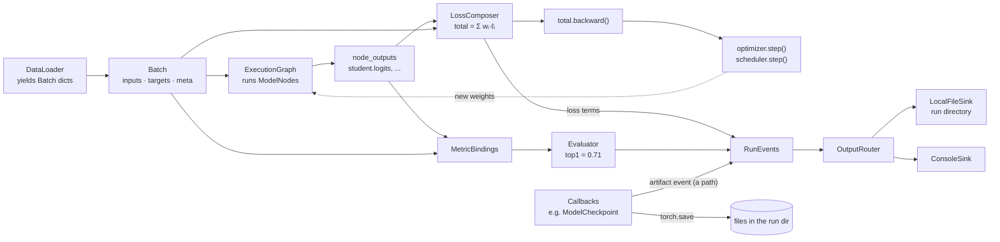
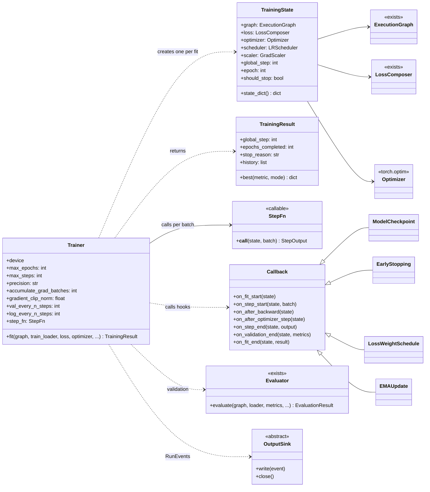
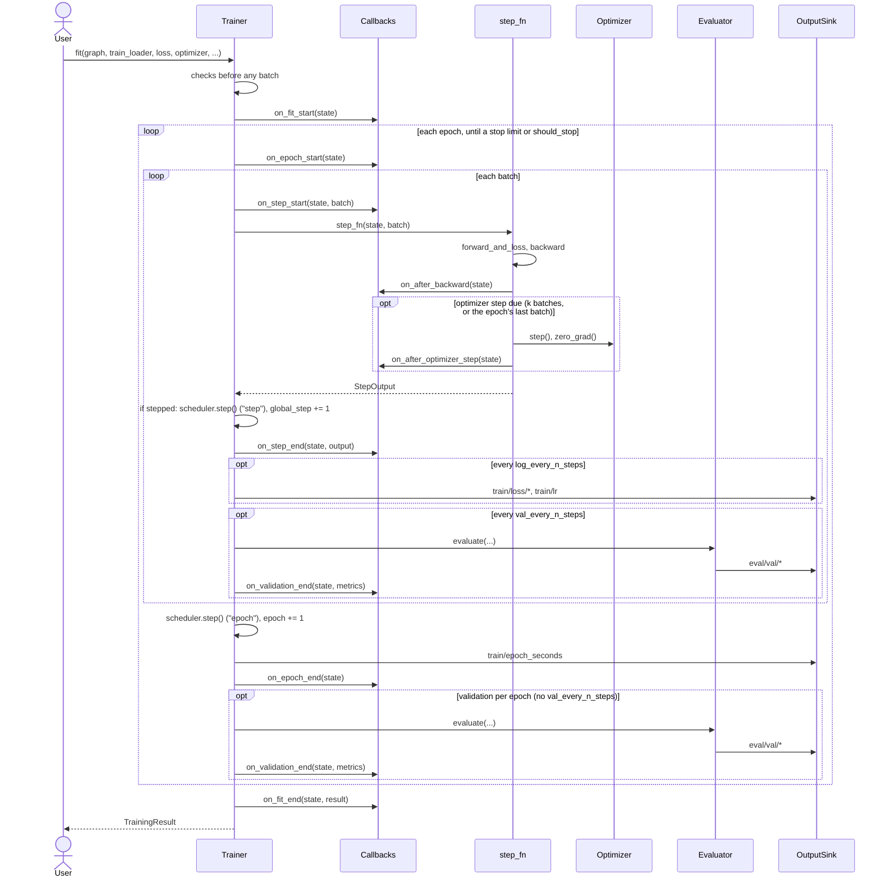
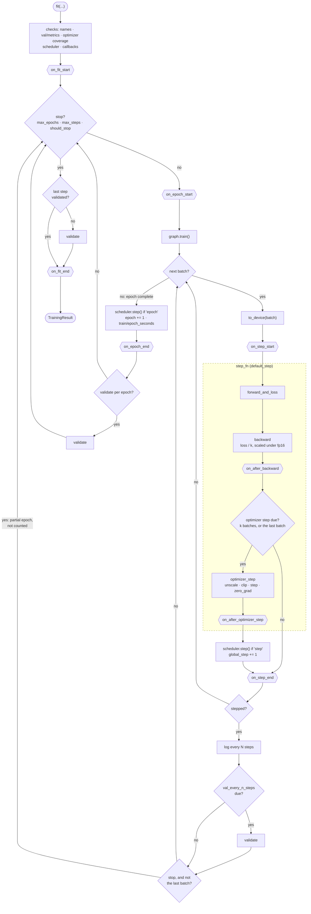
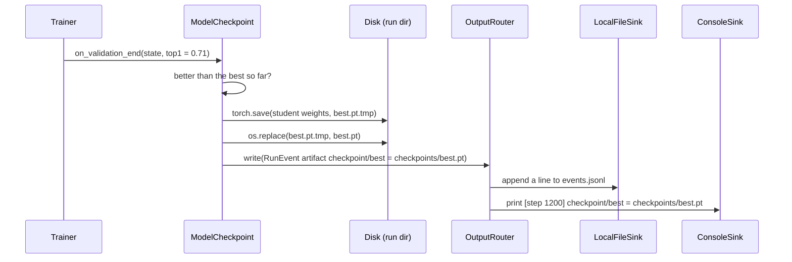
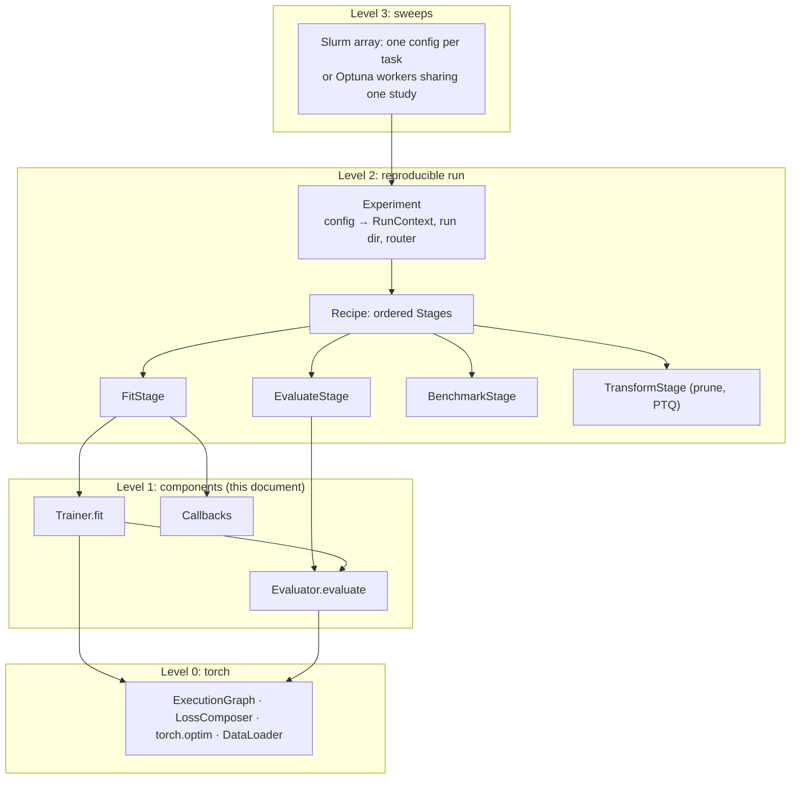
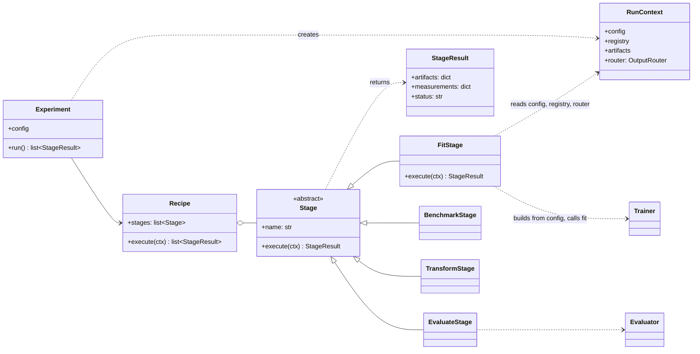

# Trainer: user-facing design

**Status:** implemented in `lwfm/training/`, except resume (§3). The code and its tests
are the reference; this document explains the design and how to use it, and
[`examples/trainer.ipynb`](examples/trainer.ipynb) is a runnable tour. It builds on code that already exists
(`ExecutionGraph`, `LossComposer`, `Evaluator`, `MetricBinding`, `OutputSink`) and on
PLAN.md §3.6 (Trainer), §3.7 (Stages) and D08 (a short plain-PyTorch loop, no Lightning).
The places where it departs from PLAN.md are listed in
[§11](#11-open-decisions-and-departures-from-planmd).

**Focus:** using the `Trainer` on its own (PLAN.md's Level 1: plain Python, no run, no
config). How it plugs into stages and the pipeline comes last, in [§12](#12-future-integration-stages-recipe-and-the-pipeline).

**New to the codebase?** Start with [§0](#0-concepts-you-need-first): it explains the objects the
trainer calls and the vocabulary used throughout. How trained models are saved through the
existing sinks is in [§7](#7-saving-trained-models).

**First user:** [`kd_plan_E0-E3.md`](kd_plan_E0-E3.md), ResNet-50 → ResNet-18 distillation on
Tiny ImageNet. §6.9 holds its schedule rules, §6.10 shows its experiments using this
trainer, and §12.6 covers its proposed higher-level helpers. `lwfm/training` replaces
kd_plan's step 4.

---

## 0. Concepts you need first

The trainer is thin. It calls objects that mostly exist already, in a fixed order, and
keeps the books. This section explains those objects and the vocabulary the rest of the
document uses, in the order data flows through one training step. _(exists)_ means the
object is in `lwfm/` today; _(proposed)_ means it comes from this document.

### 0.1 One picture



The trainer owns the _arrows_: the order of calls, when to validate, when to log, when to
stop. Every _box_ is an object you build and pass in.

### 0.2 Glossary

| Concept                        | What it is                                                                                                          | Why it exists                                                                                  | Status                        |
| ------------------------------ | ------------------------------------------------------------------------------------------------------------------- | ---------------------------------------------------------------------------------------------- | ----------------------------- |
| **Batch**                      | `{"inputs": {...}, "targets": {...}, "meta": {...}}`. Row _i_ of every tensor is sample _i_                         | One format for every task: segmentation adds `targets.mask` and needs no new code              | exists, `core/types.py`       |
| **Name**                       | A dotted string: `inputs.image` (from the batch) or `student.logits` (from a node)                                  | Nodes, losses and metrics say what they read, so a typo fails with the bad name in the message | exists, `core/names.py`       |
| **ModelNode**                  | Wraps an unchanged `nn.Module` and names its inputs and outputs. `frozen=True` makes it a teacher                   | Models stay plain torch: torchvision, timm or your own code drop in                            | exists, `core/graph.py`       |
| **ExecutionGraph**             | Runs nodes in dependency order. `graph(batch)` returns `{name: tensor}`. It is an `nn.Module`                       | One class for one model or many, so KD needs no second loop                                    | exists, `core/graph.py`       |
| **`deployable_model(node)`**   | The node's own module, a plain `nn.Module` sharing the graph's weights                                              | What you save, export and benchmark, with no teachers attached                                 | exists, `core/graph.py`       |
| **LossBinding / LossComposer** | A loss, the names it reads, and its weight. The composer returns `(total, {term: value})`                           | Adding a loss term is one list entry, not a loop edit                                          | exists, `core/losses.py`      |
| **MetricBinding / Evaluator**  | A torchmetrics metric plus the names it reads. The evaluator runs a loader in eval mode and returns `{name: float}` | Validation and the final test share one code path                                              | exists, `evaluation/`         |
| **Optimizer / scheduler**      | Plain `torch.optim`. The optimizer holds references to specific parameters                                          | It is tied to one model's parameters, so it is built fresh for each run                        | torch                         |
| **RunEvent**                   | One small record: `scalar`, `table`, `artifact`, `status` or `message`. It refuses tensors                          | Results are small, JSON-able and timestamped                                                   | exists, `results/events.py`   |
| **OutputSink**                 | A destination for events: `write(event)`, `close()`                                                                 | Code emits results without knowing where they are stored                                       | exists, `results/sinks.py`    |
| **OutputRouter**               | A sink that fans out to several sinks and records the run's final status when its `with` block exits                | One `with` block is one run's lifecycle                                                        | exists, `results/router.py`   |
| **Run directory**              | What `LocalFileSink` writes: `manifest.json`, `status.json`, `events.jsonl`, `summary.json`                         | The canonical, offline record of a run                                                         | exists, `results/sinks.py`    |
| **Artifact**                   | A file the run saved (e.g. weights), recorded by an `artifact` event that holds its path                            | Tensors live in files and records live in events (§7)                                          | event exists; savers proposed |
| **TrainingState**              | The mutable per-`fit` state passed to `step_fn` and every callback                                                  | One place holding everything a hook might need                                                 | proposed                      |
| **Callback**                   | An object with hook methods (`on_validation_end`, ...) called at fixed points                                       | Extends the loop without editing it                                                            | proposed                      |
| **`step_fn`**                  | The function that performs one step: forward, loss, backward, optimizer                                             | Lets you replace what a step computes and keep the rest of the loop                            | proposed                      |

### 0.3 A training step by hand, with the code that exists today

This runs now, on CPU. It is everything the trainer's default step does, written out by
hand, so the rest of this document reads as "the same, plus bookkeeping".

```python
import torch
from torch import nn

from lwfm.core.graph import ExecutionGraph, ModelNode
from lwfm.core.losses import LossBinding, LossComposer
from lwfm.results.events import RunEvent
from lwfm.results.sinks import ConsoleSink

# A Batch is a dict of groups. Row i of every tensor in "inputs" and "targets" is sample i.
batch = {
    "inputs": {"image": torch.rand(8, 3, 32, 32)},  # [B, C, H, W], values in [0, 1]
    "targets": {"class": torch.randint(0, 10, (8,))},  # [B] integer class ids
    "meta": {"sample_id": [f"img_{i}" for i in range(8)]},  # non-tensors are fine here
}

# A node wraps an ordinary module and names what it reads and what it writes.
student = ModelNode(
    "student",
    nn.Sequential(nn.Flatten(), nn.Linear(3 * 32 * 32, 10)),  # any nn.Module, unchanged
    inputs="inputs.image",
    outputs="logits",  # published as "student.logits"
)

# Passing a sample batch checks the wiring and the shapes now, not at step 1000.
graph = ExecutionGraph([student], preflight_sample=batch)
print(graph.preflight_output_shapes)  # {'student.logits': (8, 10)}

# A loss reads values by name, in argument order: CrossEntropyLoss(input, target).
loss = LossComposer(
    [LossBinding("ce", nn.CrossEntropyLoss(), ["student.logits", "targets.class"])]
)
optimizer = torch.optim.SGD(graph.parameters(), lr=0.1)

# ---- one training step: this is what the trainer's default_step does ----
graph.train()
node_outputs = graph(batch)  # {'student.logits': tensor of shape [8, 10]}
total, terms = loss(
    batch, node_outputs
)  # total keeps its grad; terms are detached copies
optimizer.zero_grad()
total.backward()
optimizer.step()
# ---------------------------------------------------------------------------

# Logging is a RunEvent sent to a sink. The trainer does this every log_every_n_steps.
sink = ConsoleSink()
for name, term in terms.items():
    sink.write(RunEvent("scalar", f"train/loss/{name}", term, step=0))
sink.write(RunEvent("scalar", "train/loss/total", total.detach(), step=0))
# [step 0] train/loss/ce = 2.31        (≈ ln 10 for an untrained 10-class model)
# [step 0] train/loss/total = 2.31
```

What the trainer adds on top: the loops over batches and epochs, device moves, validation,
logging intervals, stop limits, callbacks and the checks that run before the first batch.

### 0.4 Steps, epochs and accumulation

| Term            | Meaning                                                                       |
| --------------- | ----------------------------------------------------------------------------- |
| **micro-step**  | One batch through `step_fn`                                                   |
| **global step** | One optimizer update. With accumulation over _k_ batches, = micro-steps / _k_ |
| **epoch**       | One full pass over `train_loader`                                             |

- The effective batch size is $B \cdot k$.
- `max_steps`, `log_every_n_steps` and `val_every_n_steps` all count **global** steps, as
  does `TrainingResult.global_step`.
- A leftover partial accumulation group at the end of an epoch is still stepped, so
  gradients never carry over into the next epoch. Like every batch, its loss is divided
  by k, so a partial group counts slightly less. Steps per epoch are therefore
  $\lceil \text{len(train\_loader)} / k \rceil$. Use that value when sizing a per-step
  scheduler: `T_max = max_epochs * ceil(len(train_loader) / k)`.

### 0.5 Train and eval modes, and gradient contexts

These are easy to mix up, and they decide whether KD is correct:

| Switch                   | Effect                                                             | Who uses it                                                        |
| ------------------------ | ------------------------------------------------------------------ | ------------------------------------------------------------------ |
| `graph.train()`          | Dropout on; BatchNorm updates its running statistics               | the trainer, before each training phase. Frozen nodes stay in eval |
| `graph.eval()`           | Dropout off; BatchNorm uses its stored statistics                  | the `Evaluator`, which restores the previous mode afterwards       |
| `torch.no_grad()`        | No graph is recorded. Outputs can still feed another tensor's loss | frozen teacher nodes                                               |
| `torch.inference_mode()` | Faster than `no_grad`, but its outputs can never enter autograd    | the `Evaluator` only. Never for teacher outputs that feed a loss   |

### 0.6 Events, sinks and the life of a run

```python
from lwfm.results.router import OutputRouter
from lwfm.results.sinks import ConsoleSink, LocalFileSink

with OutputRouter(
    LocalFileSink("runs/demo", manifest_fields={"lr": 0.1}), ConsoleSink()
) as sink:
    # Creating LocalFileSink has already written manifest.json and status.json = "running".
    sink.write(
        RunEvent("scalar", "train/loss/total", 2.31, step=0)
    )  # → events.jsonl + console
    ...  # fit(...) goes here
# On leaving the block: status.json becomes "completed" (or "failed" with the traceback, or
# "interrupted"), summary.json is written, and every sink is closed.
```

The rules the trainer relies on:

- **Computing code only calls `sink.write(event)`.** The trainer and evaluator never know
  whether the destination is a file, the console or (later) MLflow. A new destination is a
  new sink, not a trainer change.
- **`output_sink=None` writes nothing.** Notebooks and tests leave no files behind.
- **The router owns the run's lifecycle.** That is why `fit` is called _inside_ the
  `with`: if `fit` raises, the run is recorded as failed, with its traceback.
- **A sink failure raises `SinkError`.** A run never looks successful when its results
  weren't stored.
- **Event names:** `train/loss/<term>`, `train/loss/total`, `train/lr`,
  `train/epoch_seconds`, `eval/<split>/<metric>`, and, for saved files, `checkpoint/best`, `checkpoint/last`
  and `model/<node>` (§7).

---

## 1. What the Trainer is, and what it isn't

The trainer turns **(graph, data, loss, optimizer)** into a trained graph. It owns the
bookkeeping around a training step, and nothing about _which technique_ is used:

| The trainer does                                                    | The trainer does not                                     |
| ------------------------------------------------------------------- | -------------------------------------------------------- |
| move batches and modules to the device                              | build models, losses or optimizers                       |
| `graph.train()`, forward, loss, backward, optimizer step, zero-grad | know whether a teacher exists (frozen nodes handle that) |
| count steps and epochs, and stop at a limit                         | create run directories, read YAML or launch Slurm        |
| validate through `Evaluator`                                        | choose the "best" metric (callbacks do)                  |
| emit `RunEvent`s to an `OutputSink`, if one is given                | save checkpoints by default (a callback, or `FitStage`)  |
| call callbacks at fixed hook points                                 | change the graph's wiring                                |

**The split between the constructor and `fit`:**

- `Trainer(...)` holds the **loop policy**: device, stop limits, precision, accumulation,
  clipping, how often to validate and log, and the step function. It holds no per-run
  state, so one trainer can be reused for many runs (grid search, tuning).
- `fit(...)` takes the **objects for one run**: graph, loaders, loss, optimizer,
  scheduler, metrics, callbacks and sink. These carry state (weights, optimizer momentum,
  early-stopping counters), so they are fresh for each run.

_Why:_ a grid search reuses one policy across many models. A `FitStage` can also build
the trainer straight from a `trainer:` config block (§12).

---

## 2. User-facing features

Status: **done** means implemented in `lwfm/training`; **later** means not yet built.

| #   | Feature                                                     | What the user gets                                                                                                                           | Status     |
| --- | ----------------------------------------------------------- | -------------------------------------------------------------------------------------------------------------------------------------------- | ---------- |
| F1  | Train any `ExecutionGraph` with any `torch.optim.Optimizer` | SGD, AdamW or a custom optimizer, passed in already built. The trainer never constructs one.                                                 | done       |
| F2  | Stop limits: `max_epochs`, `max_steps`                      | `max_steps=5` gives a smoke run. If both are set, training stops at whichever comes first.                                                   | done       |
| F3  | Device handling                                             | Moves the graph and loss modules to `device`, and each batch with `to_device`. Non-tensor `meta` values are kept.                            | done       |
| F4  | Validation through `Evaluator`                              | Once per epoch, or every `val_every_n_steps`. Logged as `eval/val/<metric>` and passed to callbacks.                                         | done       |
| F5  | Structured logging                                          | `train/loss/<term>`, `train/loss/total` and `train/lr` every `log_every_n_steps`, plus `train/epoch_seconds` (F19). Silent without a sink.                                     | done       |
| F6  | Reproducibility helper                                      | `seed_everything(seed)` for Python, NumPy and torch. Call it before building the model, because weight init needs it.                        | done       |
| F7  | Fail-fast checks before the first batch                     | Typos in loss or metric names; `val_loader` without `metrics`; scheduler misuse; misspelled callback hooks; no stop limit.                                     | done       |
| F8  | Optimizer coverage check                                    | Raises if a trainable parameter of the graph or loss is missing from the optimizer, e.g. a forgotten KD projector.                           | done       |
| F9  | LR schedulers                                               | `scheduler=` with a required `scheduler_interval`: `"step"`, `"epoch"`, or `"validation"` for `ReduceLROnPlateau` (with `scheduler_monitor`).                              | done       |
| F10 | Callbacks at fixed hook points                              | Watch or react without editing the loop: schedules, EMA teachers, pruning masks, early stopping.                                             | done       |
| F11 | Built-in callbacks                                          | `ModelCheckpoint` (saves models, §7), `EarlyStopping`, `LossWeightSchedule`, `EMAUpdate`.                                                    | done       |
| F12 | Mixed precision                                             | `precision="bf16"` or `"fp16"`. The trainer handles autocast, and a `GradScaler` for fp16. FP32 is the default.                              | done       |
| F13 | Gradient accumulation and clipping                          | `accumulate_grad_batches=k` gives a k× effective batch size. `gradient_clip_norm=1.0` clips the gradient norm.                               | done       |
| F14 | Replaceable step function                                   | `step_fn=` replaces forward → loss → backward → step (e.g. SAM), while keeping logging, validation and callbacks.                            | done       |
| F15 | `TrainingResult`                                            | `global_step`, `epochs_completed`, `stop_reason`, the full validation `history`, and `best("top1")`.                                         | done       |
| F16 | Clean interrupt                                             | Ctrl-C stops after the current step and runs `on_fit_end` (so "last" can be saved), then re-raises so `OutputRouter` records `interrupted`.  | done       |
| F17 | Resume                                                      | `resume_from=` restores the graph, optimizer, scheduler, scaler, step, epoch, RNG and callback state.                                        | later      |
| F18 | Teacher-agnostic                                            | Frozen `ModelNode`s stay frozen and in eval mode through `graph.train()`. One teacher, several teachers or none: the `fit` call is the same. | done       |
| F19 | Epoch timing | `train/epoch_seconds` after each full epoch: the training-cost column in kd_plan's E2 table. | done       |

---

## 3. API

**Implemented** in `lwfm/training/`: everything in §2 except resume (F17). The code and
its tests are the reference; this section summarises them. For a runnable tour, see
[`examples/trainer.ipynb`](examples/trainer.ipynb).

| File           | Contents                                                                                                            |
| -------------- | ------------------------------------------------------------------------------------------------------------------- |
| `trainer.py`   | `Trainer`; the checks run before training (`check_reads`, `check_validation`, `check_optimizer`, `check_scheduler`) |
| `state.py`     | `TrainingState`, `StepOutput`, `TrainingResult`, and the `Precision`, `SchedulerInterval`, `StopReason` types       |
| `steps.py`     | `default_step`, and the helpers it is built from: `forward_and_loss`, `backward`, `optimizer_step`                  |
| `callbacks.py` | `Callback` and its `HOOKS`; `LossWeightSchedule`, `EarlyStopping`, `ModelCheckpoint`, `EMAUpdate`                   |
| `seed.py`      | `seed_everything`                                                                                                   |

Everyday imports: `from lwfm.training import Trainer, Callback, seed_everything`.

```python
class Trainer:
    def __init__(
        self,
        *,
        device: torch.device | str,  # required: no silent CPU fallback
        max_epochs: int | None = None,  # at least one limit is required
        max_steps: int | None = None,  # counts optimizer steps, not batches
        precision: Literal["fp32", "bf16", "fp16"] = "fp32",
        accumulate_grad_batches: int = 1,
        gradient_clip_norm: float | None = None,
        val_every_n_steps: int | None = None,  # None: validate after every epoch
        log_every_n_steps: int = 50,
        step_fn: StepFn = default_step,
    ): ...

    def fit(
        self,
        graph: ExecutionGraph,
        train_loader: Iterable[Batch],
        loss: LossComposer,
        optimizer: torch.optim.Optimizer,
        *,
        val_loader: Iterable[Batch] | None = None,  # given together with metrics
        metrics: Sequence[MetricBinding] = (),
        scheduler: LRScheduler | ReduceLROnPlateau | None = None,
        # Required with a scheduler: "step", "epoch", or "validation" (plateau only)
        scheduler_interval: Literal["step", "epoch", "validation"] | None = None,
        scheduler_monitor: str | None = None,  # the metric name, for "validation"
        callbacks: Sequence[Callback] = (),
        output_sink: OutputSink | None = None,
    ) -> TrainingResult: ...
```

| Object           | Holds                                                                                                                                                                                                                                  |
| ---------------- | -------------------------------------------------------------------------------------------------------------------------------------------------------------------------------------------------------------------------------------- |
| `TrainingState`  | the run's objects (graph, loss, optimizer, scheduler, grad scaler, sink, callbacks), the loop settings, counters (`global_step`, `epoch`, `accumulated`, `is_last_batch`), `last_val_metrics`, `should_stop`; `state_dict()` for `last.pt` |
| `StepOutput`     | `total_loss` and `loss_terms`, both detached                                                                                                                                                                                           |
| `TrainingResult` | `global_step`, `epochs_completed`, `stop_reason`, `history` (every validation); `best(metric, mode)`                                                                                                                                   |

**Who does what.** `step_fn` does the maths of one batch: forward, loss, backward, and
an optimizer step when one is due. The loop does everything around it: counting,
scheduling, logging, validation and stopping. So a replacement step can't break any of
those.

**Why the helpers fire the hooks:** a custom step that calls `backward` and
`optimizer_step` keeps AMP, accumulation, clipping and the `on_after_*` callbacks for free.
A step that calls `.backward()` itself opts out of them on purpose, and in plain view.

### 3.1 Behaviour in detail

- **Counting.** `global_step` counts optimizer steps; with `accumulate_grad_batches=k`,
  one step is k batches. `max_steps`, `log_every_n_steps` and `val_every_n_steps` all
  count optimizer steps. An epoch counts only once the loader is exhausted.
- **Accumulation.** Each batch's loss is divided by k. An optimizer step happens every k
  batches, and at the end of every epoch, so gradients never cross epochs. The final
  partial group is divided by k too, so it counts slightly less.
- **Stopping.** The stop conditions (`max_epochs`, `max_steps`, `state.should_stop`) are
  checked only at optimizer steps, so no half-accumulated gradient is dropped. Reaching
  `max_steps` exactly at the end of an epoch still counts that epoch.
- **Validation.** It runs after every epoch, or every `val_every_n_steps`. If the last
  step wasn't validated (a stop mid-epoch, or a step count that isn't a multiple), it runs
  once more, so every run ends on a validation result.
- **Schedulers.** `scheduler_interval` is required with a scheduler.
  - `"step"`: after each optimizer step, including an epoch's partial final group. So
    size a per-step schedule as `max_epochs * ceil(len(train_loader) / k)`.
  - `"epoch"`: after each complete epoch.
  - `"validation"`: `ReduceLROnPlateau` only, called with `metrics[scheduler_monitor]`
    after each validation.

  The scheduler must be built on the optimizer passed to `fit`.
- **Precision.** `"bf16"` and `"fp16"` autocast the forward pass and the loss, while the
  weights stay fp32. `"fp16"` also uses a fresh `GradScaler` for each fit, and unscales
  the gradients before clipping.
- **Custom steps.** With `"fp16"` or k > 1, a `step_fn` that never calls
  `steps.backward` is refused after its first batch, because its gradients would be
  silently wrong.
- **Logging.** Every `log_every_n_steps` optimizer steps, the trainer logs
  `train/loss/<term>`, `train/loss/total` (for the batch that completed the step) and
  `train/lr` (`train/lr/<i>` with several parameter groups). After each complete epoch
  it logs `train/epoch_seconds`, which includes data loading but not validation. The
  `Evaluator` logs `eval/val/<metric>`.
- **Checks before the first batch:**
  - binding names;
  - `val_loader` and `metrics` given together;
  - every trainable parameter in the optimizer;
  - the scheduler: its interval, its optimizer, and the plateau/`"validation"` pairing
    with its monitor;
  - callbacks are `Callback` instances with no unknown `on_*` methods.

  Built-in callbacks also check their own settings in `on_fit_start`: that the metric
  they monitor exists, the node they save exists, the binding they schedule exists, and
  the EMA source and target shapes match.
- **Ctrl-C.** It runs `on_fit_end` with `stop_reason="interrupted"`, then re-raises, so
  `OutputRouter` records the run as interrupted. Any other exception propagates without
  calling `on_fit_end`.

### 3.2 Decisions taken while implementing

| Question                                 | Decision                                                    | Why                                                                                           |
| ---------------------------------------- | ----------------------------------------------------------- | --------------------------------------------------------------------------------------------- |
| Scope                                    | everything in §2 except resume                              | Resume needs decisions about RNG, sampler and callback state. `last.pt` already holds the training state it will need |
| `scheduler_interval` default             | none: required whenever a scheduler is given                | Per step and per epoch differ by a factor of the epoch length. A default would silently change behaviour when code is ported |
| `ReduceLROnPlateau`                      | `scheduler_interval="validation"` plus `scheduler_monitor`  | It needs a metric. The pairing is checked before training                                     |
| Misspelled hooks                         | `fit` raises, naming the method                             | No-op default hooks would otherwise hide them                                                 |
| Partial accumulation group               | stepped at epoch end, scaled by 1/k                         | Gradients never cross epochs, and it works for loaders without `len()`                        |
| `last.pt`                                | the full `TrainingState.state_dict()`                       | Resume can read it later without a format change                                              |
| Custom step with fp16 or accumulation    | refused if `steps.backward` wasn't used                     | Otherwise the gradients are silently wrong                                                    |
| `ModelCheckpoint(monitor=None)` default  | `last.pt` only, unless a monitor is given                   | Fixed-schedule comparisons keep final weights, not a best epoch (§6.9)                        |

### 3.3 Tests

The tests are `tests/unit/test_trainer.py`, `test_training_steps.py` and
`test_training_callbacks.py`, and they run on CPU in a few seconds:

- **Loop:**
  - overfits one batch;
  - gives bit-identical weights to the hand-written loop in §0.3;
  - counts epochs, validates once per epoch, and writes every event name;
  - fires the hooks in their exact order;
  - counts the epoch when `max_steps` lands on an epoch boundary;
  - validates after a stop mid-epoch, but doesn't count the partial epoch;
  - honours `val_every_n_steps`, with a final validation;
  - keeps a frozen teacher in eval mode and unchanged;
  - logs the learning rate of each parameter group.
- **Schedulers:**
  - stepped per step, per epoch, and on a monitored metric (plateau);
  - six kinds of misuse, all rejected before training.
- **Checks:** a misspelled binding name, a projector missing from the optimizer, the
  `val_loader`/`metrics` pairing, an empty loader, invalid settings, a misspelled hook,
  and a non-callback.
- **Stopping:** `should_stop` ends the run; Ctrl-C runs `on_fit_end`, then re-raises.
- **Steps:**
  - accumulation steps 2, 2, 1 per 5-batch epoch;
  - accumulating two halves equals one full batch;
  - clipping bounds the update;
  - bf16 autocasts the forward pass;
  - fp16 uses a grad scaler;
  - custom steps are refused under fp16 or accumulation.
- **Callbacks:**
  - `LossWeightSchedule`: the ramp, and an unknown binding name;
  - `EarlyStopping`: patience, `min_delta`, and monitor checks;
  - `ModelCheckpoint`: best saved only on improvement, relative artifact paths, a strict
    reload, a full `last.pt`, and an end-to-end run;
  - `EMAUpdate`: the exact update, the buffer copy, and shape and momentum checks.

---

## 4. Diagrams

### 4.1 Classes



### 4.2 One `fit` call



### 4.3 The loop and its customisation points

Hexagons are callback hooks. The dashed box is what `step_fn` replaces. Each "validate"
box runs `Evaluator.evaluate` (which logs `eval/val/*`), then `scheduler.step(metric)` if
the interval is `"validation"`, then `on_validation_end`. Validation boxes appear only
when a `val_loader` is given.



`on_epoch_end` fires before the per-epoch `on_validation_end`, so a callback that needs
this epoch's metrics belongs in `on_validation_end`. Ctrl-C anywhere runs `on_fit_end`
with `stop_reason="interrupted"`, then re-raises.

---

## 5. How to customise the loop

There are four levels. Use the lowest one that does the job:

| Need                                            | Mechanism                                           | Example                                    |
| ----------------------------------------------- | --------------------------------------------------- | ------------------------------------------ |
| change a number or a switch                     | a `Trainer(...)` / `fit(...)` argument              | epochs, AMP, clipping, scheduler           |
| watch the run, or change state at a known point | a `Callback`                                        | KD-weight warm-up, EMA teacher, early stop |
| change what one step computes                   | `step_fn=`                                          | SAM, several optimizers, two-pass losses   |
| change the loop itself                          | your own loop, with the building blocks and helpers | research code that fits none of the above  |

_Why not subclass `Trainer`:_ PLAN.md §1, "combine objects; don't subclass per
combination". A KD subclass and an AMP subclass don't compose. A KD loss binding, an
`EMAUpdate` callback and `precision="bf16"` do.

---

## 6. Examples

Shared setup, used by every example below. Batches follow the existing `Batch` format:
`{"inputs": {"image": ...}, "targets": {"class": ...}}`.

```python
import torch
import torch.nn.functional as F
from torch import nn
from torchmetrics.classification import MulticlassAccuracy
from torchvision.models import resnet18, resnet50
from torchvision.transforms import v2

from lwfm.core.graph import ExecutionGraph, ModelNode
from lwfm.core.losses import LossBinding, LossComposer
from lwfm.evaluation.metrics import MetricBinding
from lwfm.training import Trainer, seed_everything  # proposed
from lwfm.training.callbacks import Callback, ModelCheckpoint  # proposed

NUM_CLASSES = 100
MEAN, STD = (0.485, 0.456, 0.406), (0.229, 0.224, 0.225)

# Names are written once, as constants. A typo in one fails at fit() (F7), not at step 1000.
CE_READS = ["student.logits", "targets.class"]  # CrossEntropyLoss(input, target)
KD_READS = ["student.logits", "teacher.logits"]  # KDLoss(student, teacher)


def make_student() -> ModelNode:
    # Normalisation lives inside the model's Sequential, so the deployed model carries it
    # with it (PLAN.md §3.2): training and inference preprocessing can't drift apart.
    return ModelNode(
        "student",
        nn.Sequential(v2.Normalize(MEAN, STD), resnet18(num_classes=NUM_CLASSES)),
        inputs="inputs.image",
        outputs="logits",  # published as "student.logits"
    )


# Metrics are bound to names in the same way as losses. Evaluator resets them before every
# validation, so the same list can be shared across runs.
metrics = [
    MetricBinding(
        f"top{k}", MulticlassAccuracy(NUM_CLASSES, top_k=k, average="micro"), CE_READS
    )
    for k in (1, 5)
]

# train_loader / val_loader: any iterable of Batch dicts, e.g. a DataModule's loaders.
```

### 6.1 The simplest case: one model, plain SGD

**Pure PyTorch**

```python
model = resnet18(num_classes=NUM_CLASSES).to("cuda")
optimizer = torch.optim.SGD(model.parameters(), lr=0.1, momentum=0.9)
criterion = nn.CrossEntropyLoss()

for epoch in range(10):
    model.train()
    for images, labels in train_loader:
        images, labels = images.to("cuda"), labels.to("cuda")
        loss = criterion(model(images), labels)
        optimizer.zero_grad()
        loss.backward()
        optimizer.step()
```

**With the Trainer**

```python
seed_everything(0)  # before building: weight init draws from the RNG
student = make_student()
graph = ExecutionGraph([student])  # a single model is a one-node graph

# A one-term LossComposer. Adding KD later is one more list entry, not a new loop.
loss = LossComposer([LossBinding("ce", nn.CrossEntropyLoss(), CE_READS)])

# The optimizer is plain torch.optim, built by the user. The trainer never chooses one, so
# any optimizer (or optimizer config) works without the trainer knowing about it.
optimizer = torch.optim.SGD(graph.parameters(), lr=0.1, momentum=0.9)

result = Trainer(device="cuda", max_epochs=10).fit(graph, train_loader, loss, optimizer)
print(result.global_step, result.stop_reason)  # e.g. 3910 "max_epochs"

# The trained model is still a plain nn.Module, sharing the graph's weights.
deployable = graph.deployable_model("student")
```

**Comparison.** In this case the two are about the same length. That is intended: the
trainer must cost nothing in the simple case. The gap opens as soon as validation,
logging and a teacher are added (6.2, 6.3), and those additions leave this `fit` call
unchanged.

### 6.2 A realistic single-model run: validation, scheduler, logging, checkpoints

**Pure PyTorch:** the second loop, the logging and the "best" bookkeeping are all written
by hand, and again in every script.

```python
scheduler = torch.optim.lr_scheduler.CosineAnnealingLR(
    optimizer, T_max=90 * len(train_loader)
)
best_top1 = 0.0
for epoch in range(90):
    model.train()
    for step, (images, labels) in enumerate(train_loader):
        images, labels = (
            images.to("cuda", non_blocking=True),
            labels.to("cuda", non_blocking=True),
        )
        loss = criterion(model(images), labels)
        optimizer.zero_grad()
        loss.backward()
        optimizer.step()
        scheduler.step()
        if step % 50 == 0:
            print(f"epoch {epoch} step {step} loss {loss.item():.4f}")  # ad-hoc format

    model.eval()  # pitfall: forget this and BN/dropout leak into val
    correct = total = 0
    with torch.inference_mode():
        for images, labels in val_loader:
            images, labels = images.to("cuda"), labels.to("cuda")
            correct += (model(images).argmax(1) == labels).sum().item()
            total += labels.numel()
    top1 = correct / total
    if top1 > best_top1:
        best_top1 = top1
        torch.save(model.state_dict(), "best.pt")
```

**With the Trainer**

```python
from lwfm.results.router import OutputRouter
from lwfm.results.sinks import ConsoleSink, LocalFileSink

trainer = Trainer(
    device="cuda",
    max_epochs=90,
    log_every_n_steps=50,  # how often train/loss/* and train/lr are written
)

scheduler = torch.optim.lr_scheduler.CosineAnnealingLR(
    optimizer, T_max=90 * len(train_loader)
)

# The router fans events out to every sink, and records completed/failed/interrupted when
# the `with` block exits. The trainer only ever calls sink.write(event).
with OutputRouter(LocalFileSink("runs/r18"), ConsoleSink()) as sink:
    result = trainer.fit(
        graph,
        train_loader,
        loss,
        optimizer,
        val_loader=val_loader,
        metrics=metrics,  # top1 and top5, via the existing Evaluator
        scheduler=scheduler,
        scheduler_interval="step",  # T_max above counts steps, so step it per step
        callbacks=[
            # "Best" is a callback's decision, not the trainer's: only the callback knows
            # which metric matters and in which direction.
            ModelCheckpoint("runs/r18", node="student", monitor="top1", mode="max"),
        ],
        output_sink=sink,
    )

print(result.best("top1"))  # {"top1": 0.71, "top5": 0.90, "step": 351900}
```

Here `ModelCheckpoint` saves `graph.deployable_model("student").state_dict()`, the
student alone and never the teachers, as `checkpoints/best.pt`, and emits an `artifact`
event with its path. §7 explains how saving fits the existing sink design.

### 6.3 Distillation: one frozen teacher

**Pure PyTorch:** every line marked `pitfall` is a known way to get KD silently wrong.

```python
teacher = resnet50(num_classes=NUM_CLASSES)
teacher.load_state_dict(torch.load("teacher.pt", weights_only=True))
teacher = teacher.to("cuda").eval().requires_grad_(False)

student = resnet18(num_classes=NUM_CLASSES).to("cuda")
optimizer = torch.optim.SGD(student.parameters(), lr=0.1, momentum=0.9)
ce, T, alpha = nn.CrossEntropyLoss(), 4.0, 0.5
resize_t, norm = v2.Resize((224, 224), antialias=True), v2.Normalize(MEAN, STD)

for epoch in range(epochs):
    student.train()  # pitfall: a shared .train() would wake the teacher's BN/dropout
    for images, labels in train_loader:
        images, labels = images.to("cuda"), labels.to("cuda")
        with (
            torch.no_grad()
        ):  # pitfall: inference_mode() tensors can't be saved for backward
            t_logits = teacher(norm(resize_t(images)))
        s_logits = student(norm(images))
        loss_ce = ce(s_logits, labels)
        loss_kd = (
            F.kl_div(
                F.log_softmax(s_logits / T, -1),
                F.log_softmax(t_logits / T, -1),
                log_target=True,
                reduction="batchmean",
            )
            * T**2
        )
        loss = (1 - alpha) * loss_ce + alpha * loss_kd
        optimizer.zero_grad()
        loss.backward()
        optimizer.step()
        # ...then logging each term, validation and checkpoints, as in 6.2, written again
```

**With the Trainer:** the KD-specific code is a node and a loss binding. The `fit` call
is the one from 6.2.

```python
class KDLoss(nn.Module):
    """T^2 · KL(softmax(z_t/T) || softmax(z_s/T))."""

    def __init__(self, temperature: float = 4.0):
        super().__init__()
        self.t = temperature

    def forward(self, student: torch.Tensor, teacher: torch.Tensor) -> torch.Tensor:
        s = F.log_softmax(student / self.t, dim=-1)
        t = F.log_softmax(teacher / self.t, dim=-1)
        return F.kl_div(s, t, log_target=True, reduction="batchmean") * self.t**2


teacher_net = resnet50(num_classes=NUM_CLASSES)
teacher_net.load_state_dict(torch.load("teacher.pt", weights_only=True))

# frozen=True is the whole "teacher" concept. The node sets requires_grad=False, stays in
# eval mode through graph.train(), and runs under no_grad. The trainer needs no special case.
teacher = ModelNode(
    "teacher",
    nn.Sequential(
        v2.Resize((224, 224), antialias=True), v2.Normalize(MEAN, STD), teacher_net
    ),
    inputs="inputs.image",  # the same view as the student; each node resizes for itself
    outputs="logits",  # "teacher.logits"
    frozen=True,
)

student = make_student()
graph = ExecutionGraph([student, teacher])  # same class as 6.1, now with two nodes

loss = LossComposer(
    [
        LossBinding("ce", nn.CrossEntropyLoss(), CE_READS, weight=0.5),
        LossBinding("kd", KDLoss(temperature=4.0), KD_READS, weight=0.5),
    ]
)

# Only the student is optimized. Passing graph.parameters() would also work (frozen
# parameters get no grad and SGD skips them), but naming the student states the intent.
optimizer = torch.optim.SGD(student.parameters(), lr=0.1, momentum=0.9)

trainer = Trainer(
    device="cuda", max_epochs=epochs, precision="bf16", gradient_clip_norm=1.0
)
with OutputRouter(LocalFileSink("runs/kd"), ConsoleSink()) as sink:
    result = trainer.fit(
        graph,
        train_loader,
        loss,
        optimizer,
        val_loader=val_loader,
        metrics=metrics,
        output_sink=sink,
        callbacks=[ModelCheckpoint("runs/kd", node="student", monitor="top1")],
    )
# The sink receives train/loss/ce, train/loss/kd and train/loss/total separately, for free,
# because LossComposer already returns each term by name.
```

**What the trainer adds here that the pure loop doesn't:**

- **Optimizer coverage (F8).** Suppose a feature-KD projector node is added later but
  left out of the optimizer. `fit` raises before the first batch and names the missing
  parameters. In the pure loop, the projector silently stays at its random init.
- **Name checks (F7).** Mistype `"teacher.logit"` in `KD_READS` and `fit` fails at once,
  listing the outputs that do exist.
- **Precision and clipping** are arguments. In the pure loop, adding fp16 means writing
  autocast, a `GradScaler` and an unscale-before-clip, in the right order.

### 6.4 Several teachers, with a KD warm-up schedule (callback)

A second teacher is a second node and a second binding. A schedule that changes a loss
weight during training is a callback, because it acts _at a point in time_, not on the
values.

```python
from lwfm.training.callbacks import LossWeightSchedule

vit = ModelNode(
    "vit", vit_teacher_module, inputs="inputs.image", outputs="logits", frozen=True
)
cnn = ModelNode(
    "cnn", cnn_teacher_module, inputs="inputs.image", outputs="logits", frozen=True
)
graph = ExecutionGraph([make_student(), vit, cnn])

loss = LossComposer(
    [
        LossBinding("ce", nn.CrossEntropyLoss(), CE_READS, weight=1.0),
        # Each teacher gets its own named binding, so each is logged and weighted separately.
        LossBinding(
            "kd_vit", KDLoss(4.0), ["student.logits", "vit.logits"], weight=0.0
        ),
        LossBinding(
            "kd_cnn", KDLoss(4.0), ["student.logits", "cnn.logits"], weight=0.0
        ),
    ]
)

# Ramp both KD weights from 0 to 0.5 over the first 2000 steps, so the student first learns
# from labels, then increasingly from the teachers.
warmup = lambda step: 0.5 * min(1.0, step / 2000)
callbacks = [LossWeightSchedule("kd_vit", warmup), LossWeightSchedule("kd_cnn", warmup)]

trainer.fit(
    graph,
    train_loader,
    loss,
    optimizer,
    val_loader=val_loader,
    metrics=metrics,
    callbacks=callbacks,
)
```

`LossWeightSchedule` shows how small a callback is (from `lwfm/training/callbacks.py`):

```python
class LossWeightSchedule(Callback):
    def __init__(self, binding_name: str, schedule: Callable[[int], float]):
        self.binding_name, self.schedule = binding_name, schedule

    def on_fit_start(self, state):
        # Fails before training if no binding has this name
        names = [binding.name for binding in state.loss.loss_bindings]
        if self.binding_name not in names:
            raise ValueError(f"no loss binding named {self.binding_name!r}: {names}")
        self.binding = state.loss.loss_bindings[names.index(self.binding_name)]

    def on_step_start(self, state, batch):
        # Changing a binding's float weight is safe: LossComposer reads it on every call
        self.binding.weight = self.schedule(state.global_step)
```

### 6.5 Self-distillation with an EMA teacher (DINO-style), as a callback

The teacher is a copy of the student whose weights follow an exponential moving average
of the student's: $\theta_t \leftarrow m\,\theta_t + (1-m)\,\theta_s$. That is "change
the weights right after each optimizer step": the `on_after_optimizer_step` hook.

```python
import copy

from lwfm.training.callbacks import EMAUpdate

student = make_student()
# frozen=True: no gradients and no optimizer entry. The EMA callback is the only thing that
# changes the teacher's weights.
teacher = ModelNode(
    "teacher",
    copy.deepcopy(student.module),
    inputs="inputs.global_crops",
    outputs="logits",
    frozen=True,
)
# Multi-crop is a data and wiring choice, not a trainer feature: the teacher reads global
# crops, the student reads all crops (CLAUDE.md, preprocessing).
graph = ExecutionGraph([student, teacher])

callbacks = [EMAUpdate(source="student", target="teacher", momentum=0.996)]
trainer.fit(graph, train_loader, dino_loss, optimizer, callbacks=callbacks)
```

```python
class EMAUpdate(Callback):
    def __init__(self, source: str, target: str, momentum: float):
        self.source, self.target, self.m = source, target, momentum

    @torch.no_grad()
    def on_after_optimizer_step(self, state):
        src = state.graph.deployable_model(self.source)
        tgt = state.graph.deployable_model(self.target)
        # lerp_: tgt ← tgt + (1 − m)(src − tgt) = m·tgt + (1 − m)·src
        for p_t, p_s in zip(tgt.parameters(), src.parameters(), strict=True):
            p_t.lerp_(p_s, 1 - self.m)
        for b_t, b_s in zip(tgt.buffers(), src.buffers(), strict=True):
            b_t.copy_(b_s)  # BatchNorm running statistics: copy, don't average
```

### 6.6 Replacing the step: sharpness-aware minimisation (SAM)

SAM needs two forward/backward passes per optimizer step. No callback can express that,
because it changes _what one step computes_, so it is a `step_fn`. Logging, validation,
callbacks and stop limits all still come from the trainer.

```python
from lwfm.training import StepOutput
from lwfm.training.steps import forward_and_loss


def sam_step(state, batch, rho: float = 0.05) -> StepOutput:
    graph, optimizer = state.graph, state.optimizer

    # Pass 1: the gradient at the current weights w.
    total, terms = forward_and_loss(state, batch)
    total.backward()
    params = [p for p in graph.parameters() if p.grad is not None]

    # Move to w + ε, with ε = ρ · g / ||g||: the locally worst nearby point.
    with torch.no_grad():
        grad_norm = torch.linalg.vector_norm(
            torch.stack([p.grad.norm() for p in params])
        )
        eps = [rho * p.grad / (grad_norm + 1e-12) for p in params]
        for p, e in zip(params, eps):
            p.add_(e)
    optimizer.zero_grad()

    # Pass 2: the gradient at w + ε, then return to w and step with it.
    forward_and_loss(state, batch)[0].backward()
    with torch.no_grad():
        for p, e in zip(params, eps):
            p.sub_(e)
    optimizer.step()
    optimizer.zero_grad()

    # This step calls .backward() and .step() itself, so it opts out of AMP, accumulation
    # and the on_after_* hooks (§3). The trainer raises if precision="fp16" or
    # accumulate_grad_batches > 1 is combined with a step that doesn't use the helpers.
    return StepOutput(total.detach(), terms)


Trainer(device="cuda", max_epochs=90, step_fn=sam_step).fit(
    graph, train_loader, loss, optimizer
)
```

### 6.7 Your own loop, with the same building blocks

When the loop itself is the research question, drop to PLAN.md's Level 0/1. The trainer
must never be the only way to train: the graph, loss, evaluator and sinks all work without
it, and the step helpers are public.

```python
from lwfm.core.batch import to_device
from lwfm.evaluation.evaluator import Evaluator

graph.to("cuda").train()
for step, batch in enumerate(train_loader):
    batch = to_device(batch, torch.device("cuda"))
    total, terms = loss(batch, graph(batch))  # the same objects the Trainer takes
    optimizer.zero_grad()
    total.backward()
    optimizer.step()
    if step % 1000 == 0:
        print(
            Evaluator().evaluate(
                graph, val_loader, metrics, device=torch.device("cuda")
            )
        )
```

### 6.8 Smoke runs and the overfit check

PLAN.md §3.6 requires a tiny-batch overfit check. With the trainer it is a stop limit and
a one-batch loader:

```python
one_batch = [next(iter(train_loader))] * 200  # the same batch, 200 times
result = Trainer(device="cpu", max_steps=200, log_every_n_steps=20).fit(
    graph, one_batch, loss, optimizer, output_sink=ConsoleSink()
)
# Expect train/loss/total → ~0. If it doesn't fall, the bug is in the wiring, not the data.

# CI smoke test: a few steps on FakeData, with no sink and no files written.
Trainer(device="cpu", max_steps=3).fit(graph, fake_loader, loss, optimizer)
```

### 6.9 Learning-rate schedules and fair comparisons

Schedulers are plain `torch.optim.lr_scheduler` objects. The trainer only steps them,
per batch or per epoch, as `scheduler_interval` says. These are kd_plan's two builders.
Both step per batch, so they need `scheduler_interval="step"`:

```python
def warmup_cosine(optimizer, steps: int, warmup: int):
    # Linear ramp from 1 % of the lr over `warmup` steps, then cosine decay to 0
    return torch.optim.lr_scheduler.SequentialLR(
        optimizer,
        [
            torch.optim.lr_scheduler.LinearLR(
                optimizer, start_factor=0.01, total_iters=warmup
            ),
            torch.optim.lr_scheduler.CosineAnnealingLR(optimizer, T_max=steps - warmup),
        ],
        milestones=[warmup],
    )


def one_cycle(optimizer, steps: int, peak_lr: float = 0.2):
    # Rises to peak_lr over the first 30 % of steps, then anneals to ~0
    return torch.optim.lr_scheduler.OneCycleLR(
        optimizer, max_lr=peak_lr, total_steps=steps
    )


# Size schedules in optimizer steps. len(train_loader) already accounts for drop_last.
steps = max_epochs * len(train_loader)
scheduler = warmup_cosine(optimizer, steps, warmup=5 * len(train_loader))
trainer.fit(
    graph, train_loader, loss, optimizer, scheduler=scheduler, scheduler_interval="step"
)
```

The schedules kd_plan considers:

| Schedule            | Settings                                                                       | Good for                                                    | Drawback                                         |
| ------------------- | ------------------------------------------------------------------------------ | ----------------------------------------------------------- | ------------------------------------------------ |
| **Warmup + cosine** | SGD lr 0.1, momentum 0.9, Nesterov, wd 5e-4, batch 256; 5 warmup epochs, then cosine to 0 | main runs; almost no tuning                      | the length is fixed up front                     |
| **One-cycle**       | `OneCycleLR`, peak lr 0.2, 25 epochs                                           | fast sweeps                                                 | rankings at a short budget may not hold at a long one |
| **Step decay**      | lr 0.1, ÷10 at 30/60/90 of 100 epochs, wd 1e-4                                 | comparing with published ImageNet KD results                | a little worse than cosine for the same budget   |
| **AdamW + cosine**  | lr 1e-3 at batch 256, wd 0.05, 5–10 warmup epochs                              | ViT students, which train poorly with SGD                   | not comparable with the SGD baseline             |
| **Long**            | the main schedule at ~3× the epochs                                            | KD keeps improving after CE has plateaued (Beyer et al., 2022) | costly; best configuration only               |

**Rules for a fair comparison.** These decide which trainer features a comparison may use:

- **Every run in one comparison uses the same schedule.** Otherwise the comparison
  measures schedule length, not the technique.
- **Sweeps rank, main runs report.** Sweeps use one-cycle, 25 epochs and 1 seed. Main
  results use warmup + cosine, 100 epochs and 3 seeds. A single long check (baseline and
  best KD at 300 epochs) shows whether the gap grows with budget.
- **Compare final weights, not best epochs.** If validation peaks early, shorten the
  schedule for *every* run, rather than picking a best epoch per run. So these comparisons
  use neither `ModelCheckpoint`'s best-saving nor `EarlyStopping`: both pick a different
  stopping point per run. Save the final weights (§7.3). The selection metric is the
  final-epoch `eval/val/bal_acc`, which `summary.json` already holds, because
  `LocalFileSink` keeps the last value of every scalar.

### 6.10 Worked case: kd_plan's E0–E3 with the Trainer

kd_plan's steps 1–3 and 5 (data, models, KD losses, cost metrics) don't depend on the
trainer, and are used unchanged. Its step 6, the `run()` function behind every E0–E3
run, becomes the following. The comments mark what the trainer now does.

```python
from functools import partial
from pathlib import Path

import torch
from torch.utils.data import DataLoader
from torchmetrics.regression import CosineSimilarity

from lwfm.core.batch import to_device
from lwfm.core.graph import ExecutionGraph
from lwfm.core.losses import LossComposer
from lwfm.evaluation.evaluator import Evaluator
from lwfm.evaluation.metrics import MetricBinding
from lwfm.results.events import RunEvent
from lwfm.results.router import OutputRouter
from lwfm.results.sinks import ConsoleSink, LocalFileSink
from lwfm.training import Trainer
from lwfm.training.callbacks import LossWeightSchedule

# kd_plan steps 1–3, unchanged: ManifestDataset, TRAIN, EVAL, DKD, ...
# kd_plan step 6, unchanged: ROOT, SPLITS, K, EMBED, class_metrics, weighted_ce, ...


def linear_ramp(target: float, over_steps: int):
    """step -> loss weight, rising from 0 to `target` over the first `over_steps` steps."""
    return lambda step: target * min(1.0, step / over_steps)


def run(
    name,
    nodes,
    losses,
    hparams,
    *,
    seed,
    epochs=100,
    schedule="cosine",
    device=torch.device("cuda"),
):
    # Seed first: it fixes the weight init, the shuffle order and the augmentation
    torch.manual_seed(seed)
    loader = partial(DataLoader, num_workers=8, pin_memory=True)
    train = loader(
        ManifestDataset(ROOT, SPLITS / "train.csv", TRAIN),
        batch_size=256,
        shuffle=True,
        drop_last=True,
        generator=torch.Generator().manual_seed(seed),
    )
    val = loader(ManifestDataset(ROOT, SPLITS / "val.csv", EVAL), batch_size=512)
    test = loader(ManifestDataset(ROOT, SPLITS / "test.csv", EVAL), batch_size=512)

    # Check every output shape on one real batch, before any training
    graph = ExecutionGraph(nodes).to(device)
    graph.preflight(to_device(next(iter(val)), device))

    # Only trainable parameters: the student, plus the projector in E3. The teacher is
    # frozen. If a trainable node were left out here, fit() would refuse to start (F8).
    params = [p for p in graph.parameters() if p.requires_grad]
    optimizer = torch.optim.SGD(
        params, lr=0.1, momentum=0.9, nesterov=True, weight_decay=5e-4
    )
    steps = epochs * len(train)
    scheduler = (
        warmup_cosine(optimizer, steps, warmup=5 * len(train))
        if schedule == "cosine"
        else one_cycle(optimizer, steps)
    )

    # E2: DKD's weight rises from 0 to its set value over the first 20 epochs
    callbacks = [
        LossWeightSchedule(b.name, linear_ramp(b.weight, over_steps=20 * len(train)))
        for b in losses
        if isinstance(b.loss, DKD)
    ]

    metrics = class_metrics("student")  # bal_acc (selection), macro_f1, top1
    if "projector" in graph.nodes:  # E3: cos(P(h_s), h_t) should rise
        metrics.append(
            MetricBinding("embed_cos", CosineSimilarity(reduction="mean"), EMBED)
        )

    run_dir = Path("runs") / name
    manifest = hparams | {
        "seed": seed,
        "epochs": epochs,
        "schedule": schedule,
        "losses": [b.name for b in losses],
        "weights": [b.weight for b in losses],  # recorded before any ramp changes them
    }
    trainer = Trainer(device=device, max_epochs=epochs)
    with OutputRouter(LocalFileSink(run_dir, manifest), ConsoleSink()) as sink:
        # The whole loop: device moves, train mode, steps, scheduler, logging, the DKD
        # ramp, per-epoch timing and validation
        result = trainer.fit(
            graph,
            train,
            LossComposer(losses),
            optimizer,
            val_loader=val,
            metrics=metrics,
            scheduler=scheduler,
            scheduler_interval="step",
            callbacks=callbacks,
            output_sink=sink,
        )
        # The test set, once, after every choice has been made on val
        Evaluator().evaluate(
            graph,
            test,
            class_metrics("student"),
            device=device,
            split_name="test",
            output_sink=sink,
        )
        # Final weights, not the best epoch (§6.9). The student alone: no teacher or
        # projector. The event records the path relative to the run directory (§7)
        weights = run_dir / "student.pt"
        torch.save(graph.deployable_model("student").state_dict(), weights)
        sink.write(
            RunEvent(
                "artifact",
                "model/student",
                weights.relative_to(run_dir),
                step=result.global_step,
            )
        )
```

**How each experiment maps onto trainer inputs.** Only the nodes, the bindings and the
schedule change between rows. The `fit` call is the same every time.

| Experiment                         | Nodes                                       | Losses                                                    | Trainer features it relies on                                      |
| ---------------------------------- | ------------------------------------------- | --------------------------------------------------------- | ------------------------------------------------------------------ |
| **E0 teachers**                    | one frozen teacher node                     | none: nothing trains                                      | none. `Evaluator` only                                             |
| **E0 baseline**                    | `student_node(K)`                           | `weighted_ce()`                                           | F1–F5, F19                                                         |
| **E1 logit KD**                    | + `teacher_node(keep)`                      | `(1 − α)·CE + α·KD(T)`                                    | as above; a sweep over T and α is §8's pattern, on one-cycle       |
| **E2 loss swap**                   | as E1                                       | CE + DKD or DIST                                          | F10: `LossWeightSchedule` ramps DKD; F19 for the timing column     |
| **E3 embedding KD**                | + `ModelNode("projector", ...)`             | CE + `EmbedCos` or `EmbedMSE`                             | F8 (the projector must be in the optimizer); an extra `embed_cos` metric |
| **E3(d) linear probe**             | the saved student, `frozen=True` + a probe node | CE on `probe.logits`                                  | F8 again: only the probe is trainable, so only the probe must be in the optimizer |

The probe in E3(d) shows that "frozen" isn't only for teachers. Loading the trained
student as a frozen node and training a linear head on its embedding uses the same
trainer, with no new code:

```python
student = nn.Sequential(v2.Normalize(MEAN, STD), resnet18_64px(K))
student.load_state_dict(torch.load("runs/e3d_s0/student.pt", weights_only=True))
probe = ModelNode("probe", nn.Linear(512, K), inputs="student.embed", outputs="logits")
graph = ExecutionGraph(
    [
        ModelNode(
            "student", student, inputs="inputs.image", outputs="embed", frozen=True
        ),
        probe,
    ]
)
w = class_weights(SPLITS / "train.csv", K)
loss = LossComposer(
    [
        LossBinding(
            "ce", nn.CrossEntropyLoss(weight=w), ["probe.logits", "targets.class"]
        )
    ]
)
Trainer(device=device, max_epochs=30).fit(
    graph,
    train,
    loss,
    torch.optim.SGD(probe.parameters(), lr=0.1, momentum=0.9),
    val_loader=val,
    metrics=class_metrics("probe"),
)
```

---

## 7. Saving trained models

### 7.1 The rule: files hold tensors, events hold paths

The existing results code already makes this choice. `RunEvent` refuses any tensor that
isn't a single number, and its error message says what to do instead: _"save it to a file
and emit an artifact event"_ (`lwfm/results/events.py`). So saving a model is always two
steps, done by whichever piece of code knows _what_ should be saved:

1. **Write the file** with `torch.save`, inside the run directory.
2. **Record it** by sending `RunEvent("artifact", name, path, step=...)` to the sink.

Why the work is split this way:

- **Each sink decides what an artifact means.** `LocalFileSink` appends the record to
  `events.jsonl`. `ConsoleSink` prints the path. A later MLflow or W&B sink could upload
  the file the path points to. No sink ever handles tensors, and adding a remote
  destination changes neither the trainer nor the code that saves.
- **The record stays small and readable.** `events.jsonl` is text you can grep, not logs
  mixed with megabytes of weights.
- **The file is plain torch.** Loading it needs `torch.load` and nothing from lwfm, which
  matters for TIAToolbox wrapping and for the move to WSIs.



**The order matters:** file first, then the event. The record then never points at a file
that doesn't exist yet.

### 7.2 What to save

| File                                | Contents                                                                                       | Used for                                           | Load with                                                                               |
| ----------------------------------- | ---------------------------------------------------------------------------------------------- | -------------------------------------------------- | --------------------------------------------------------------------------------------- |
| `student.pt`, `checkpoints/best.pt` | `graph.deployable_model("student").state_dict()`                                               | deployment, the final test, benchmarks, next stage | the same architecture code, then `load_state_dict(torch.load(path, weights_only=True))` |
| `checkpoints/last.pt` | `TrainingState.state_dict()`: graph, loss, optimizer, scheduler, grad scaler, `global_step`, `epoch` | resuming (F17, not built yet) | `torch.load(path, weights_only=True)`; `resume_from=` comes with F17 |

Design decisions:

- **Save a `state_dict`, not the whole module.** `torch.save(model)` pickles the class by
  its import path. Renaming a file then breaks every old checkpoint, and loading needs
  `weights_only=False`, which can run arbitrary code stored in the file. A `state_dict` is
  a dict of tensors, and it loads with `weights_only=True`.
- **Save the student only.** The student is the deliverable. Teacher weights are large,
  already stored elsewhere, and must not leak into the deployable model (PLAN.md §7
  acceptance). `deployable_model("student")` returns exactly that module.
- **Architecture is code; weights are data.** A `state_dict` holds parameters and buffers
  only. The preprocessing inside the `Sequential` isn't in it (`v2.Normalize` keeps its mean
  and std as plain attributes, not buffers), so the same `make_student()` code rebuilds it.
  Record which builder and settings made the model in `manifest_fields`, so weights and code
  can be matched later.
- **Paths are relative to the run directory.** A run directory can then be moved (cluster
  scratch → home → a colleague's laptop) without breaking its records. This matches
  `StageResult.artifacts` in PLAN.md §3.7 ("path inside the run directory").
- **Writes are atomic.** Save to `*.tmp`, then `os.replace`, as `write_json_atomic`
  already does for JSON. A job killed mid-save leaves the previous `best.pt` intact instead
  of a truncated file.

### 7.3 Simplest example: save the final model after `fit`

This needs no callback: only the existing results classes and `fit`.

```python
from pathlib import Path

import torch

from lwfm.results.events import RunEvent
from lwfm.results.router import OutputRouter
from lwfm.results.sinks import ConsoleSink, LocalFileSink

run_dir = Path("runs/r18_demo")

# The manifest records what built the model, so the weights file can be matched to its code.
manifest = {
    "builder": "make_student",
    "arch": "resnet18",
    "num_classes": NUM_CLASSES,
    "lr": 0.1,
}

with OutputRouter(
    LocalFileSink(run_dir, manifest_fields=manifest), ConsoleSink()
) as sink:
    result = Trainer(device="cuda", max_epochs=10).fit(
        graph, train_loader, loss, optimizer, output_sink=sink
    )

    # Step 1: write the file. Only the student's weights, as a plain dict of tensors.
    weights_path = run_dir / "student.pt"
    torch.save(graph.deployable_model("student").state_dict(), weights_path)

    # Step 2: record it. The event holds the path, relative to the run directory, and never
    # the tensors. The step ties the file to the point in training it came from.
    sink.write(
        RunEvent(
            "artifact",
            "model/student",
            weights_path.relative_to(run_dir),
            step=result.global_step,
        )
    )

# Both steps are inside the `with` on purpose. If saving raises, the router records the run
# as "failed": a run whose model wasn't saved did not succeed.
```

The run directory afterwards:

```text
runs/r18_demo/
├── manifest.json   # manifest_fields + environment (Python, torch, GPU)
├── status.json     # {"status": "completed", "updated_utc": ...}
├── events.jsonl    # every event, one JSON object per line
├── summary.json    # the last value of every scalar
└── student.pt      # the weights
```

The artifact's line in `events.jsonl`, as the existing `to_json` writes it (a `Path`
value is stored as a string):

```json
{
  "kind": "artifact",
  "name": "model/student",
  "value": "student.pt",
  "stage": null,
  "step": 3910,
  "timestamp_utc": "2026-11-20T14:02:11.512+00:00"
}
```

### 7.4 Loading it back

```python
import json

# Find the file from the run's own record rather than guessing its name.
events = [json.loads(line) for line in (run_dir / "events.jsonl").open()]
relative_path = next(
    event["value"]
    for event in reversed(events)  # the latest record wins
    if event["kind"] == "artifact" and event["name"] == "model/student"
)

model = make_student().module  # the same architecture code, with fresh weights
model.load_state_dict(torch.load(run_dir / relative_path, weights_only=True))
model.eval()  # a plain nn.Module: no lwfm needed from here on
```

### 7.5 Saving during training: `ModelCheckpoint`

Saving only at the end has two problems: it loses the best epoch if validation peaks
earlier, and it loses everything if the job dies. `ModelCheckpoint` runs the same two steps
from callback hooks.

```python
# lwfm/training/callbacks.py
class ModelCheckpoint(Callback):
    """Saves one node's weights as `best.pt` whenever `monitor` improves (only if a
    monitor is given), and the full training state as `last.pt` when fit ends,
    including after Ctrl-C.

    Files go in `run_dir/subdir`. Each save is written atomically, then announced as
    an `artifact` event whose path is relative to `run_dir`, so the run directory can
    be moved without breaking its records.
    """

    def __init__(
        self,
        run_dir: str | Path,
        node: str = "student",
        monitor: str | None = None,
        mode: Literal["max", "min"] = "max",
        subdir: str = "checkpoints",
        save_last: bool = True,
    ):
        check_mode(mode)
        self.run_dir = Path(run_dir)
        self.node, self.monitor = node, monitor
        self.mode: Literal["max", "min"] = mode
        self.save_last = save_last
        self.best_path = self.run_dir / subdir / "best.pt"
        self.last_path = self.run_dir / subdir / "last.pt"
        self.best_value: float | None = None

    def on_fit_start(self, state: "TrainingState") -> None:
        if self.node not in state.graph.nodes:
            raise ValueError(
                f"ModelCheckpoint saves node {self.node!r}, but the graph has "
                f"{list(state.graph.nodes)}"
            )
        if self.monitor is not None:
            require_metric(self, self.monitor, state)
        self.best_path.parent.mkdir(parents=True, exist_ok=True)
        self.best_value = None

    def on_validation_end(
        self, state: "TrainingState", metrics: dict[str, float]
    ) -> None:
        if self.monitor is None:
            return
        value = metrics[self.monitor]
        if improved(value, self.best_value, self.mode):
            self.best_value = value
            # The deployable module only: no teachers, no training-only projectors
            weights = state.graph.deployable_model(self.node).state_dict()
            self._save(state, weights, self.best_path, "checkpoint/best")

    def on_fit_end(self, state: "TrainingState", result: "TrainingResult") -> None:
        if self.save_last:
            self._save(state, state.state_dict(), self.last_path, "checkpoint/last")

    def _save(
        self, state: "TrainingState", contents: dict, path: Path, event_name: str
    ) -> None:
        # File first, then the event, so the record never points at a missing file.
        # os.replace is atomic: a job killed mid-save leaves the previous file intact.
        temporary = path.with_name(path.name + ".tmp")
        torch.save(contents, temporary)
        os.replace(temporary, path)
        if state.output_sink is not None:
            state.output_sink.write(
                RunEvent(
                    "artifact",
                    event_name,
                    path.relative_to(self.run_dir),
                    step=state.global_step,
                )
            )
```

Usage. The same run directory goes to both the sink and the callback:

```python
run_dir = Path("runs/r18")
with OutputRouter(LocalFileSink(run_dir), ConsoleSink()) as sink:
    trainer.fit(
        graph,
        train_loader,
        loss,
        optimizer,
        val_loader=val_loader,
        metrics=metrics,
        output_sink=sink,
        callbacks=[ModelCheckpoint(run_dir, node="student", monitor="top1")],
    )
# On the console, each time top1 improves:
#   [step 1200] eval/val/top1 = 0.71
#   [step 1200] checkpoint/best = checkpoints/best.pt
```

Points to note:

- **`best.pt` is overwritten** on each improvement, but `events.jsonl` keeps every
  `checkpoint/best` event with its step. The record still shows _when_ the best changed,
  and the `eval/val/top1` scalar at the same step shows by how much.
- **Why the run directory is passed twice** (to `LocalFileSink` and to
  `ModelCheckpoint`): the callback sees only the abstract `OutputSink`, which has no
  notion of a directory, and shouldn't have one, since a console or remote sink has none.
  At Level 2, `FitStage` passes `ctx.run_dir` to both, so users never repeat it (§12.3).
- **`last.pt` holds the full training state**, and holds only tensors and plain Python
  values, so it loads with `weights_only=True`.
- **When not to save the best epoch:** in fixed-schedule comparisons such as kd_plan's
  E0–E3 (§6.9). There, leave `monitor` unset (the default), so only `last.pt` is
  written, or save the final weights as in 7.3. Choosing a best epoch per run gives each run a different
  stopping point, so the comparison no longer measures the technique alone.

### 7.6 Gaps in the existing results code

Both gaps are small and additive:

1. **`summary.json` keeps only scalars.** It stores the last value of each scalar, so
   artifacts appear only in `events.jsonl`, and finding the best checkpoint means scanning
   the events (7.4). Proposal: `LocalFileSink` also keeps the last path for each artifact
   name in `summary.json`, under `"artifacts"`. That is one more
   `elif event.kind == "artifact"` branch.
2. **No checksum.** `RunEvent.value` can be any JSON-safe value, so an artifact could
   carry `{"path": ..., "sha256": ..., "bytes": ...}` to detect a file that was replaced or
   corrupted after the run. Agree on one shape before both forms appear in run
   directories.

---

## 8. Grid search

A grid search is a Python loop. The trainer's job is to make the loop _body_ one call, and
to make every run's results comparable (the same event names, the same run-directory
format). Three properties make that work:

1. **The trainer is stateless between fits**, so one instance serves the whole grid.
2. **Everything with state is built fresh per run** by a small `build` function. An
   optimizer is tied to its model's parameters, so it can't be shared.
3. **Expensive, unchanging parts are built once and shared**: a frozen teacher never
   changes, so it isn't reloaded for every run.

```python
from itertools import product
from pathlib import Path

# Built once: frozen, so sharing it across runs is safe and saves reloading its weights.
teacher = ModelNode(
    "teacher", teacher_module, inputs="inputs.image", outputs="logits", frozen=True
)


def build(*, lr: float, kd_weight: float, temperature: float, seed: int):
    """Everything that carries per-run state is created here, fresh, every call."""
    seed_everything(seed)  # seed first: it decides the weight init
    student = make_student()
    graph = ExecutionGraph([student, teacher])
    loss = LossComposer(
        [
            LossBinding("ce", nn.CrossEntropyLoss(), CE_READS, weight=1 - kd_weight),
            LossBinding("kd", KDLoss(temperature), KD_READS, weight=kd_weight),
        ]
    )
    optimizer = torch.optim.SGD(student.parameters(), lr=lr, momentum=0.9)
    return graph, loss, optimizer


trainer = Trainer(
    device="cuda", max_epochs=30, precision="bf16"
)  # one policy for the grid

grid = {
    "lr": [0.05, 0.1],
    "kd_weight": [0.5, 0.9],
    "temperature": [2.0, 4.0],
    "seed": [0, 1, 2],  # ≥ 3 seeds per configuration (PLAN.md §10)
}
rows = []
for values in product(*grid.values()):
    config = dict(zip(grid, values))
    graph, loss, optimizer = build(**config)
    run_dir = Path("runs/grid") / "_".join(f"{k}={v}" for k, v in config.items())

    # One run directory per configuration. The config goes into manifest.json, so every
    # result can be traced back to the exact settings that produced it.
    with OutputRouter(LocalFileSink(run_dir, manifest_fields=config)) as sink:
        result = trainer.fit(
            graph,
            train_loader,
            loss,
            optimizer,
            val_loader=val_loader,
            metrics=metrics,
            output_sink=sink,
        )
    rows.append({**config, **result.best("top1")})

best = max(rows, key=lambda row: row["top1"])
```

**Compared with pure PyTorch:** the `product` loop is identical. The difference is the
body. Without the trainer, it is the whole 6.3 loop (copied, or pulled into an ad-hoc
`train()` function that grows a new argument for every grid axis), plus hand-rolled
logging whose format drifts between scripts. Here a grid axis is a `build` argument, and
every run writes the same `events.jsonl` / `summary.json`, so comparing runs needs no
glue code.

kd_plan's E1 sweep over `T` and `α` is this pattern exactly, using the fast one-cycle
schedule (§6.9, §6.10).

At cluster scale, the same `build` + `fit` runs as one configuration per Slurm array task
(§12).

---

## 9. Hyperparameter tuning

Tuning differs from a grid in two ways: the next configuration depends on earlier results,
and bad runs should be **stopped early**. The first is the tuner's job. The second needs a
hook into the run, and that hook is a callback. The example uses Optuna. It is an optional
extra, never a core dependency, and it wraps only the _objective function_, never the
model, so the torch-native rule holds.

```python
import optuna


class OptunaPruning(Callback):
    """Reports each validation result to Optuna, and stops the run if Optuna says to."""

    def __init__(self, trial: optuna.Trial, monitor: str):
        self.trial, self.monitor, self.pruned = trial, monitor, False

    def on_validation_end(self, state, metrics):
        self.trial.report(metrics[self.monitor], step=state.global_step)
        if self.trial.should_prune():
            self.pruned = True
            # Stop cleanly rather than raising inside the loop. on_fit_end still runs,
            # the run directory records a normal stop, and fit returns a result.
            state.should_stop = True


trainer = Trainer(device="cuda", max_epochs=30, precision="bf16", val_every_n_steps=500)


def objective(trial: optuna.Trial) -> float:
    # The search space is plain Python. The trainer doesn't know a search is happening.
    config = {
        "lr": trial.suggest_float("lr", 1e-3, 0.3, log=True),
        "kd_weight": trial.suggest_float("kd_weight", 0.1, 0.9),
        "temperature": trial.suggest_categorical("temperature", [1.0, 2.0, 4.0, 8.0]),
        "seed": 0,
    }
    graph, loss, optimizer = build(**config)  # the same build as the grid search
    pruning = OptunaPruning(trial, monitor="top1")

    with OutputRouter(
        LocalFileSink(f"runs/optuna/trial_{trial.number}", config)
    ) as sink:
        result = trainer.fit(
            graph,
            train_loader,
            loss,
            optimizer,
            val_loader=val_loader,
            metrics=metrics,
            callbacks=[pruning],
            output_sink=sink,
        )

    # Raise outside the `with`: raising inside would make OutputRouter record "failed".
    if pruning.pruned:
        raise optuna.TrialPruned()
    return result.best("top1")["top1"]


study = optuna.create_study(
    direction="maximize", pruner=optuna.pruners.MedianPruner(n_warmup_steps=3)
)
study.optimize(objective, n_trials=40)
```

**Fair comparisons (PLAN.md §10, D14).** When tuning a KD student against a baseline:

- Give both the **same budget** (trials and epochs). A KD student tuned for 40 trials
  against a baseline tuned for 5 shows nothing.
- **Select on validation, and report test once.** The objective returns a validation
  metric. The final test is a separate `Evaluator().evaluate(..., split_name="test")` call
  on the chosen configuration only.
- **Re-run the winner with ≥ 3 seeds** (as in the grid) before claiming a difference.

Because the objective is a plain function `trial → float`, the same `build` + `fit` body
works with any tuner (random search, Ray Tune, a hand-written Bayesian loop).

---

## 10. Summary: what you write versus what the Trainer does

| Concern                                         | Pure PyTorch: you write                   | With the Trainer                                           |
| ----------------------------------------------- | ----------------------------------------- | ---------------------------------------------------------- |
| device moves (nested dict batches)              | per tensor, per loop                      | automatic (F3)                                             |
| teacher frozen, eval mode, no_grad              | three separate lines, each easy to forget | `frozen=True` on the node                                  |
| several loss terms, weighted and logged by name | manual sum, manual logging                | `LossComposer` + sink (F5)                                 |
| validation loop and mode switching              | a second loop per script                  | `val_loader=`, `metrics=` (F4)                             |
| typos in names, forgotten parameters            | found at step N, or never                 | raised before step 1 (F7, F8)                              |
| AMP, accumulation, clipping in the right order  | about 10 order-sensitive lines            | three arguments (F12, F13)                                 |
| best and last checkpoints                       | manual `if` and `torch.save`              | `ModelCheckpoint` (F11)                                    |
| schedules, EMA, early stopping                  | edits inside the loop                     | callbacks (F10)                                            |
| a new kind of step                              | a new loop                                | `step_fn=` (F14)                                           |
| comparable results across runs                  | hand-kept conventions                     | identical event names and run-directory format             |
| leaving the abstraction                         | n/a                                       | always possible: every input is a plain torch object (6.7) |

---

## 11. Open decisions and departures from PLAN.md

**Resolved during implementation**, recorded in §3.2: the scheduler interval, plateau
schedulers, misspelled hooks, the accumulation tail, what `last.pt` holds, and custom
steps under fp16 or accumulation.

**Implemented here, but still departing from PLAN.md**, so the team should confirm:

1. **Constructor/`fit` split.** PLAN.md §3.6 puts everything in `fit(graph,
   train_loader, val_loader, loss_composer, optimizer, *, epochs, device, ...)`. The
   implementation keeps the loop settings in the constructor, for reuse across runs
   (§8–9) and a 1:1 mapping to a config block (§12).
2. **Validation needs metrics.** PLAN.md §3.6's `fit` takes `val_loader` but no metric
   bindings. The implementation adds `metrics=`, and raises if only one of the two is
   given.
3. **`Callback` as a base class with no-op hooks.** PLAN.md §3.5 says interfaces are ABCs
   with only abstract methods. Nine abstract hooks would force every callback to implement
   all nine. No-op defaults aren't shared _behaviour_, so the rule's reason (changing an
   interface can't change implementations) still holds. The team should agree to the
   exception explicitly.
4. **Checkpointing at Level 1.** PLAN.md §3.6 says the stage saves checkpoints. Here a
   stage does so by attaching `ModelCheckpoint`, so Level 1 users get the same behaviour.
5. **Saving goes through artifact events (§7).** Savers (callbacks, stages) write the
   file, then emit `RunEvent("artifact", name, relative_path)`. Sinks never receive
   tensors. `TrainingState.output_sink` lets callbacks emit events.

**Not done yet:**

6. **Resume (F17).** `last.pt` already holds the state it needs. Still to decide: how RNG,
   sampler and callback state are restored, and whether resume can happen mid-epoch.
7. **`summary.json` should list artifacts** (§7.6). This is a small additive change to
   `LocalFileSink`, so the best checkpoint can be found without scanning `events.jsonl`.
8. **kd_plan step 4 is superseded** by `lwfm/training`. kd_plan's text still shows the
   old signature and callback interface.

---

## 12. Future integration: stages, recipe and the pipeline

Everything above works without these layers. This section shows how they would _use_ the
trainer, and why nothing in §3 has to change for them. The import rule (PLAN.md §1)
fixes the direction: `orchestration` imports `training`, never the reverse.
`Trainer` never sees a `RunContext`.

### 12.1 Layers



### 12.2 Classes



### 12.3 `FitStage`: config in, trainer call, artifacts out

The `trainer:` block maps directly onto `Trainer(**block)`. This is the payoff of the
constructor/`fit` split.

```yaml
stages:
  - kind: fit
    name: fit_kd
    trainer:
      {
        max_epochs: 90,
        precision: bf16,
        gradient_clip_norm: 1.0,
        log_every_n_steps: 50,
      }
    optimizer: { name: sgd, lr: 0.1, momentum: 0.9, params: student }
    scheduler: { name: cosine, interval: step }
    callbacks:
      - { name: checkpoint, node: student, monitor: top1, mode: max }
      - { name: early_stopping, monitor: top1, patience: 10 }
```

```python
class FitStage(Stage):
    name = "fit"

    def execute(self, ctx: RunContext) -> StageResult:
        cfg = ctx.config.stage(self.stage_name)
        # Registries turn config names into objects. The trainer only ever sees objects.
        graph, loss, metrics = ctx.registry.build_graph(ctx.config)
        optimizer = ctx.registry.build_optimizer(cfg.optimizer, graph)
        # The stage passes its run directory to the checkpoint and the router alike (§7.5).
        checkpoint = ModelCheckpoint(
            ctx.run_dir,
            node="student",
            monitor="top1",
            subdir=f"checkpoints/{self.stage_name}",
        )
        callbacks = [checkpoint, *ctx.registry.build_callbacks(cfg.callbacks)]

        result = Trainer(**cfg.trainer, device=ctx.device).fit(
            graph,
            ctx.data.train_dataloader(),
            loss,
            optimizer,
            val_loader=ctx.data.val_dataloader(),
            metrics=metrics,
            scheduler=ctx.registry.build_scheduler(cfg.scheduler, optimizer),
            scheduler_interval=cfg.scheduler.interval,
            callbacks=callbacks,
            output_sink=StageTagSink(
                ctx.router, stage=self.stage_name
            ),  # stamps RunEvent.stage
        )
        return StageResult(
            artifacts={  # paths inside the run directory, as PLAN.md §3.7 requires
                "best": str(checkpoint.best_path.relative_to(ctx.run_dir)),
                "last": str(checkpoint.last_path.relative_to(ctx.run_dir)),
            },
            measurements={"global_step": result.global_step, **result.best("top1")},
        )
```

`StageTagSink` is a small `OutputSink` that fills in `RunEvent.stage` before forwarding.
The trainer stays stage-agnostic, but events in the run directory still say which stage
emitted them.

### 12.4 Recipes reuse the trainer unchanged

The Phase 3 recipe (PLAN.md §8) is two `FitStage`s around a transform. Fine-tuning after
pruning is the same trainer with a different config block, and gradual pruning is a
callback (PLAN.md D09), not a trainer variant.

```text
FitStage(student + KD)        → Trainer.fit, ModelCheckpoint → artifact "best"
EvaluateStage / BenchmarkStage (float)
TransformStage(prune)         → ModelTransform replaces node.module
FitStage(fine-tune, KD)       → the same Trainer, shorter schedule, lower lr
EvaluateStage / BenchmarkStage (pruned)
TransformStage(PTQ)           → calibration loader, no Trainer
EvaluateStage / BenchmarkStage (quantised)
```

A future `Technique` bundle (PLAN.md §8) is a set of trainer inputs: KD = a teacher node +
a KD binding + an optional `LossWeightSchedule`. Gradual pruning = a callback that
re-applies masks in `on_after_optimizer_step`. QAT = a `ModelTransform` + a callback. None
of these touch `Trainer`.

### 12.5 Sweeps and tuning at the pipeline level

- **Grid search:** §8's loop becomes a generated list of resolved configs, one per Slurm
  array task (PLAN.md §11). Each task runs the same `python -m lwfm.run --config ...`.
  Each run directory holds its resolved config, and a later `collect` step builds the
  results table that §8 built in memory.
- **Tuning:** §9's `objective` calls `Experiment(config).run()` instead of
  `trainer.fit` directly. Optuna's pruning callback is added to the `FitStage`'s callbacks
  through the config. Several Slurm workers can share one study through a shared storage
  backend. Check which backend works reliably on DCS's filesystem before relying on one.
- **Multi-GPU (PLAN.md D20, not soon):** if it comes, it belongs inside the trainer (DDP
  wrapping, distributed samplers, rank-0-only sinks), so none of the user code in §6–9
  changes.

### 12.6 Higher-level helpers (from kd_plan)

Even with the trainer, each experiment family still needs about 150 lines of setup
(§6.10's `run()`), and most of it repeats. kd_plan proposes helpers that remove it. Each
sits *above* the trainer and hands it ordinary objects. None of them changes `fit`.

| Helper                                                 | What it removes                                                                                  | What it hands the trainer                                                       |
| ------------------------------------------------------ | ------------------------------------------------------------------------------------------------ | ------------------------------------------------------------------------------- |
| **Model presets:** `models.student(...)`, `models.teacher(...)` | wrapper classes, stem surgery, normalisation constants, `MergeOther`, `frozen=True`     | ready `ModelNode`s with a fixed output contract (`logits`, `embed`)             |
| **`ImageFolderDataModule`** (PLAN.md §3.5)             | three `DataLoader`s, seeding the generator, class weights, the teacher class lookup             | `train_loader`, `val_loader`; class weights for the loss                        |
| **`Experiment`**                                       | all of `run()`                                                                                   | builds everything for each seed, calls `fit`, runs the test, saves the deployable model |
| **Technique bundles:** `LogitKD`, `EmbedKD`            | choosing binding names and weights; adding projector nodes                                       | extra nodes, bindings and callbacks (e.g. the DKD ramp)                         |
| **`sweep`, `compare`, `plot_curves`**                  | nested loops, merging results, plotting                                                          | nothing directly: they call `Experiment` and read run directories               |
| **`BenchmarkRunner`** (PLAN.md §3.8)                   | remembering which module to time, and how                                                        | nothing: it runs after `fit`, on `deployable_model(deploy)`                     |
| **Cached teacher node**                                | re-running a large frozen teacher every epoch                                                    | a node with the same output names, so losses and trainer are unchanged          |

**`Experiment`, the pipeline object at Python level.** kd_plan's sketch, in this
document's shape:

```python
Experiment(
    name="kd_T4_a0.9",
    data=data,  # a DataModule
    # Builders, not objects: each seed needs fresh weights and a fresh optimizer
    nodes=lambda: [models.student("resnet18", num_classes=11, image_size=64), teacher],
    losses=lambda: [
        LossBinding(
            "ce", nn.CrossEntropyLoss(weight=data.class_weights()), CE, weight=0.1
        ),
        LossBinding("kd", KD(T=4), LOGITS, weight=0.9),
    ],
    metrics=class_metrics("student"),
    optimizer=partial(torch.optim.SGD, lr=0.1, momentum=0.9, weight_decay=5e-4),
    schedule=WarmupCosine(warmup_epochs=5),  # builds the scheduler once steps are known
    trainer=Trainer(
        device="cuda", max_epochs=100
    ),  # one set of loop settings, for every seed
    deploy="student",  # what is saved and benchmarked
).run(seeds=(0, 1, 2))  # runs/kd_T4_a0.9_s{0,1,2}/
```

Two points the sketch makes concrete:

- **Nodes and losses must be builders.** kd_plan's version passes built objects and then
  runs three seeds. Seeds 1 and 2 would continue from seed 0's trained weights. The frozen
  teacher can be shared, since it never changes (§8). Everything trainable must be rebuilt.
- **It is the same object as PLAN.md's `Experiment`.** This constructor is the Python
  form. At Level 2, the YAML front end builds the same arguments through the registries,
  and `run()` becomes a `Recipe`: `FitStage` (this `fit` call), then `EvaluateStage` on
  test, then `BenchmarkStage` on the deployable model. The trainer can't tell which front
  end called it.
